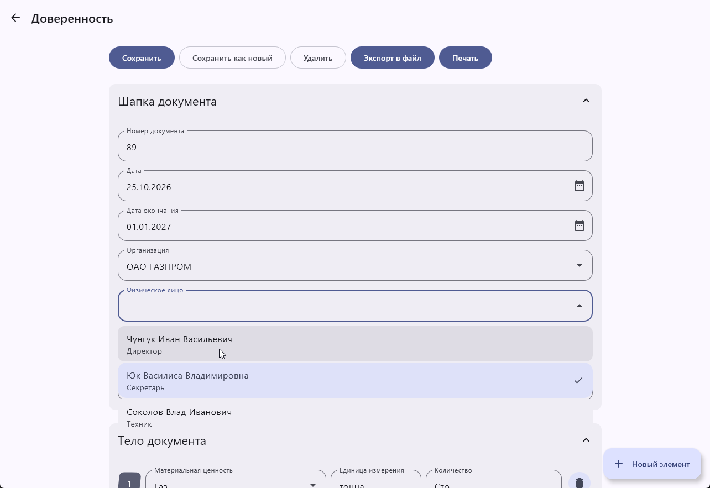

# docmanager

**`docmanager`** — это учебный проект и практическое руководство по разработке
кроссплатформенного приложения на базе **Kotlin Multiplatform (KMP)** для
управления документооборотом на примере автоматизации работы с доверенностями.

### Цель проекта 

Создание многоплатформенного приложения (поддерживающего Android и Desktop JVM), 
демонстрирующего полный цикл разработки документ-ориентированных систем: от 
проектирования базы данных и моделей до реализации пользовательских форм и 
автоматизации генерации документов.

### Возможности

- [X] Кроссплатформенность: **Android** + **Desktop** (Windows, macOS, Linux)
- [X] Управление документами типа Доверенность (Форма М-2)
- [X] Управление справочниками (организации, физические лица, поставщики и т. д.)
- [X] Создание документов формата **Word** (`.docx`) из шаблона с использованием **Apache POI**
- [X] Поддержка печати на **Desktop**
- [X] Поддержка датабаз **H2** (embedded/in-memory) и **PostgreSQL**
- [X] Material 3 UI с **Compose Multiplatform**

## Требования

- **JDK 11+** (рекомендуется JDK 17)
- **Android SDK** (для сборки Android-приложения)
- **IntelliJ IDEA** (рекомендуется для разработки)

## Сборка

- Windows (MSI): `./gradlew :desktopApp:packageMsi`
- macOS (DMG): `./gradlew :desktopApp:packageDmg`
- Linux (DEB): `./gradlew :desktopApp:packageDeb`
- Android APK: `./gradlew :androidApp:assembleRelease`

## Настройка базы данных

При первом запуске выберите тип подключения:
- **H2 Embedded File** — встроенная файловая база (по умолчанию)
- **H2 In-Memory** — временная база в памяти
- **PostgreSQL Server** — удалённый сервер (укажите хост, порт, имя базы, логин и пароль)

## Структура проекта

| Модуль | Описание |
|--------|---------|
| [/shared](./shared) | Общий код (95% платформенно-независимый) |
| [/shared/src/commonMain](./shared/src/commonMain) | Общий код для всех платформ |
| [/shared/src/jvmMain](./shared/src/jvmMain) | JVM-специфичный код (AWT, печать) |
| [/shared/src/androidMain](./shared/src/androidMain) | Android-специфичный код (MediaStore, Scoped Storage) |
| [/desktopApp](./desktopApp) | Точка входа для Desktop-приложения |
| [/androidApp](./androidApp) | Android-приложение |
| [/docs](./docs) | Документация и лабораторные работы |

## [Документация](https://volsss.github.io/docmanager/)

### Лабораторная работа 1 — Установка и настройка окружения

1. [Введение](docs/Лабораторная%20работа%201/Введение.md)
2. [Глава 1. Установка IDE](docs/Лабораторная%20работа%201/Глава%201.%20Установка%20IDE.md)
3. [Глава 2. Настройка IDE и плагинов](docs/Лабораторная%20работа%201/Глава%202.%20Настройка%20IDE%20и%20плагинов.md)
4. [Глава 3. Создание проекта](docs/Лабораторная%20работа%201/Глава%203.%20Создание%20проекта.md)
5. [Практическое задание](docs/Лабораторная%20работа%201/Практическое%20задание.md)

### Лабораторная работа 2 — Знакомство с Kotlin

1. [Введение](docs/Лабораторная%20работа%202/Введение.md)
2. [Глава 1. Основы синтаксиса Kotlin](docs/Лабораторная%20работа%202/Глава%201.%20Основы%20синтаксиса%20Kotlin.md)
3. [Глава 2. Функции и лямбда-выражения](docs/Лабораторная%20работа%202/Глава%202.%20Функции%20и%20лямбда-выражения.md)
4. [Глава 3. Классы, наследование и коллекции](docs/Лабораторная%20работа%202/Глава%203.%20Классы,%20наследование%20и%20коллекции.md)
5. [Глава 4. Обработка коллекций и extension-функции](docs/Лабораторная%20работа%202/Глава%204.%20Обработка%20коллекций%20и%20extension-функции.md)
6. [Глава 5. Enum, sealed и data классы, делегаты](docs/Лабораторная%20работа%202/Глава%205.%20Enum,%20sealed%20и%20data%20классы,%20делегаты.md)
7. [Практическое задание](docs/Лабораторная%20работа%202/Практическое%20задание.md)

### Лабораторная работа 3 — Gradle, мультипроектные сборки и корутины

1. [Введение](docs/Лабораторная%20работа%203/Введение.md)
2. [Глава 1. Пакеты и импорты в Kotlin](docs/Лабораторная%20работа%203/Глава%201.%20Пакеты%20и%20импорты%20в%20Kotlin.md)
3. [Глава 2. Введение в Gradle и мультипроектные сборки](docs/Лабораторная%20работа%203/Глава%202.%20Введение%20в%20Gradle%20и%20мультипроектные%20сборки.md)
4. [Глава 3. Задачи Gradle, зависимости и репозитории](docs/Лабораторная%20работа%203/Глава%203.%20Задачи%20Gradle,%20зависимости%20и%20репозитории.md)
5. [Глава 4. Жизненный цикл Gradle и плагины](docs/Лабораторная%20работа%203/Глава%204.%20Жизненный%20цикл%20Gradle%20и%20плагины.md)
6. [Глава 5. Корутины и асинхронное программирование](docs/Лабораторная%20работа%203/Глава%205.%20Корутины%20и%20асинхронное%20программирование.md)
7. [Практическое задание](docs/Лабораторная%20работа%203/Практическое%20задание.md)

### Лабораторная работа 4 — Jetpack Compose и UI

1. [Введение](docs/Лабораторная%20работа%204/Введение.md)
2. [Глава 1. Модель Jetpack Compose и архитектура интерфейса](docs/Лабораторная%20работа%204/Глава%201.%20Модель%20Jetpack%20Compose%20и%20архитектура%20интерфейса.md)
3. [Глава 2. Composable-функции, композиция и рекомпозиция](docs/Лабораторная%20работа%204/Глава%202.%20Composable-функции,%20композиция%20и%20рекомпозиция.md)
4. [Глава 3. Компоновка интерфейсов и Modifier](docs/Лабораторная%20работа%204/Глава%203.%20Компоновка%20интерфейсов%20и%20Modifier.md)
5. [Глава 4. Основные UI-компоненты Jetpack Compose](docs/Лабораторная%20работа%204/Глава%204.%20Основные%20UI-компоненты%20Jetpack%20Compose.md)
6. [Глава 5. Управление состоянием в Jetpack Compose](docs/Лабораторная%20работа%204/Глава%205.%20Управление%20состоянием%20в%20Jetpack%20Compose.md)
7. [Глава 6. Побочные эффекты и асинхронность в Jetpack Compose](docs/Лабораторная%20работа%204/Глава%206.%20Побочные%20эффекты%20и%20асинхронность%20в%20Jetpack%20Compose.md)
8. [Глава 7. Списки, навигация и сложные экраны](docs/Лабораторная%20работа%204/Глава%207.%20Списки,%20навигация%20и%20сложные%20экраны.md)
9. [Глава 8. Архитектура приложения и MVVM](docs/Лабораторная%20работа%204/Глава%208.%20Архитектура%20приложения%20и%20MVVM.md)
10. [Глава 9. Темы, дизайн-системы и адаптивный интерфейс](docs/Лабораторная%20работа%204/Глава%209.%20Темы,%20дизайн-системы%20и%20адаптивный%20интерфейс.md)
11. [Практическое задание](docs/Лабораторная%20работа%204/Практическое%20задание.md)

### Лабораторная работа 5 — Знакомство с Kotlin Multiplatform

1. [Введение](docs/Лабораторная%20работа%205/Введение.md)
2. [Глава 1. Взаимосвязь с Jetpack Compose](docs/Лабораторная%20работа%205/Глава%201.%20Взаимосвязь%20с%20Jetpack%20Compose.md)
3. [Глава 2. Создание KMP приложения](docs/Лабораторная%20работа%205/Глава%202.%20Создание%20KMP%20приложения.md)
4. [Практическое задание](docs/Лабораторная%20работа%205/Практическое%20задание.md)

### Лабораторная работа 6 — Создание KMP-приложения docmanager

1. [Введение](docs/Лабораторная%20работа%206/Введение.md)
2. [Глава 1. Создание и настройка проекта](docs/Лабораторная%20работа%206/Глава%201.%20Создание%20и%20настройка%20проекта.md)
3. [Глава 2. Доменный слой](docs/Лабораторная%20работа%206/Глава%202.%20Доменный%20слой.md)
4. [Глава 3. Слой данных](docs/Лабораторная%20работа%206/Глава%203.%20Слой%20данных.md)
5. [Глава 4. Внедрение зависимостей](docs/Лабораторная%20работа%206/Глава%204.%20Внедрение%20зависимостей.md)
6. [Глава 5. Компоненты и навигация](docs/Лабораторная%20работа%206/Глава%205.%20Компоненты%20и%20навигация.md)
7. [Глава 6. ViewModel и состояние](docs/Лабораторная%20работа%206/Глава%206.%20ViewModel%20и%20состояние.md)
8. [Глава 7. Обработка документов](docs/Лабораторная%20работа%206/Глава%207.%20Обработка%20документов.md)
9. [Глава 8. Платформенные модули и запуск](docs/Лабораторная%20работа%206/Глава%208.%20Платформенные%20модули%20и%20запуск.md)
10. [Практическое задание](docs/Лабораторная%20работа%206/Практическое%20задание.md)

## Литература

- [Kotlin](https://kotlinlang.org/docs/getting-started.html)
- [Kotlin Multiplatform Development](https://www.jetbrains.com/help/kotlin-multiplatform-dev/get-started.html)
- [Jetpack Compose](https://developer.android.com/develop/ui/compose/documentation)
- [PostgreSQL](https://www.postgresql.org/docs/)
- [H2](https://h2database.com/html/quickstart.html)