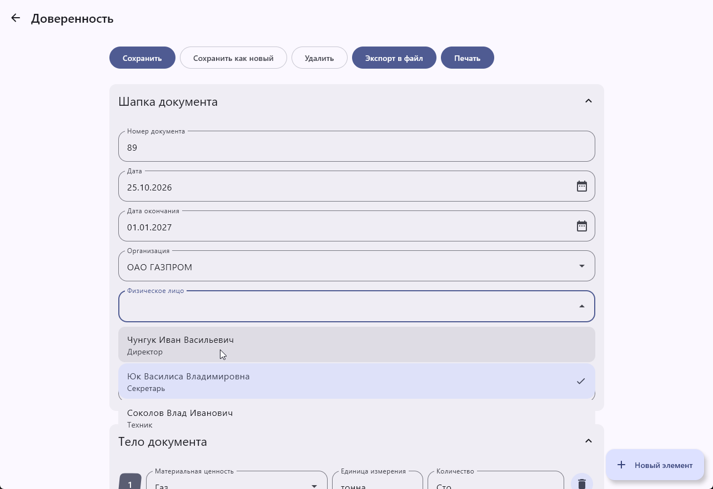

# docmanager

**`docmanager`** — это учебный проект и практическое руководство по разработке
кроссплатформенного приложения на базе **Kotlin Multiplatform (KMP)** для
управления документооборотом на примере автоматизации работы с доверенностями.

### Цель проекта 

Создание многоплатформенного приложения (поддерживающего Android и Desktop JVM), 
демонстрирующего полный цикл разработки документ-ориентированных систем: от 
проектирования базы данных и моделей до реализации пользовательских форм и 
автоматизации генерации документов.

### Возможности

- [X] Кроссплатформенность: **Android** + **Desktop** (Windows, macOS, Linux)
- [X] Управление документами типа Доверенность (Форма М-2)
- [X] Управление справочниками (организации, физические лица, поставщики и т. д.)
- [X] Создание документов формата **Word** (`.docx`) из шаблона с использованием **Apache POI**
- [X] Поддержка печати на **Desktop**
- [X] Поддержка датабаз **H2** (embedded/in-memory) и **PostgreSQL**
- [X] Material 3 UI с **Compose Multiplatform**

## Требования

- **JDK 11+** (рекомендуется JDK 17)
- **Android SDK** (для сборки Android-приложения)
- **IntelliJ IDEA** (рекомендуется для разработки)

## Сборка

- Windows (MSI): `./gradlew :desktopApp:packageMsi`
- macOS (DMG): `./gradlew :desktopApp:packageDmg`
- Linux (DEB): `./gradlew :desktopApp:packageDeb`
- Android APK: `./gradlew :androidApp:assembleRelease`

## Настройка базы данных

При первом запуске выберите тип подключения:
- **H2 Embedded File** — встроенная файловая база (по умолчанию)
- **H2 In-Memory** — временная база в памяти
- **PostgreSQL Server** — удалённый сервер (укажите хост, порт, имя базы, логин и пароль)

## Структура проекта

| Модуль | Описание |
|--------|---------|
| [/shared](./shared) | Общий код (95% платформенно-независимый) |
| [/shared/src/commonMain](./shared/src/commonMain) | Общий код для всех платформ |
| [/shared/src/jvmMain](./shared/src/jvmMain) | JVM-специфичный код (AWT, печать) |
| [/shared/src/androidMain](./shared/src/androidMain) | Android-специфичный код (MediaStore, Scoped Storage) |
| [/desktopApp](./desktopApp) | Точка входа для Desktop-приложения |
| [/androidApp](./androidApp) | Android-приложение |
| [/docs](./docs) | Документация и лабораторные работы |

## Документация

В документацию включено руководство по использованию следующих инструментов:
- IntelliJ IDEA (`lab1`)
- Kotlin (`lab2`-`lab4`)
- Gradle (`lab5`)
- Kotlin Coroutines (`lab6`)
- Jetpack Compose (`lab7`)
- Compose Multiplatform (`lab8`)

### Литература

- [Kotlin](https://kotlinlang.org/docs/getting-started.html)
- [Kotlin Multiplatform Development](https://www.jetbrains.com/help/kotlin-multiplatform-dev/get-started.html)
- [Jetpack Compose](https://developer.android.com/develop/ui/compose/documentation)
- [PostgreSQL](https://www.postgresql.org/docs/)
- [H2](https://h2database.com/html/quickstart.html)