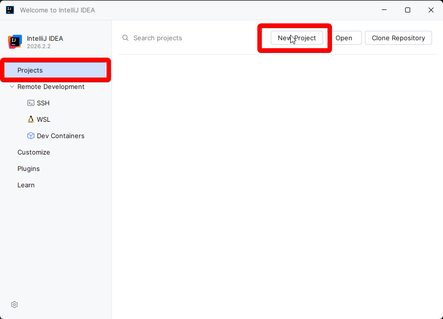
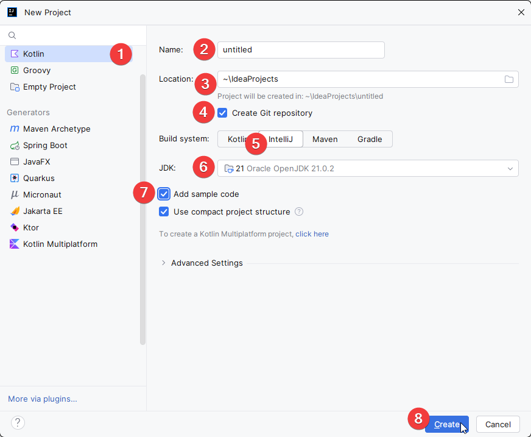
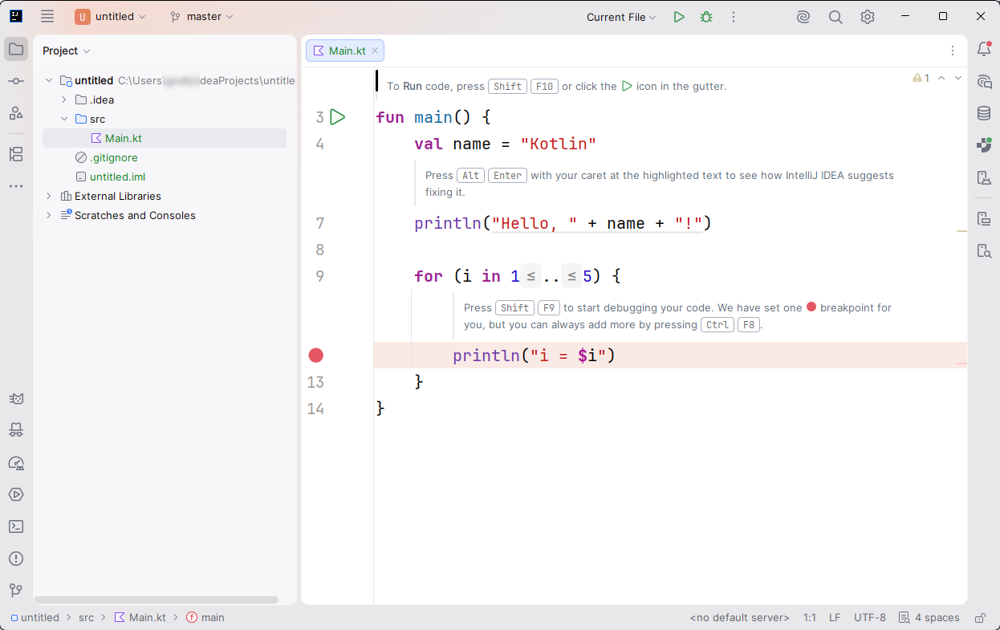
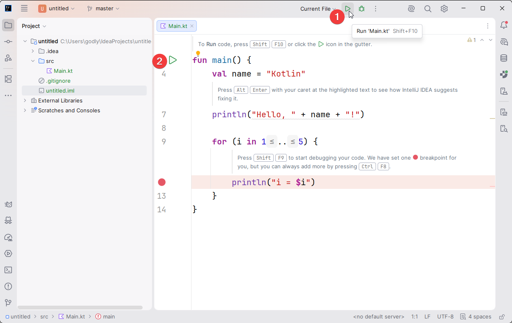
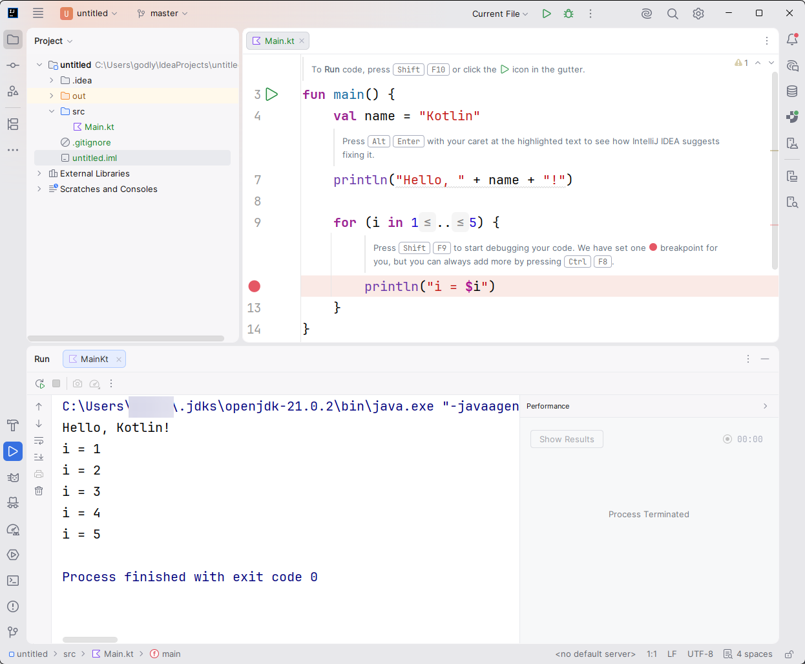

# Создание проекта

Чтобы создать первый проект, перейдите во вкладку `Projects` 
и нажмите на кнопку `New Project`.

## Настройки создания проекта

1. Выберите вкладку `Kotlin`.
2. Введите название проекта.
3. При необходимости измените расположение проекта.
4. При необходимости настройте создание **Git**-репозитория при создании проекта.
5. В качестве системы сборки для изучения теории выберите `IntelliJ`. 
В дальнейшем сборка проекта будет осуществляться с помощью `Gradle`.
6. Выберите версию **JDK**. Если подходящая версия не установлена, установите её.
7. Нажмите **Add sample code**, чтобы добавить шаблон программы с выводом `"Hello World"`.
8. Нажмите **Create**, чтобы создать проект.

Проект создан! Теперь можно ознакомиться с его структурой и запустить программу.

## Структура шаблонного проекта

Шаблонный проект содержит следующие файлы и директории:
- `src/` — исходный код проекта на **Kotlin**.
- `.gitignore` — файл с правилами исключения файлов и директорий из **Git**. 
Создаётся, если при настройке проекта был включён **Git**.
- `.idea/` — служебная директория с настройками проекта в **IntelliJ IDEA**.
- Файл с расширением `.iml` — служебный файл с настройками модуля проекта, 
создаваемый **IDE**.

В директории `src/` находится файл `Main.kt`, который содержит точку входа 
в программу — функцию `main()`.

## Запуск проекта

Запустить проект можно одним из двух способов:
1. Нажмите кнопку `Run` в правом верхнем углу окна **IDE**. 
2. Нажмите кнопку `Run` рядом с объявлением функции `fun main()`.

После запуска в нижней части окна **IDE** откроется панель с 
результатом выполнения программы.

