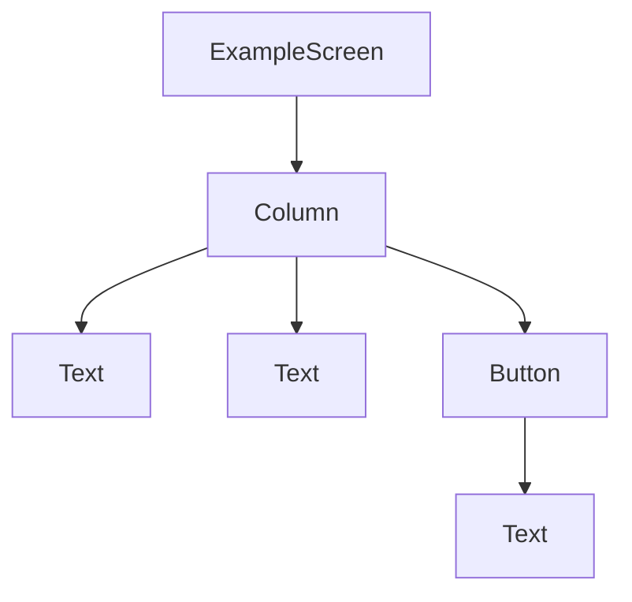
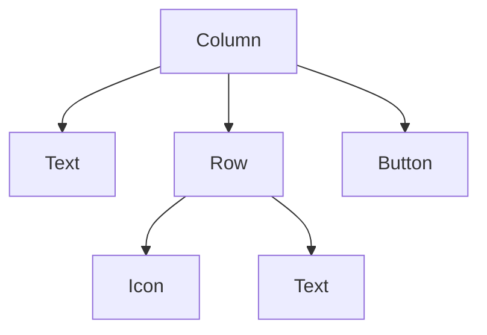

# Глава 3. Компоновка интерфейсов и Modifier

## 3.1. Как Compose строит интерфейс

В **Jetpack Compose** построение пользовательского интерфейса можно разделить на три основные фазы:
- **Composition** — формирование структуры интерфейса.
- **Layout** — измерение и размещение элементов.
- **Drawing** — отрисовка элементов.

В предыдущих главах мы подробно рассматривали первую фазу. Теперь сосредоточимся на Layout.

Представим экран, состоящий из заголовка, описания и кнопки.

```kotlin
@Composable
fun ExampleScreen() {
    Column {
        Text("Заголовок")
        Text("Описание")
        Button(
            onClick = { }
        ) {
            Text("Продолжить")
        }
    }
}
```

На этапе композиции **Compose** получает структуру интерфейса:



На этапе **Layout** система должна определить:
- какую ширину займёт каждый элемент;
- какую высоту займёт каждый элемент;
- где именно будет расположен каждый элемент;
- сколько пространства останется свободным.

На этапе **Drawing** элементы отображаются на экране.

Таким образом, описание интерфейса само по себе не определяет окончательные размеры элементов.
Они рассчитываются в соответствии с правилами компоновки.

## 3.2. Механизм измерения элементов

В **Compose** используется система ограничений размеров — **Constraints**.

Каждый элемент получает ограничения от родителя.
Они определяют минимально и максимально допустимую ширину и высоту.

Ограничения можно представить следующими параметрами:
- `minWidth` — минимальная ширина;
- `maxWidth` — максимальная ширина;
- `minHeight` — минимальная высота;
- `maxHeight` — максимальная высота.

Например, если родитель передал компоненту ограничения:

```text
minWidth  = 100.dp
maxWidth  = 300.dp

minHeight = 50.dp
maxHeight = 200.dp
```

то компонент должен выбрать размеры внутри заданных диапазонов.

Он не может просто сообщить, что хочет занимать `500.dp` по ширине, если родитель ограничил
его максимальную ширину значением `300.dp`.

### Как происходит измерение

Последовательность работы выглядит следующим образом:
1. Родитель получает собственные ограничения.
2. Родитель измеряет дочерние элементы, передавая им ограничения.
3. Дочерние элементы возвращают выбранные размеры.
4. Родитель определяет собственный размер.
5. Родитель размещает дочерние элементы внутри своей области.

Рассмотрим:



Сначала измеряется `Column`. Для определения своего размера она измеряет дочерние элементы.

Когда измеряется `Row`, она, в свою очередь, измеряет `Icon` и `Text`.

После получения размеров родитель размещает содержимое согласно правилам выбранного контейнера.

### Почему нельзя произвольно измерять элемент несколько раз

Одна из важных особенностей стандартной модели измерения **Compose** — дочерний элемент в рамках
обычного прохода измерения должен измеряться родителем только один раз.

Это ограничение помогает сохранять предсказуемость и производительность компоновки.

Поэтому нельзя реализовать обычный `layout` так, чтобы сначала измерить ребёнка, затем поменять
условия и повторно измерить его в рамках того же прохода.

Для отдельных сложных сценариев существуют специальные механизмы, включая **intrinsic
measurements** и **subcomposition**. Они будут рассмотрены позднее.

## 3.3. Основные контейнеры Compose

Большинство простых интерфейсов можно построить с помощью трёх основных контейнеров:
- `Column`;
- `Row`;
- `Box`.

Их можно вкладывать друг в друга, создавая сложные структуры.

### 3.3.1. Column

`Column` располагает дочерние элементы вертикально, один под другим.

```kotlin
@Composable
fun UserProfile() {
    Column {
        Text("Имя пользователя")
        Text("Описание профиля")
        Button(
            onClick = { }
        ) {
            Text("Редактировать")
        }
    }
}
```

Или в виде схемы:

```text
┌──────────────────────────┐
│ Имя пользователя         │
│                          │
│ Описание профиля         │
│                          │
│ [ Редактировать ]        │
└──────────────────────────┘
```

Основные параметры `Column`:

```kotlin
Column(
    modifier = Modifier,
    verticalArrangement = Arrangement.Top,
    horizontalAlignment = Alignment.Start
) {
    // Содержимое
}
```

- `verticalArrangement` определяет расположение элементов по вертикали.
- `horizontalAlignment` определяет выравнивание элементов по горизонтали.

Например, чтобы расположить содержимое по центру контейнера:

```kotlin
Column(
    modifier = Modifier.fillMaxWidth(),
    horizontalAlignment = Alignment.CenterHorizontally
) {
    Text("Заголовок")
    Text("Описание")
}
```

Оба элемента будут выровнены по горизонтальному центру доступной ширины.

### 3.3.2. Row

`Row` располагает дочерние элементы горизонтально, один за другим.

```kotlin
@Composable
fun UserActions() {
    Row {
        Button(
            onClick = { }
        ) {
            Text("Сохранить")
        }

        Button(
            onClick = { }
        ) {
            Text("Отмена")
        }
    }
}
```

В виде схемы:

```text
┌────────────────────────────────┐
│ [ Сохранить ] [ Отмена ]       │
└────────────────────────────────┘
```

Основные параметры:

```kotlin
Row(
    modifier = Modifier,
    horizontalArrangement = Arrangement.Start,
    verticalAlignment = Alignment.Top
) {
    // Содержимое
}
```

- `horizontalArrangement` определяет расположение элементов по горизонтали.
- `verticalAlignment` определяет выравнивание элементов по вертикали.

Например:

```kotlin
Row(
    verticalAlignment = Alignment.CenterVertically
) {
    Text("Статус:")
    Text("В сети")
}
```

Элементы будут выровнены по вертикальному центру строки.

### 3.3.3. Box

`Box` позволяет располагать элементы в одной области, в том числе накладывать их друг на друга.

Это полезно для создания аватаров с индикаторами состояния, изображений с надписями и других подобных элементов.

```kotlin
@Composable
fun Avatar() {
    Box(
        modifier = Modifier.size(100.dp)
    ) {
        Image(
            painter = /* изображение */,
            contentDescription = "Аватар",
            modifier = Modifier.fillMaxSize()
        )

        Text(
            text = "Онлайн",
            modifier = Modifier.align(Alignment.BottomEnd)
        )
    }
}
````

Схематично:

```text
┌──────────────────────┐
│                      │
│       Аватар         │
│                      │
│             Онлайн   │
└──────────────────────┘
```


В `Box` доступен параметр `contentAlignment`, определяющий выравнивание содержимого по умолчанию.

```kotlin
Box(
    modifier = Modifier.fillMaxSize(),
    contentAlignment = Alignment.Center
) {
    Text("По центру")
}
```

Также отдельные дочерние элементы можно позиционировать независимо друг от друга:

```kotlin
Box(
    modifier = Modifier.size(200.dp)
) {
    Text(
        "Слева сверху",
        modifier = Modifier.align(Alignment.TopStart)
    )

    Text(
        "Справа снизу",
        modifier = Modifier.align(Alignment.BottomEnd)
    )
}
```

> [!IMPORTANT] `Modifier.align()` здесь доступен благодаря `BoxScope`.

## 3.4. Arrangement — управление расположением элементов

Контейнеры `Row` и `Column` предоставляют механизм `Arrangement`.

Он позволяет определить, как распределить дочерние элементы по основной оси контейнера.

Для `Row` основной осью является горизонтальная.

Для `Column` основной осью является вертикальная.

Рассмотрим наиболее часто используемые варианты.

### Arrangement.Start

Элементы располагаются в начале основной оси.

```kotlin
Row(
    horizontalArrangement = Arrangement.Start
) {
    Text("Первый")
    Text("Второй")
    Text("Третий")
}
```

### Arrangement.Center

Элементы группируются в центре.

```kotlin
Row(
    modifier = Modifier.fillMaxWidth(),
    horizontalArrangement = Arrangement.Center
) {
    Text("Первый")
    Text("Второй")
}
```

### Arrangement.End

Элементы располагаются в конце основной оси.

```kotlin
Row(
    modifier = Modifier.fillMaxWidth(),
    horizontalArrangement = Arrangement.End
) {
    Text("Первый")
    Text("Второй")
}
```

### Arrangement.SpaceBetween

Свободное пространство распределяется между элементами.

```kotlin
Row(
    modifier = Modifier.fillMaxWidth(),
    horizontalArrangement = Arrangement.SpaceBetween
) {
    Text("Назад")
    Text("Продолжить")
}
```

Первый элемент располагается в начале, последний — в конце. Пространство между ними распределяется равномерно.

### Arrangement.SpaceAround

Вокруг каждого элемента выделяется одинаковое пространство. При этом промежутки между соседними
элементами получаются в два раза больше промежутков от крайних элементов до границ контейнера.

### Arrangement.SpaceEvenly

Все промежутки, включая пространство до первого и после последнего элемента, становятся одинаковыми.

### Arrangement.spacedBy()

Позволяет задать фиксированный промежуток между соседними элементами.

```kotlin
Column(
    verticalArrangement = Arrangement.spacedBy(12.dp)
) {
    Text("Имя")
    Text("Фамилия")
    Text("Электронная почта")
}
```

В отличие от `SpaceBetween`, `spacedBy()` задаёт конкретную величину расстояния.

При необходимости можно комбинировать распределение пространства и фиксированное расстояние
через соответствующие перегрузки API.

## 3.5. Alignment — выравнивание элементов

`Alignment` отвечает за выравнивание по поперечной оси контейнера или внутри области компонента.

У `Row` поперечная ось вертикальная.
У `Column` поперечная ось горизонтальная.
У `Box` используется двухмерное выравнивание.

### Выравнивание в Row

```kotlin
Row(
    verticalAlignment = Alignment.CenterVertically
) {
    Icon(
        imageVector = Icons.Default.Person,
        contentDescription = null
    )

    Text("Пользователь")
}
```

Иконка и текст будут располагаться на одной горизонтальной линии с вертикальным выравниванием по центру.

### Выравнивание в Column

```kotlin
Column(
    horizontalAlignment = Alignment.CenterHorizontally
) {
    Text("Заголовок")
    Text("Подзаголовок")
}
```

Оба элемента будут центрированы по горизонтали.

### Выравнивание в Box

Для `Box` доступны, в частности:

- `Alignment.TopStart`;
- `Alignment.TopCenter`;
- `Alignment.TopEnd`;
- `Alignment.CenterStart`;
- `Alignment.Center`;
- `Alignment.CenterEnd`;
- `Alignment.BottomStart`;
- `Alignment.BottomCenter`;
- `Alignment.BottomEnd`.

Например:

```kotlin
Box(
    modifier = Modifier.fillMaxSize(),
    contentAlignment = Alignment.Center
) {
    Text("Загрузка...")
}
```

Содержимое будет располагаться в центре доступной области.

> [!IMPORTANT] `Arrangement` и `Alignment` решают разные задачи. Первый управляет распределением
> элементов вдоль основной оси, второй — их выравниванием по поперечной оси или внутри контейнера.

## 3.6. Spacer — управление свободным пространством

`Spacer` — composable-функция, предназначенная для создания пустого пространства.

Она особенно удобна, когда необходимо расположить элементы на определённом расстоянии друг от друга.

```kotlin
Column {
    Text("Имя пользователя")

    Spacer(
        modifier = Modifier.height(16.dp)
    )

    Text("Описание")
}
```

В `Row` можно использовать горизонтальный промежуток:

```kotlin
Row {
    Text("Цена")

    Spacer(
        modifier = Modifier.width(8.dp)
    )

    Text("99 €")
}
```

Также `Spacer` можно использовать для распределения оставшегося пространства:

```kotlin
Row(
    modifier = Modifier.fillMaxWidth()
) {
    Text("Настройки")

    Spacer(
        modifier = Modifier.weight(1f)
    )

    Text("Сохранить")
}
```

В этом случае `Spacer` получает свободное пространство между двумя текстовыми элементами.

Однако для простых фиксированных промежутков предпочтительнее использовать `Arrangement.spacedBy()`,
поскольку это делает намерение компоновки более очевидным.

## 3.7. Что такое Modifier

`Modifier` — один из центральных механизмов **Compose**.

Он позволяет изменять размер, расположение, внешний вид, поведение и взаимодействие composable-компонента.

С помощью модификаторов можно:
- задавать ширину и высоту;
- устанавливать отступы;
- изменять фон;
- добавлять границы;
- обрезать содержимое;
- обрабатывать нажатия;
- управлять прокруткой;
- задавать информацию для accessibility;
- изменять поведение размещения.

Пример:

```kotlin
Text(
    text = "Привет!",
    modifier = Modifier
        .padding(16.dp)
        .background(Color.LightGray)
)
```

Здесь `Modifier` используется для изменения внешнего вида и пространства вокруг текста.

### 3.7.1. Modifier — неизменяемая цепочка

`Modifier` представляет собой упорядоченную цепочку элементов.

Каждый вызов модификатора возвращает новый объект цепочки, в которую включается
соответствующее поведение.

Например:

```kotlin
val modifier = Modifier
    .padding(16.dp)
    .fillMaxWidth()
    .background(Color.LightGray)
```

Это не набор независимо применяемых атрибутов. Это последовательность модификаторов,
порядок которых влияет на результат.

### 3.7.2. Modifier параметр composable-функции

Один из важных принципов разработки компонентов **Compose** — принимать `modifier` извне.

Пример:

```kotlin
@Composable
fun UserTitle(
    name: String,
    modifier: Modifier = Modifier
) {
    Text(
        text = name,
        modifier = modifier
    )
}
```

Теперь вызывающий компонент может самостоятельно управлять расположением `UserTitle`.

```kotlin
@Composable
fun ProfileScreen() {
    Column(
        modifier = Modifier.padding(16.dp)
    ) {
        UserTitle(
            name = "Александр",
            modifier = Modifier.fillMaxWidth()
        )
    }
}
```

Такой подход делает компонент универсальным.

Почему важно передавать `modifier` дальше

Рассмотрим компонент:

```kotlin
@Composable
fun UserTitle(
    name: String,
    modifier: Modifier = Modifier
) {
    Text(
        text = name,
        modifier = Modifier.padding(16.dp)
    )
}
```

Здесь входящий `modifier` вообще не используется.

В результате вызывающая сторона не может управлять размером и расположением компонента ожидаемым способом.

Правильный вариант:

```kotlin
@Composable
fun UserTitle(
    name: String,
    modifier: Modifier = Modifier
) {
    Text(
        text = name,
        modifier = modifier.padding(16.dp)
    )
}
```

Теперь модификаторы вызывающей стороны сохраняются и дополняются внутренним отступом.

Обычно `modifier` размещают среди необязательных параметров composable-функции и передают корневому
элементу, который непосредственно участвует в построении UI.

> [!IMPORTANT]
> Не следует заменять переданный `modifier` собственным `Modifier`, если только такое поведение не является
> намеренной частью контракта компонента.

## 3.8. Основные модификаторы размеров

Рассмотрим наиболее часто применяемые модификаторы.

### Modifier.size()

Задаёт предпочтительную ширину и высоту компонента.

```kotlin
Box(
    modifier = Modifier.size(100.dp)
)
```

Компоненту задаётся размер `100.dp * 100.dp`, если родительские ограничения позволяют его получить.

Можно также указать ширину и высоту отдельно:

```kotlin
Box(
    modifier = Modifier.size(
        width = 120.dp,
        height = 80.dp
    )
)
```

### Modifier.width() и Modifier.height()

Позволяют задавать отдельные размеры.

```kotlin
Box(
    modifier = Modifier
        .width(200.dp)
        .height(100.dp)
)
```

### Modifier.fillMaxWidth()

Запрашивает использование всей доступной ширины в рамках полученных ограничений.

```kotlin
Button(
    onClick = { },
    modifier = Modifier.fillMaxWidth()
) {
    Text("Продолжить")
}
```

### Modifier.fillMaxHeight()

Запрашивает использование всей доступной высоты.

```kotlin
Box(
    modifier = Modifier.fillMaxHeight()
)
```

### Modifier.fillMaxSize()

Запрашивает заполнение доступной ширины и высоты.

```kotlin
Box(
    modifier = Modifier.fillMaxSize()
)
```

Важно понимать, что `fillMaxSize()` не означает автоматически размер всего физического экрана.
Элемент заполняет пространство, которое предоставляет его родитель.

### Modifier.wrapContentSize()

Позволяет располагать компонент с учётом размеров его содержимого, а не растягивать его на всю доступную область.

```kotlin
Box(
    modifier = Modifier
        .fillMaxWidth()
        .wrapContentSize(Alignment.Center)
) {
    Text("Центр")
}
```

В этом примере сам `Box` занимает доступную ширину, а его содержимое располагается по центру.

### Modifier.widthIn() и Modifier.heightIn()

Позволяют устанавливать минимальные и максимальные размеры.

```kotlin
Text(
    text = "Описание",
    modifier = Modifier.widthIn(
        min = 100.dp,
        max = 300.dp
    )
)
```

### Modifier.aspectRatio()

Позволяет установить соотношение ширины и высоты.

```kotlin
Box(
    modifier = Modifier
        .fillMaxWidth()
        .aspectRatio(16f / 9f)
)
```

Это удобно для изображений, видеоплееров, карточек и других элементов с фиксированными пропорциями.

### Modifier.requiredSize()

В отличие от обычного `size()`, этот модификатор требует заданный размер даже тогда, когда он
выходит за ограничения, переданные ребёнку родителем.

Родитель при этом продолжает работать с результатом измерения в рамках собственных ограничений.
Поэтому фактическое отображение может выходить за ожидаемую область или приводить к наложениям.

В обычных интерфейсах `requiredSize()` следует использовать осознанно, а не вместо `size()`.

## 3.9. Modifier.padding()

`padding()` задаёт внутреннее пространство вокруг содержимого элемента на этапе компоновки.

Например:

```kotlin
Column(
    modifier = Modifier.padding(16.dp)
) {
    Text("Заголовок")
    Text("Описание")
}
```

Можно задавать разные отступы:

```kotlin
Text(
    text = "Пример",
    modifier = Modifier.padding(
        start = 16.dp,
        top = 8.dp,
        end = 16.dp,
        bottom = 8.dp
    )
)
```

В **Compose** рекомендуется использовать `start` и `end`, а не `left` и `right`, когда отступы имеют логический смысл.

Это позволяет корректно учитывать направление письма и поддерживать интерфейсы с RTL-разметкой.

### Чем padding отличается от margin

В классической модели **View System** часто используется понятие внешнего отступа `margin`.

В **Compose** отдельного стандартного модификатора `margin` нет.

Необходимое пространство снаружи компонента обычно организуется с помощью padding родительского контейнера
либо других элементов компоновки.

Например:

```kotlin
Column(
    modifier = Modifier.padding(16.dp)
) {
    UserCard()
}
```

Здесь родитель предоставляет содержимому пространство с отступом от своих границ.

## 3.10. Modifier.background(), border() и clip()

Эти модификаторы используются для изменения визуального представления компонентов.

### background()

Задаёт фон:

```kotlin
Box(
    modifier = Modifier
        .background(Color.LightGray)
        .padding(16.dp)
) {
    Text("Содержимое")
}
```

Можно использовать форму:

```kotlin
Box(
    modifier = Modifier
        .background(
            color = Color.Blue,
            shape = RoundedCornerShape(12.dp)
        )
        .padding(16.dp)
) {
    Text("Карточка", color = Color.White)
}
```

### border()

Добавляет границу:

```kotlin
Box(
    modifier = Modifier
        .border(
            width = 1.dp,
            color = Color.Gray,
            shape = RoundedCornerShape(12.dp)
        )
        .padding(16.dp)
) {
    Text("Карточка")
}
```

### clip()

Обрезает содержимое по заданной форме:

```kotlin
Box(
    modifier = Modifier
        .clip(RoundedCornerShape(16.dp))
        .background(Color.LightGray)
)
```

`clip()` особенно полезен для изображений, карточек и элементов с закруглёнными углами.

Однако стоит помнить, что визуальная форма фона и клиппинг содержимого — не одно и то же.
Для интерактивных элементов также важно учитывать порядок `clip`, `background` и `clickable`.

## 3.11. Порядок применения модификаторов

Это один из самых важных разделов главы.

Порядок модификаторов непосредственно влияет на результат компоновки и внешний вид элемента.

Рассмотрим два варианта.

### Вариант 1

```kotlin
Text(
    text = "Привет",
    modifier = Modifier
        .padding(16.dp)
        .background(Color.Yellow)
)
```

В этом случае отступ располагается снаружи области фона. Фон применяется к области после внешнего `padding`.

### Вариант 2

```kotlin
Text(
    text = "Привет",
    modifier = Modifier
        .background(Color.Yellow)
        .padding(16.dp)
)
```

Теперь фон оборачивает область с внутренним отступом. Поэтому цветная область будет больше.

Схематично:

### padding().background()

```text
┌──────────────────────────┐
│        Отступ            │
│     ┌──────────────┐     │
│     │ Жёлтый фон   │     │
│     │   Привет     │     │
│     └──────────────┘     │
│                          │
└──────────────────────────┘
```

### background().padding()

```text
┌──────────────────────────┐
│                          │
│       Жёлтый фон         │
│                          │
│         Привет           │
│                          │
│                          │
└──────────────────────────┘
```

### Порядок clickable() и padding()

Рассмотрим следующий пример:

```kotlin
Modifier
    .clickable { }
    .padding(16.dp)
```

Здесь `clickable` оборачивает область, добавляемую `padding`, поэтому отступы также относятся к кликабельной области.

Если поменять порядок:

```kotlin
Modifier
    .padding(16.dp)
    .clickable { }
```

то внешний отступ не будет входить в область обработчика нажатия.

Это полезно, когда нужно явно контролировать размер интерактивной области.

### Главное правило

Цепочку модификаторов всегда следует читать слева направо, учитывая, что каждый последующий элемент
применяется к результату предыдущего.

Не существует универсального порядка для всех компонентов. Необходимо понимать, какой результат требуется получить.

## 3.12. Modifier.weight()

`weight()` — важный модификатор, позволяющий распределять оставшееся пространство между дочерними
элементами `Row` или `Column`.

Рассмотрим пример:

```kotlin
Row(
    modifier = Modifier.fillMaxWidth()
) {
    Text(
        text = "Название товара",
        modifier = Modifier.weight(1f)
    )

    Text("99 €")
}
```

Первый текст получает оставшееся доступное пространство, а второй занимает ширину, необходимую для своего содержимого.

### Распределение пропорций

Можно распределять свободное пространство между несколькими элементами:

```kotlin
Row(
    modifier = Modifier.fillMaxWidth()
) {
    Box(
        modifier = Modifier
            .weight(1f)
            .height(50.dp)
            .background(Color.Blue)
    )

    Box(
        modifier = Modifier
            .weight(2f)
            .height(50.dp)
            .background(Color.Green)
    )
}
```

При одинаковых условиях ширина первого элемента будет в два раза меньше ширины второго.

### Важные особенности weight()

1. `weight()` применяется внутри `RowScope` или `ColumnScope`.
2. Распределение выполняется относительно свободного пространства после учёта других элементов и доступных промежутков.
3. Вес не является абсолютным размером в `dp`.
4. Поведение зависит от ограничений родительского контейнера.
5. `weight(fill = false)` позволяет элементу использовать весовую долю как верхнюю границу выделенного пространства,
   не заставляя его полностью заполнять эту долю.

Пример распределения по вертикали:

```kotlin
Column(
    modifier = Modifier.fillMaxSize()
) {
    Text("Заголовок")

    Box(
        modifier = Modifier
            .weight(1f)
            .fillMaxWidth()
            .background(Color.LightGray)
    )

    Button(
        onClick = {}
    ) {
        Text("Продолжить")
    }
}
```

Центральный элемент получает свободное пространство между заголовком и кнопкой.

Это часто используется при построении экранов с закреплённой нижней кнопкой.

## 3.13. Scope-specific modifiers

Некоторые модификаторы доступны только в определённом контексте.

Например:
- `Modifier.weight()` — внутри `RowScope` или `ColumnScope`;
- `Modifier.align()` — в контексте соответствующего scope;
- `Modifier.matchParentSize()` — внутри `BoxScope`.

Это называется scope-specific API.

Такой подход помогает сделать API безопаснее: компилятор ограничивает использование модификаторов
теми контейнерами, где их поведение имеет смысл.

Пример:

```kotlin
Column {
    Text(
        text = "Заголовок",
        modifier = Modifier.align(Alignment.CenterHorizontally)
    )
}
```

Здесь `align()` выравнивает дочерний элемент относительно горизонтальной оси `Column`.

Другой пример:

```kotlin
Box {
    Text(
        text = "Внизу",
        modifier = Modifier.align(Alignment.BottomCenter)
    )
}
```

Здесь `align()` определяет положение элемента внутри `Box`.

## 3.14. Адаптивная компоновка

Современное приложение должно корректно отображаться на разных размерах экранов.

Нельзя рассчитывать исключительно на фиксированные размеры устройства.

Для построения адаптивных интерфейсов полезно использовать:
- ограничения, передаваемые родителем;
- `fillMaxWidth()` и `fillMaxSize()`;
- минимальные и максимальные размеры;
- `BoxWithConstraints`;
- адаптивные контейнеры;
- изменение структуры интерфейса при изменении доступного пространства.

### BoxWithConstraints

`BoxWithConstraints` предоставляет доступ к ограничениям, в которых размещается содержимое.

Например:

```kotlin
@Composable
fun AdaptiveContent() {
    BoxWithConstraints(
        modifier = Modifier.fillMaxWidth()
    ) {
        if (maxWidth >= 600.dp) {
            Row {
                Text("Левая часть")
                Text("Правая часть")
            }
        } else {
            Column {
                Text("Левая часть")
                Text("Правая часть")
            }
        }
    }
}
```

В этом примере структура интерфейса зависит от доступной ширины контейнера.

Для компактной области используется вертикальная компоновка, для более широкой — горизонтальная.

`BoxWithConstraints` полезен, когда структура содержимого действительно зависит от полученных ограничений.
Однако не нужно использовать его для каждой небольшой задачи изменения размера или отступа: дополнительные
возможности имеют смысл только там, где они необходимы.

### Подготовка к Compose Multiplatform

При проектировании общего UI-кода рекомендуется опираться на доступное пространство компонента, а не на
сведения о конкретном устройстве.

Например, вместо обращения к **Android** API для получения ширины экрана можно использовать ограничения,
переданные родителем, или соответствующие адаптивные API **Compose**.

Также не следует жёстко привязывать интерфейс к пикселям конкретного устройства.

Такой подход позволяет повторно использовать компоновки на Android, iOS и desktop.

## 3.15. Распространённые ошибки при построении интерфейсов

### Ошибка 1. Использовать fillMaxSize() повсюду

`fillMaxSize()` запрашивает всё доступное пространство родителя.

Если применить его к нескольким вложенным элементам без понимания ограничений, можно получить неожиданное
распределение пространства.

### Ошибка 2. Путать Arrangement и Alignment

`Arrangement` распределяет дочерние элементы вдоль основной оси.

`Alignment` определяет их выравнивание по поперечной оси либо внутри области `Box`.

### Ошибка 3. Использовать weight() вне соответствующего scope

`weight()` является scope-specific модификатором. Его нельзя применять произвольно к любому элементу.

### Ошибка 4. Не учитывать порядок модификаторов

Например, перестановка `clickable()` и `padding()` способна изменить размер интерактивной области.

Перестановка `background()` и `padding()` изменяет размер цветной области.

### Ошибка 5. Не передавать Modifier в дочерний компонент

Это снижает гибкость повторно используемого UI.

### Ошибка 6. Использовать фиксированные размеры без необходимости

Фиксированные размеры могут приводить к проблемам при изменении ширины экрана, масштаба шрифта и количества
отображаемого текста.

Следует предпочитать ограничения, адаптивное поведение и размеры, соответствующие содержимому.

### Ошибка 7. Считать, что вложенные Row и Column обязательно ухудшают производительность

Вложенные компоновки являются нормальным способом построения интерфейсов **Compose**. Не нужно искусственно
объединять всё в одну composable-функцию ради уменьшения глубины дерева.

В то же время сложные кастомные компоновки стоит создавать только тогда, когда стандартных контейнеров недостаточно.

