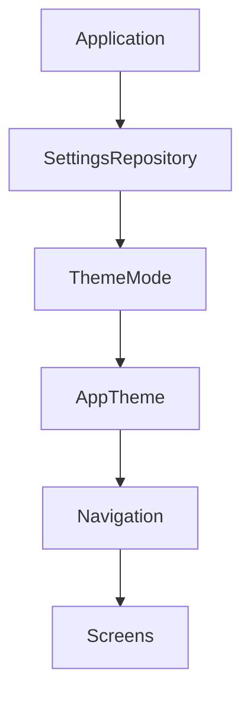

# Глава 9. Темы, дизайн-системы и адаптивный интерфейс

## 9.1. Что такое дизайн-система

При разработке приложения недостаточно просто создать несколько экранов.

Все экраны должны выглядеть как части одного продукта.

Например, если на одном экране кнопка имеет синий цвет, на втором — зелёный, а на третьем — красный, без определённой причины, интерфейс выглядит непоследовательно.

Для решения этой проблемы используется дизайн-система.

Дизайн-система — набор правил, компонентов и визуальных параметров, определяющих внешний вид и поведение интерфейса.

Обычно она содержит:

- цветовую палитру;
- типографику;
- формы компонентов;
- размеры;
- отступы;
- правила использования компонентов;
- состояния взаимодействия;
- визуальные токены.

В **Compose** для этого можно использовать **Material 3** и собственные механизмы темы.

## 9.2. MaterialTheme

`MaterialTheme` — composable-функция, предоставляющая дизайн-параметры дочерним компонентам.

В **Material 3** основными подсистемами являются:

1. `ColorScheme`.
2. `Typography`.
3. `Shapes`.

Простейший пример:

```kotlin
@Composable
fun AppTheme(
    content: @Composable () -> Unit
) {
    MaterialTheme(
        colorScheme = lightColorScheme(),
        typography = Typography(),
        shapes = Shapes(),
        content = content
    )
}
```

После этого значения темы доступны через `MaterialTheme`.

Например:

```kotlin
Text(
    text = "Заголовок",
    color = MaterialTheme.colorScheme.primary,
    style = MaterialTheme.typography.headlineMedium
)
```

Благодаря этому компоненты не должны самостоятельно хранить все цвета и текстовые стили.

Они используют централизованную конфигурацию.

## 9.3. ColorScheme — цветовая схема

`ColorScheme` содержит набор семантических цветов **Material 3**.

Вместо того чтобы использовать конкретные цвета напрямую, рекомендуется обращаться к ролям цветовой схемы.

Основные группы:

| Цвет | Назначение |
|---|---|
| `primary` | Основной цвет интерфейса |
| `onPrimary` | Цвет содержимого на primary |
| `primaryContainer` | Контейнер основного цвета |
| `onPrimaryContainer` | Содержимое primaryContainer |
| `secondary` | Дополнительный акцент |
| `tertiary` | Третичный акцент |
| `background` | Фон приложения |
| `surface` | Цвет поверхностей |
| `error` | Цвет ошибок |
| `outline` | Контуры и разделители |

### Почему лучше использовать роли цветов?

Предположим, кнопка приложения должна использовать основной цвет.

Вместо:

```kotlin
Button(
    colors = ButtonDefaults.buttonColors(
        containerColor = Color(0xFF6750A4)
    ),
    onClick = {}
) {
    Text("Продолжить")
}
```

можно использовать цветовую схему темы и оставить **Material**-компоненту стандартные цвета.

Тогда при изменении темы внешний вид кнопки обновится автоматически.

## 9.4. Создание собственной цветовой схемы

**Material 3** предоставляет функции:

- `lightColorScheme()`;
- `darkColorScheme()`.

Пример:

```kotlin
private val LightColors = lightColorScheme(
    primary = Color(0xFF315DA8),
    onPrimary = Color.White,
    primaryContainer = Color(0xFFD8E2FF),
    onPrimaryContainer = Color(0xFF001A43),

    secondary = Color(0xFF585E71),
    onSecondary = Color.White,

    background = Color(0xFFF9F9FF),
    surface = Color(0xFFF9F9FF),

    error = Color(0xFFBA1A1A)
)
```

Тёмная тема:

```kotlin
private val DarkColors = darkColorScheme(
    primary = Color(0xFFADC6FF),
    onPrimary = Color(0xFF002E69),
    primaryContainer = Color(0xFF16458F),
    onPrimaryContainer = Color(0xFFD8E2FF),

    secondary = Color(0xFFC0C6DC),
    onSecondary = Color(0xFF293042),

    background = Color(0xFF111318),
    surface = Color(0xFF111318),

    error = Color(0xFFFFB4AB)
)
```

Это только пример палитры.

В реальном проекте все используемые цветовые роли следует определить систематически, чтобы интерфейс имел достаточную контрастность.

### Использование темы

```kotlin
@Composable
fun AppTheme(
    darkTheme: Boolean,
    content: @Composable () -> Unit
) {
    val colors = if (darkTheme) {
        DarkColors
    } else {
        LightColors
    }

    MaterialTheme(
        colorScheme = colors,
        content = content
    )
}
```

Теперь можно переключать цветовую схему приложения.

## 9.5. Динамические цвета

В **Material You** появилась концепция динамических цветов.

На **Android 12** и новее приложение может использовать цветовую палитру, сформированную на основе обоев устройства.

Для этого **Material 3** предоставляет:

- `dynamicLightColorScheme()`;
- `dynamicDarkColorScheme()`.

Пример Android-специфичной реализации:

```kotlin
@Composable
fun AndroidAppTheme(
    darkTheme: Boolean,
    dynamicColor: Boolean,
    content: @Composable () -> Unit
) {
    val context = LocalContext.current

    val colorScheme = when {
        dynamicColor &&
            Build.VERSION.SDK_INT >= Build.VERSION_CODES.S -> {
            if (darkTheme) {
                dynamicDarkColorScheme(context)
            } else {
                dynamicLightColorScheme(context)
            }
        }

        darkTheme -> DarkColors

        else -> LightColors
    }

    MaterialTheme(
        colorScheme = colorScheme,
        content = content
    )
}
```

Здесь используются **Android API**:

- `LocalContext`;
- `Build.VERSION`;
- `dynamicLightColorScheme`;
- `dynamicDarkColorScheme`.

Следовательно, эта функция относится к Android-части приложения.

### Как поступить в Compose Multiplatform

В общем коде лучше определить интерфейс темы, который принимает готовую цветовую схему.

Например:

```kotlin
@Composable
fun SharedAppTheme(
    colorScheme: ColorScheme,
    darkTheme: Boolean,
    content: @Composable () -> Unit
) {
    MaterialTheme(
        colorScheme = colorScheme,
        typography = AppTypography,
        shapes = AppShapes,
        content = content
    )
}
```

**Android** может передавать динамическую цветовую схему.

**iOS** и **Desktop** могут использовать собственные схемы или общие палитры приложения.

В результате визуальная система остаётся общей, а получение платформенных цветов изолируется.

## 9.6. Typography — типографика

`Typography` определяет набор текстовых стилей приложения.

В предыдущей главе мы использовали:

- `headlineMedium`;
- `titleLarge`;
- `bodyMedium`;
- `labelLarge`.

Теперь рассмотрим, как создать собственную типографику.

```kotlin
val AppTypography = Typography(
    displayLarge = TextStyle(
        fontSize = 57.sp,
        fontWeight = FontWeight.Normal
    ),

    headlineMedium = TextStyle(
        fontSize = 28.sp,
        fontWeight = FontWeight.Bold
    ),

    titleLarge = TextStyle(
        fontSize = 22.sp,
        fontWeight = FontWeight.SemiBold
    ),

    bodyLarge = TextStyle(
        fontSize = 16.sp,
        fontWeight = FontWeight.Normal
    ),

    bodyMedium = TextStyle(
        fontSize = 14.sp,
        fontWeight = FontWeight.Normal
    ),

    labelLarge = TextStyle(
        fontSize = 14.sp,
        fontWeight = FontWeight.Medium
    )
)
```

Затем подключаем типографику:

```kotlin
MaterialTheme(
    colorScheme = LightColors,
    typography = AppTypography
) {
    AppContent()
}
```

Использование:

```kotlin
Text(
    text = "Мои заметки",
    style = MaterialTheme.typography.headlineMedium
)
```

### Почему нельзя задавать шрифт каждому компоненту отдельно

Допустим, необходимо увеличить все заголовки приложения.

Если размеры указаны непосредственно в сотнях composable-функций, потребуется изменить множество файлов.

Если же используется единая `Typography`, изменение делается централизованно.

Это также позволяет поддерживать согласованное оформление во всех приложениях, использующих общий UI-код.

## 9.7. Shapes

`Shapes` определяет формы элементов интерфейса.

**Material 3** предоставляет несколько основных категорий:

- `extraSmall`;
- `small`;
- `medium`;
- `large`;
- `extraLarge`.

Пример:

```kotlin
val AppShapes = Shapes(
    extraSmall = RoundedCornerShape(4.dp),
    small = RoundedCornerShape(8.dp),
    medium = RoundedCornerShape(12.dp),
    large = RoundedCornerShape(20.dp),
    extraLarge = RoundedCornerShape(28.dp)
)
```

Использование:

```kotlin
Card(
    shape = MaterialTheme.shapes.large
) {
    Text(
        text = "Карточка",
        modifier = Modifier.padding(16.dp)
    )
}
```

Так можно централизованно изменять формы компонентов.

## 9.8. Полная тема приложения

Объединим цветовую схему, типографику и формы.

```kotlin
@Composable
fun AppTheme(
    darkTheme: Boolean,
    content: @Composable () -> Unit
) {
    val colors = if (darkTheme) {
        DarkColors
    } else {
        LightColors
    }

    MaterialTheme(
        colorScheme = colors,
        typography = AppTypography,
        shapes = AppShapes
    ) {
        content()
    }
}
```

Использование:

```kotlin
@Composable
fun App() {
    AppTheme(
        darkTheme = false
    ) {
        MainNavigation()
    }
}
```

Теперь весь интерфейс находится внутри единой дизайн-системы.

В реальном проекте параметр `darkTheme` обычно связывается с настройками приложения или системной темой.

## 9.9. CompositionLocal и собственная дизайн-система

Иногда стандартных параметров **Material 3** недостаточно.

Например, приложению могут потребоваться дополнительные цвета:

- успешное действие;
- предупреждение;
- информационный блок;
- специальный акцент бренда;
- цвет диаграммы.

Для таких случаев можно использовать `CompositionLocal`.

`CompositionLocal` позволяет передавать значения вниз по дереву композиции без явной передачи каждого параметра через все промежуточные компоненты.

Пример:

```kotlin
@Immutable
data class AppColors(
    val success: Color,
    val warning: Color,
    val info: Color
)
```

Создание локального значения:

```kotlin
val LocalAppColors = staticCompositionLocalOf {
    AppColors(
        success = Color.Green,
        warning = Color.Yellow,
        info = Color.Blue
    )
}
```

Функция доступа:

```kotlin
object AppTheme {
    val colors: AppColors
        @Composable
        get() = LocalAppColors.current
}
```

Использование:

```kotlin
Text(
    text = "Операция выполнена",
    color = AppTheme.colors.success
)
```

Предоставление значения:

```kotlin
@Composable
fun AppTheme(
    content: @Composable () -> Unit
) {
    val colors = AppColors(
        success = Color(0xFF2E7D32),
        warning = Color(0xFFED6C02),
        info = Color(0xFF0288D1)
    )

    CompositionLocalProvider(
        LocalAppColors provides colors
    ) {
        MaterialTheme {
            content()
        }
    }
}
```

### staticCompositionLocalOf и compositionLocalOf

`staticCompositionLocalOf` применяется для значений, которые обычно не меняются часто.

`compositionLocalOf` предназначен для значений, изменение которых должно учитывать наблюдение за чтением.

Выбирать механизм нужно исходя из характера данных.

Не следует использовать `CompositionLocal` для передачи любых параметров.

Если зависимость компонента важна для его самостоятельной работы, явные параметры обычно понятнее.

`CompositionLocal` подходит для общих визуальных токенов, локализованного окружения и других зависимостей, которые логически распространяются по дереву UI.

## 9.10. Светлая и тёмная тема

Поддержка светлой и тёмной темы — важная характеристика современного приложения.

На **Android** системная тема может определяться через `isSystemInDarkTheme()`.

Пример:

```kotlin
@Composable
fun App() {
    val systemDarkTheme = isSystemInDarkTheme()

    AppTheme(
        darkTheme = systemDarkTheme
    ) {
        MainNavigation()
    }
}
```

Однако приложения часто предоставляют собственную настройку:

- системная;
- светлая;
- тёмная.

Для этого можно описать модель:

```kotlin
enum class ThemeMode {
    SYSTEM,
    LIGHT,
    DARK
}
```

Функция определения темы:

```kotlin
@Composable
fun resolveDarkTheme(
    mode: ThemeMode
): Boolean {
    return when (mode) {
        ThemeMode.LIGHT -> false
        ThemeMode.DARK -> true
        ThemeMode.SYSTEM -> isSystemInDarkTheme()
    }
}
```

При переносе на другие платформы получение системного режима может потребовать платформенной адаптации.

Саму модель `ThemeMode` можно использовать в общем Kotlin-коде.

### Важные правила тёмной темы

1. Не стоит просто инвертировать все цвета.
2. Необходимо проверить контраст текста и фона.
3. Поверхности должны сохранять визуальную иерархию.
4. Цвет ошибок должен оставаться различимым.
5. Изображения и иконки должны корректно отображаться в обеих темах.

## 9.11. Ресурсы Compose Multiplatform

В обычной Android-разработке ресурсы часто подключаются через `R.drawable`, `R.string` и другие классы.

В **Compose Multiplatform** используется собственная система ресурсов.

Ресурсы общего модуля размещаются в каталоге:


Основные типы:

| Каталог | Назначение |
|---|---|
| `drawable` | Изображения |
| `font` | Шрифты |
| `values` | Строковые и другие значения |
| `files` | Прочие файлы |

После генерации ресурсных accessor-классов можно обращаться к ресурсам из общего кода.

## 9.12. Использование строковых ресурсов

Пример файла `strings.xml`:

```xml
<resources>
    <string name="app_name">Мои заметки</string>
    <string name="welcome">Добро пожаловать!</string>
    <string name="save">Сохранить</string>
</resources>
```

Использование:

```kotlin
@Composable
fun WelcomeScreen() {
    Column {
        Text(
            stringResource(Res.string.app_name)
        )

        Text(
            stringResource(Res.string.welcome)
        )

        Button(
            onClick = {}
        ) {
            Text(
                stringResource(Res.string.save)
            )
        }
    }
}
```

Это позволяет отделять текст от кода UI.

### Почему нельзя хранить весь текст в composable-функциях

Например:

```kotlin
Text("Добро пожаловать!")
```

Для небольшого примера такой вариант допустим.

Но в реальном приложении необходимо поддерживать:

- перевод на другие языки;
- изменение текста без изменения UI-логики;
- единообразие формулировок;
- множественные формы;
- локализацию.

Поэтому пользовательские строки следует размещать в ресурсах.

## 9.13. Локализация

Локализация — адаптация приложения к языку и региональным особенностям.

Она включает:

- перевод текста;
- форматирование дат;
- форматирование чисел;
- форматирование валют;
- правила множественного числа;
- направление письма;
- региональные изображения и ресурсы.

В **Compose Multiplatform** поддерживаются квалифицированные ресурсы.

Например:


Это позволяет предоставлять разные варианты строк для различных языков.

При работе с локализацией важно учитывать не только перевод, но и длину текста.

Например, немецкий или русский вариант надписи может быть значительно длиннее английского.

Поэтому нельзя рассчитывать на то, что текст всегда поместится в фиксированную область.

## 9.14. Адаптивный интерфейс

До этого мы преимущественно рассматривали интерфейсы, ориентированные на мобильный экран.

Однако **Compose** может использоваться на:

- телефонах;
- планшетах;
- складных устройствах;
- настольных компьютерах;
- Chromebook;
- других устройствах с различными размерами окон.

Адаптивный интерфейс — интерфейс, который изменяет структуру и расположение элементов в зависимости от доступного пространства и условий отображения.

Важно учитывать именно размер окна приложения, а не только физический размер экрана устройства.

Например, приложение может работать в режиме разделённого экрана, где доступная ширина значительно меньше ширины всего дисплея.

## 9.15. Window Size Classes

Для адаптивной разработки на **Android** применяются **Window Size Classes**.

Они классифицируют размеры окна по категориям:

- `Compact`;
- `Medium`;
- `Expanded`.

Обычно ширина окна является одним из основных параметров для выбора структуры интерфейса.

Пример общей концепции:

| Класс | Типичная компоновка |
|---|---|
| `Compact` | Один столбец |
| `Medium` | Более широкая область или упрощённая двухколоночная компоновка |
| `Expanded` | Несколько панелей одновременно |

Конкретные границы классов определяются используемой библиотекой и актуальной спецификацией. Не рекомендуется самостоятельно устанавливать произвольные пороги без учёта официальных рекомендаций.

### BoxWithConstraints

Для общего UI часто достаточно использовать доступные ограничения контейнера.

```kotlin
@Composable
fun AdaptiveScreen() {
    BoxWithConstraints(
        modifier = Modifier.fillMaxWidth()
    ) {
        if (maxWidth >= 600.dp) {
            Row {
                NavigationPanel()
                MainContent()
            }
        } else {
            Column {
                MainContent()
            }
        }
    }
}
```

В компактном режиме отображается основное содержимое.

В более широком режиме рядом появляется дополнительная панель.

Такой подход не требует знания **Android Context** или физических характеристик устройства.

## 9.16. Многопанельные интерфейсы

На больших экранах часто удобнее отображать несколько связанных областей одновременно.

Например, почтовое приложение:

```text
┌──────────────┬──────────────────────┐
│              │                      │
│   Письма     │   Содержимое письма  │
│              │                      │
│   Письмо 1   │   Тема               │
│   Письмо 2   │                      │
│   Письмо 3   │   Текст              │
│              │                      │
└──────────────┴──────────────────────┘
```

На телефоне эти области обычно показываются последовательно.

Для этого используется паттерн List-Detail.

У **Material 3 Adaptive** есть соответствующие строительные блоки:

- `ListDetailPaneScaffold`;
- `SupportingPaneScaffold`;
- `NavigationSuiteScaffold`.

### ListDetailPaneScaffold

Предназначен для отображения списка и связанной с ним детальной информации.

На компактном окне обычно отображается одна панель.

На расширенном — список и детальная информация могут находиться одновременно.

### SupportingPaneScaffold

Позволяет отображать основную область и дополнительную панель.

Например, редактор документа и его свойства.

### NavigationSuiteScaffold

Помогает адаптировать навигацию.

В зависимости от размера окна может использоваться нижняя навигационная панель или боковая навигация.

Эти компоненты особенно полезны при создании адаптивных Android-приложений.

Для **Compose Multiplatform** необходимо отдельно проверять поддержку конкретной версии **Material 3 Adaptive** на всех целевых платформах.

## 9.17. Адаптивная типографика и размеры

Адаптивный интерфейс — это не только перестановка колонок.

Необходимо учитывать:

- размеры текста;
- длину строк;
- ширину карточек;
- максимальную ширину контента;
- расстояния между элементами;
- доступность взаимодействия.

Например, если текстовая область занимает всю ширину большого монитора, строки могут стать слишком длинными.

Решение — ограничить ширину содержимого:

```kotlin
Column(
    modifier = Modifier
        .fillMaxWidth()
        .widthIn(max = 720.dp)
        .padding(24.dp)
)
```

Дополнительно необходимо учитывать масштабирование текста средствами операционной системы.

Для текста следует использовать `sp`, а не фиксированные пиксели.

## 9.18. Window Insets

На мобильных устройствах интерфейс взаимодействует с системными областями:

- статус-баром;
- навигационной областью;
- вырезами экрана;
- экранными жестами;
- клавиатурой.

Эти области учитываются через **Window Insets**.

Compose предоставляет соответствующие API, включая:

- `WindowInsets`;
- `safeDrawing`;
- `safeContent`;
- `ime`;
- `statusBars`;
- `navigationBars`.

Например:

```kotlin
Column(
    modifier = Modifier
        .fillMaxSize()
        .windowInsetsPadding(
            WindowInsets.safeDrawing
        )
) {
    Text("Основное содержимое")
}
```

Это позволяет размещать содержимое в безопасной области.

Необходимо учитывать, что некоторые компоненты, например **Material 3 Scaffold** и определённые системные контейнеры, уже предоставляют inset-related padding.

Не следует механически применять одинаковые отступы несколько раз: это может привести к двойным промежуткам.

## 9.19. Тема и архитектура приложения

Настройки темы могут быть частью состояния приложения.

Например:

```kotlin
enum class ThemeMode {
    SYSTEM,
    LIGHT,
    DARK
}

data class AppearanceUiState(
    val themeMode: ThemeMode = ThemeMode.SYSTEM
)
```

`ViewModel` может получать и сохранять значение через репозиторий настроек.

Однако сама тема приложения обычно применяется на верхнем уровне UI-дерева.

Условная структура:



Это позволяет всем экранам использовать одну и ту же тему.

При этом получение системной темы может отличаться на разных платформах.

Поэтому в общем модуле лучше разделить:

- модель пользовательской настройки;
- применение `MaterialTheme`;
- получение системного режима;
- платформенные динамические цвета.

## 9.20. Подготовка к Compose Multiplatform

В этой главе мы рассмотрели несколько механизмов, которые особенно важны для будущего перехода.

### В общий код можно выносить

- общие цветовые схемы;
- `Typography`;
- `Shapes`;
- `CompositionLocal`;
- общие composable-компоненты;
- ресурсы;
- локализованные строки;
- адаптивные компоновки на основе доступных ограничений;
- модель настройки темы.

### Платформенная реализация может потребоваться для

- динамических Android-цветов;
- системных настроек внешнего вида;
- системных `Insets`;
- специальных системных интерфейсов;
- определения особенностей устройства;
- отдельных адаптивных API.

### Главное правило

Общий UI не должен самостоятельно определять, на какой платформе он запущен, только ради выбора ширины карточки или расположения кнопок.

Ему следует получать необходимые параметры темы и доступное пространство через соответствующие API Compose.

## 9.21. Типичные ошибки

1. Использовать жёстко заданные цвета во всех компонентах.
2. Создавать разные визуальные стили для одинаковых элементов.
3. Не поддерживать тёмную тему.
4. Использовать динамические цвета **Android** непосредственно в `commonMain`.
5. Не выносить пользовательские строки в ресурсы.
6. Рассчитывать, что все переводы имеют одинаковую длину.
7. Использовать фиксированную ширину экрана вместо доступного пространства окна.
8. Игнорировать адаптацию под планшеты.
9. Не учитывать складные устройства и режим разделённого экрана.
10. Не ограничивать слишком широкие текстовые области.
11. Дублировать системные отступы.
12. Использовать платформенные ресурсы **Android** непосредственно в общем модуле.

