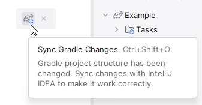
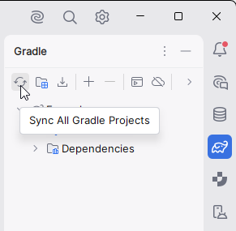

# Теория Gradle I

**Gradle** — система автоматизации сборки программного обеспечения.

Она помогает не только компилировать исходный код, но и выполнять другие задачи, 
необходимые для разработки и доставки приложения.

**Gradle** может:

- компилировать **Kotlin**- и **Java**-код;
- загружать и подключать внешние библиотеки;
- запускать автоматические тесты;
- собирать **JAR**-файлы и другие артефакты;
- проверять качество кода;
- выполнять задачи плагинов;
- организовывать сборку многомодульных проектов.

Без системы сборки разработчику пришлось бы самостоятельно организовывать 
компиляцию, управлять библиотеками, запускать проверки и собирать готовые файлы.

**Gradle** автоматизирует эти процессы и позволяет описывать их в конфигурации проекта.

### Основные понятия

| Понятие          | Значение                                             |
|------------------|------------------------------------------------------|
| Gradle           | Система автоматизации сборки                         |
| Build            | Процесс сборки проекта и выполнения связанных задач  |
| Build script     | Файл с конфигурацией сборки                          |
| Plugin           | Расширение, добавляющее задачи и возможности         |
| Dependency       | Библиотека или другой компонент, необходимый проекту |
| Task             | Отдельная операция, которую Gradle может выполнить   |
| Module / project | Отдельная часть Gradle-сборки со своей конфигурацией |
| Artifact         | Результат сборки, например JAR-файл                  |

Например, команда:

```bash
./gradlew build
```

запускает задачу `build` через **Gradle Wrapper**. В зависимости от подключённых 
плагинов и настроек она может включать компиляцию, тестирование и другие 
необходимые операции.

## Структура Gradle-проекта

Рассмотрим типичный **Kotlin/JVM**-проект, использующий **Gradle** и **Kotlin DSL**.


Это пример структуры, а не обязательный шаблон для любого проекта. 
Например, у небольшого проекта может не быть отдельного модуля `:app`, 
а в многомодульной сборке каталогов будет значительно больше.

Разберём основные элементы.

## settings.gradle.kts

Этот файл описывает структуру **Gradle**-сборки: её имя, подключаемые 
проекты и другие настройки уровня сборки.

Пример:

```gradle
rootProject.name = "my-project"

include(":app")
```

Здесь:

- `rootProject.name` задаёт имя корневого проекта;
- `include(":app")` подключает модуль `:app` к сборке.

Если используется такая конфигурация, **Gradle** видит корневой проект 
и отдельный модуль `:app`.

В многомодульном проекте подключение может выглядеть так:

```gradle
rootProject.name = "my-project"

include(":app")
include(":core")
include(":data")
```

Теперь сборка включает три подпроекта (модуля) `:app`, `:core` и `:data`.

#### Когда изменять этот файл?

Когда нужно подключить новый модуль, изменить имя корневого проекта или настроить
некоторые параметры разрешения плагинов и зависимостей на уровне всей сборки.

> После изменения кода в файлах **Gradle**, в **IntelliJ IDEA** необходимо
> синхронизировать изменения, либо с помощью нажатия появившейся кнопки:
>
> 
>
> либо во вкладке **Gradle** справа:
>
> 

## build.gradle.kts

Это скрипт сборки, написанный с использованием **Kotlin DSL** (Domain-Specific Language).

В нём настраиваются плагины, зависимости и задачи проекта.

Пример корневого файла:

```gradle
plugins {
    id("org.jetbrains.kotlin.jvm") version "2.2.20" apply false
}
```

В этом примере объявляется версия **Kotlin Gradle Plugin**, но `apply false` означает, что плагин 
не применяется непосредственно к корневому проекту.

Версия здесь приведена только для примера. В реальном проекте нужно использовать версию, 
совместимую с выбранными версиями **Gradle** и **JDK**.

Если в корневом проекте несколько модулей, общие настройки и версии часто определяют на 
уровне корневой сборки, а сами плагины применяют к нужным модулям.

## app/build.gradle.kts

У модуля `:app` может быть собственный скрипт сборки.

Например:

```gradle
plugins {
    id("org.jetbrains.kotlin.jvm")
    application
}

repositories {
    mavenCentral()
}

dependencies {
    testImplementation(kotlin("test"))
}

kotlin {
    jvmToolchain(21)
}

application {
    mainClass.set("org.example.MainKt")
}

tasks.test {
    useJUnitPlatform()
}
```

Что здесь происходит?

- `plugins` подключает плагины **Kotlin/JVM** и **Application**;
- `repositories` указывает репозитории, из которых **Gradle** может получать библиотеки;
- `dependencies` объявляет зависимости модуля;
- `kotlin.jvmToolchain(21)` задаёт инструментальную цепочку **JDK** для **Kotlin/JVM**;
- `application` указывает класс, с которого начинается запуск приложения;
- `tasks.test` настраивает запуск тестов с использованием платформы **JUnit**.

Этот пример предполагает, что точка входа находится в файле `Main.kt` в пакете `org.example` 
и используется соответствующая конфигурация тестирования. Для другого проекта настройки 
могут отличаться.

> **Обратите внимание:** `Main.kt` — имя исходного файла, а `org.example.MainKt` — имя сгенерированного
> **JVM**-класса для функции `main`, объявленной на верхнем уровне файла `Main.kt`.

## gradle.properties

Файл содержит свойства, влияющие на конфигурацию **Gradle**.

Например:

```text
org.gradle.caching=true
org.gradle.parallel=true
```

В этом примере включаются кэширование результатов задач и параллельное выполнение 
совместимых задач.

Также здесь могут находиться параметры **JVM** для **Gradle**, например:

```text
org.gradle.jvmargs=-Xmx2g -Dfile.encoding=UTF-8
```

Такие настройки стоит добавлять осознанно: оптимальные значения зависят от размера 
проекта и доступных ресурсов.

В больших проектах через `gradle.properties` также могут передаваться свойства, 
используемые в скриптах сборки.

Не следует хранить в репозитории пароли, токены и другие секреты в открытом виде.

## gradlew и gradlew.bat

Это скрипты **Gradle Wrapper**.

- `gradlew` используется в **Linux** и **macOS**.
- `gradlew.bat` используется в **Windows**.

**Wrapper** позволяет запускать сборку с определённой версией **Gradle**, указанной 
в конфигурации проекта.

Вместо установки **Gradle** вручную и запуска команды **gradle** обычно используют **Wrapper**:

```bash
./gradlew build
```

В **Windows**:

```bash
.\gradlew.bat build
```

Это помогает разработчикам и **CI**-системам использовать согласованную версию **Gradle**.

## gradle/wrapper/

В нём находятся файлы, необходимые **Gradle Wrapper**.

`gradle-wrapper.properties` содержит настройки загрузки и использования **Gradle**, 
в том числе ссылку на дистрибутив и его версию.

Например, в нём может быть указано:

```text
distributionUrl=https\://services.gradle.org/distributions/gradle-8.14-bin.zip
```

Это пример версии, а не рекомендация выбирать именно её.

- `gradle-wrapper.jar` — исполняемый компонент **Wrapper**.

Файлы **Wrapper** обычно хранят в системе контроля версий вместе с проектом, чтобы другие 
разработчики могли запускать сборку тем же способом.

## .gitignore

Этот файл задаёт правила для **Git**: какие файлы и каталоги не нужно добавлять в 
систему контроля версий.

Для **Gradle**-проекта часто исключают:

```text
.gradle/
**/build/
.idea/workspace.xml
```

Здесь исключаются локальный каталог состояния **Gradle**, результаты сборки модулей и один 
из файлов пользовательского состояния **IntelliJ IDEA**.

Конкретный `.gitignore` зависит от используемой **IDE**, операционной системы и инструментов.

Не нужно автоматически исключать всё, что находится в каталоге `gradle/`: файлы **Wrapper** 
и другие важные файлы конфигурации обычно должны попадать в репозиторий.

## Исходный код: src/main и src/test

В **Gradle**-проектах часто используется соглашение о разделении основного кода и тестов.


Не каждый проект использует все эти каталоги. Их наличие зависит от языка, 
плагинов и настроек сборки.

## src/main/kotlin

Здесь размещается основной **Kotlin**-код приложения.

Например:


Файл `Main.kt`:

```kotlin
package org.example

fun main() {
    println("Hello, Gradle!")
}
```

Этот код содержит функцию `main`, которая может служить точкой входа приложения.

## src/main/java

В **Kotlin/JVM**-проекте здесь могут находиться исходные файлы **Java**, если проект 
использует **Java** вместе с **Kotlin**.

Например:


**Kotlin** и **Java** могут взаимодействовать друг с другом на **JVM**, но для совместной 
компиляции необходимо учитывать настройки **Kotlin Gradle Plugin** и **Java**-плагинов.

## src/main/resources

Здесь хранятся ресурсы, необходимые приложению во время выполнения.

Примеры:


В зависимости от конфигурации **Gradle** эти файлы попадают в каталог ресурсов результата 
сборки и могут включаться в **JAR**.

Например, приложение может читать **JSON**-файл как ресурс из `classpath`, а не как произвольный 
файл по абсолютному пути на диске.

## src/test/kotlin

Здесь располагаются автоматические тесты.

Например:


Простейший пример теста с использованием **JUnit Jupiter**:

```kotlin
package org.example

import org.junit.jupiter.api.Assertions.assertEquals
import org.junit.jupiter.api.Test

class CalculatorTest {

    @Test
    fun `addition returns sum`() {
        assertEquals(5, 2 + 3)
    }
}
```

Для такого теста необходимо подключить соответствующую зависимость **JUnit Jupiter** 
и настроить тестовую платформу. Одного импорта в **Kotlin**-файле недостаточно.

## src/test/resources

Здесь располагаются данные, необходимые тестам: тестовые конфигурации, **JSON**-файлы, 
образцы документов и другие ресурсы.

Например:


Главное правило: основной код находится в `src/main`, а тестовый — в `src/test`. 
При стандартной конфигурации тестовый код и его зависимости не входят в обычный 
`runtime classpath` приложения.

## Что такое Gradle Wrapper и зачем он нужен?

Представим, что над проектом работают несколько человек. У одного установлена 
одна версия **Gradle**, у другого — другая.

Различия между версиями могут приводить к ошибкам конфигурации или несовместимости 
плагинов.

**Gradle Wrapper** решает эту проблему: проект содержит настройки версии **Gradle**, 
которую нужно использовать при запуске сборки.

Основная команда:

```bash
./gradlew build
```

Если необходимая версия **Gradle** ещё не загружена, **Wrapper** обычно загружает её автоматически.

В **Windows**:

```bash
.\gradlew.bat build
```

Полезные команды:

```bash
./gradlew --version
./gradlew tasks
./gradlew build
./gradlew clean
./gradlew test
```

Их назначение:

| Команда               | Назначение                 |
|-----------------------|----------------------------|
| `./gradlew --version` | Показать версию **Gradle** |
| `./gradlew tasks`     | Показать список задач      |
| `./gradlew build`     | Собрать проект             |
| `./gradlew clean`     | Удалить все файлы сборки   |
| `./gradlew test`      | Запустить тесты            |

В многомодульной сборке можно обратиться к задаче конкретного проекта:

```bash
./gradlew :app:build
./gradlew :app:test
```

Здесь `:app` — путь проекта в **Gradle**-сборке, а не обязательно имя физического каталога.

В некоторых случаях задача зависит от других задач и **Gradle** автоматически выполнит 
их перед ней.

Практическое правило: если проект содержит **Wrapper**, предпочитайте `./gradlew` или 
`gradlew.bat`, а не глобально установленную команду `gradle`.

