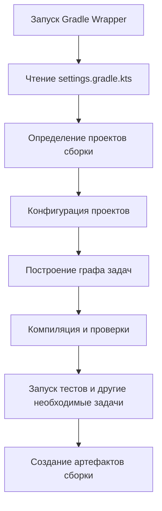

# Теория Gradle II

## Tasks — задачи Gradle

**Gradle** организует выполнение сборки с помощью задач (`Task`).

Задача представляет собой отдельную операцию. Это может быть компиляция исходников, 
запуск тестов, создание **JAR** или проверка качества кода.

Некоторые часто встречающиеся задачи:

| Задача          | Что делает                                                   |
|-----------------|--------------------------------------------------------------|
| `help`          | Показывает справочную информацию                             |
| `tasks`         | Выводит доступные задачи                                     |
| `clean`         | Удаляет результаты сборки                                    |
| `compileKotlin` | Компилирует **Kotlin**-код в соответствующем `source set`    |
| `test`          | Запускает тесты                                              |
| `jar`           | Создаёт **JAR**-архив, если задача предоставлена и настроена |
| `build`         | Выполняет задачи, необходимые для сборки                     |
| `check`         | Запускает проверки, определённые конфигурацией проекта       |

Точный набор задач зависит от подключённых плагинов и настроек. Например, **Android**-проект 
будет иметь задачи, отличающиеся от обычного **Kotlin/JVM**-проекта.

Посмотреть задачи можно так:

```bash
./gradlew tasks
```

Запустить отдельную задачу:

```bash
./gradlew test
```

В многомодульном проекте:

```bash
./gradlew :app:test
```

### Как Gradle выполняет задачи?

Упрощённо процесс выглядит следующим образом:

1. **Gradle** читает настройки сборки и определяет входящие в неё проекты.
2. Конфигурирует проекты и создаёт необходимые задачи.
3. Определяет, какие задачи нужны для запрошенной операции.
4. Выполняет задачи с учётом зависимостей между ними.
5. Сохраняет результаты и информацию, необходимую для последующих сборок.

На практике **Gradle** использует граф задач и может пропускать некоторые операции, 
если считает, что их результаты актуальны.

Поэтому `build` — не одна большая команда компиляции, а набор взаимосвязанных задач.

## Plugins — плагины Gradle

Сам по себе **Gradle** предоставляет инфраструктуру для сборки. Большая часть возможностей 
для конкретных языков и типов приложений добавляется с помощью плагинов.

Например, **Kotlin/JVM**-плагин добавляет возможности компиляции **Kotlin**-кода для **JVM**, 
а **Application Plugin** помогает настраивать и запускать приложение.

Подключение плагинов выглядит так:

```gradle
plugins {
    id("org.jetbrains.kotlin.jvm") version "2.2.20"
    application
}
```

Версия **Kotlin** здесь указана для иллюстрации синтаксиса.

Плагин может добавлять:

* новые задачи;
* конфигурационные блоки;
* правила компиляции;
* соглашения о структуре проекта;
* дополнительные проверки;
* задачи для упаковки и публикации артефактов.

Например, после применения соответствующих плагинов в проекте могут появиться задачи 
`compileKotlin`, `test`, `jar` и другие.

Не все плагины нужно подключать непосредственно в каждом модуле. В больших проектах версии 
плагинов часто централизуют в корневом файле, каталоге версий или другой общей конфигурации.

### Где Gradle ищет плагины?

Внешний плагин должен быть разрешён — то есть **Gradle** должен определить, откуда 
получить его реализацию.

Репозитории для этого часто настраиваются через `pluginManagement` в `settings.gradle.kts`:

```gradle
pluginManagement {
    repositories {
        gradlePluginPortal()
        mavenCentral()
    }
}
```

Этот блок предназначен для поиска плагинов.

Репозитории обычных библиотек настраиваются отдельно, например через 
`dependencyResolutionManagement`.

Таким образом, наличие `mavenCentral()` в репозиториях зависимостей проекта само по 
себе не означает, что любой сторонний **Gradle**-плагин обязательно будет найден.

## Dependencies — зависимости проекта

Большинство реальных приложений используют готовые библиотеки: для тестирования, работы 
с сетью, сериализации, базами данных и других задач.

**Gradle** позволяет объявлять эти библиотеки в `dependencies`.

Например:

```gradle
dependencies {
    testImplementation(kotlin("test"))
}
```

Этот пример добавляет **Kotlin Test** в конфигурацию тестовой компиляции и выполнения тестов.

Другой пример:

```gradle
dependencies {
    implementation("com.example:some-library:1.0.0")
}
```

Здесь `com.example:some-library:1.0.0` — условный координатный идентификатор библиотеки. 
Он приведён только для объяснения формата.

Обычно координаты **Maven**-артефакта записываются в виде:

```text
group:name:version
```

- `group` — организация или группа артефактов;
- `name` — имя библиотеки;
- `version` — её версия.

### Основные конфигурации зависимостей

| Конфигурация         | Назначение                                                                                                                                       |
|----------------------|--------------------------------------------------------------------------------------------------------------------------------------------------|
| `implementation`     | Зависимость, используемая основным кодом модуля                                                                                                  |
| `api`                | Зависимость, типы которой должны быть доступны потребителям библиотеки через публичный **API**; применяется, например, с **Java Library Plugin** |
| `compileOnly`        | Зависимость нужна для компиляции, но не добавляется в `runtime classpath` через эту конфигурацию                                                 |
| `runtimeOnly`        | Зависимость нужна во время выполнения, но не для компиляции основного исходного кода                                                             |
| `testImplementation` | Зависимость для компиляции и выполнения тестов                                                                                                   |
| `testRuntimeOnly`    | Зависимость только для выполнения тестов                                                                                                         |

Доступность и точная семантика конфигураций зависят от подключённых плагинов. 
Например, `api` используется в моделях сборки, которые поддерживают соответствующую конфигурацию.

### Чем зависимости отличаются от импортов?

Рассмотрим библиотеку, предоставляющую класс `JsonParser`.

Сначала библиотека должна быть доступна **Gradle** через объявленную зависимость и 
репозиторий. Затем, если класс доступен из исходного кода, его можно импортировать:

```kotlin
import some.library.JsonParser
```

`import` не загружает библиотеку. Этим занимается система разрешения зависимостей **Gradle**.

### Чем plugins {} отличается от dependencies {}?

Эти два блока решают разные задачи.

```gradle
plugins {
    application
}
```

Подключает расширение сборки — в данном случае **Application Plugin**.

А этот блок:

```gradle
dependencies {
    implementation(libs.guava)
}
```

Подключает библиотеку, которая нужна исходному коду приложения.

- плагин меняет возможности и конфигурацию сборки;
- библиотека предоставляет код и функциональность, которые может использовать приложение.

Плагин тоже может иметь собственные зависимости, но это не делает понятия плагина и библиотеки взаимозаменяемыми.

## Repositories — репозитории

Чтобы загрузить библиотеку, **Gradle** должен знать, где её искать.

Например:

```gradle
repositories {
    mavenCentral()
}
```

`mavenCentral()` подключает **Maven Central** — распространённый репозиторий **Java**- и **Kotlin**-библиотек.

Другие репозитории могут быть необходимы для библиотек, которые опубликованы в других местах.

При этом в многомодульных проектах репозитории зависимостей и репозитории плагинов могут 
настраиваться в разных файлах. Например, `pluginManagement` в `settings.gradle.kts` относится 
к разрешению плагинов, а `repositories` в конфигурации проекта — к разрешению обычных зависимостей.

## Multi-module projects — многомодульные проекты

Когда проект растёт, его удобно разделять на несколько модулей.

Например:


В `settings.gradle.kts`:

```gradle
rootProject.name = "my-project"

include(":app")
include(":core")
include(":data")
```

Каждый модуль может иметь собственный код, тесты, зависимости и конфигурацию сборки.

Например:

- `app` содержит точку входа и координирует работу приложения;
- `core` содержит общие модели и бизнес-логику;
- `data` отвечает за работу с источниками данных.

Это пример возможного разделения, а не универсальное архитектурное правило.

### Как модули взаимодействуют?

Если `:app` использует код из `:core`, между ними обычно объявляют проектную зависимость.

В `app/build.gradle.kts`:

```gradle
dependencies {
    implementation(project(":core"))
}
```

Теперь **Gradle** знает, что `:app` зависит от модуля `:core`, и учитывает эту связь при сборке.

При этом модуль `:core` должен быть подключён в `settings.gradle.kts`, а его публичные классы 
должны быть доступны потребителю.

<!-- prettier-ignore -->
> [!CAUTION]
> **Важно:** физическое наличие каталога `core` ещё не означает, что **Gradle** подключил его к сборке. 
> Для этого проект нужно включить в настройки и правильно сконфигурировать.

## Как устроен процесс сборки?

Рассмотрим стандартный сценарий:

```bash
./gradlew build
```

Упрощённо процесс можно представить так:



Это иллюстрация типичного процесса, а не точный порядок всех задач для любого проекта. 
Конкретный граф определяется плагинами, конфигурацией и запрошенной задачей.

### Где находятся результаты сборки?

Обычно результаты модуля находятся в каталоге:

```
app/build/
```

Например, там могут появиться:


Реальная структура зависит от задач, плагинов и версии инструментов.

Каталог `build/` обычно не хранится в **Git**, потому что его содержимое можно 
получить повторным запуском сборки.

## JDK, JVM и версия Java

При работе с **Kotlin/JVM** важно различать несколько понятий.

- **JDK** (**Java Development Kit**) — комплект инструментов для разработки, включая компилятор 
**Java** и инструменты запуска.
- **JVM** (**Java Virtual Machine**) — виртуальная машина, на которой выполняется **JVM**-байткод.
- **Java toolchain** — настройка инструментальной цепочки, позволяющая **Gradle** выбирать 
подходящую версию **JDK** для задач сборки.

Например:

```gradle
kotlin {
    jvmToolchain(21)
}
```

Эта настройка задаёт **JDK** 21 в качестве `toolchain` для **Kotlin/JVM**. 
Если проект также компилирует **Java**-код, стоит согласовать соответствующие настройки **Java** `toolchain`.

При этом важно различать:

- **JVM**, на которой запущен сам **Gradle**;
- **JDK**, используемую для компиляции;
- целевую версию байткода;
- минимальную версию **Java**, на которой должно запускаться приложение.

Эти значения не всегда обязаны совпадать.

Если проект не собирается, одной из первых проверок может быть:

```bash
./gradlew --version
```

Команда помогает увидеть версию **Gradle** и **JVM**, используемую для его запуска.

## Полезные команды для повседневной работы

Ниже приведён набор команд, с которыми стоит познакомиться в первую очередь.

```bash
# Информация о Gradle и JVM
./gradlew --version

# Список доступных задач
./gradlew tasks

# Сборка проекта
./gradlew build

# Запуск тестов
./gradlew test

# Удаление результатов сборки
./gradlew clean

# Сборка конкретного модуля
./gradlew :app:build

# Тесты конкретного модуля
./gradlew :app:test

# Запуск приложения при наличии Application Plugin
./gradlew :app:run
```

В **Windows** команды нужно запускать через `.\gradlew.bat`.

Не каждая команда доступна в любом проекте. Например, `run` появляется при наличии соответствующей 
конфигурации **Application Plugin**.

При диагностике проблем полезны также следующие команды:

```bash
./gradlew help
./gradlew projects
./gradlew dependencies
./gradlew build --stacktrace
```

Они позволяют получить справочную информацию, посмотреть структуру проектов, изучить зависимости 
и увидеть более подробный стек ошибки.

## Типичные ошибки при работе с Gradle

### Ошибка 1. Запуск глобального Gradle вместо Wrapper

Команда:

```bash
gradle build
```

может использовать версию **Gradle**, установленную в системе, а не версию, заданную проектом.

Обычно предпочтительнее:

```bash
./gradlew build
```

### Ошибка 2. Импорт библиотеки без подключения зависимости

Если класс находится во внешней библиотеке, одного `import` недостаточно.

Нужно проверить:
1. Объявлена ли зависимость в правильном модуле.
2. Указана ли подходящая конфигурация зависимости.
3. Подключён ли нужный репозиторий.
4. Совместимы ли версии библиотек.
5. Успешно ли Gradle разрешил зависимости.

### Ошибка 3. Размещение тестов в src/main

Код тестов обычно нужно размещать в `src/test`, иначе он может попасть в основной набор исходников 
и потребовать тестовые зависимости при компиляции приложения.

### Ошибка 4. Изменение не того build.gradle.kts

В многомодульном проекте могут существовать корневой `build.gradle.kts` и отдельные файлы сборки модулей.

Перед внесением изменений важно определить, на каком уровне нужно изменить конфигурацию: во всей 
сборке или только в конкретном модуле.

### Ошибка 5. Удаление файлов Wrapper

Если удалить необходимые файлы **Wrapper**, привычный запуск через `./gradlew` перестанет работать.

Поэтому `gradlew`, `gradlew.bat` и каталог `gradle/wrapper/` обычно сохраняют в **Git**.

### Ошибка 6. Хранение секретов в конфигурации

Не следует добавлять пароли, приватные ключи и токены непосредственно в файлы сборки, которые 
отправляются в общий репозиторий.

Для чувствительных данных используют безопасные механизмы хранения секретов и подходящие локальные 
или **CI**-настройки.