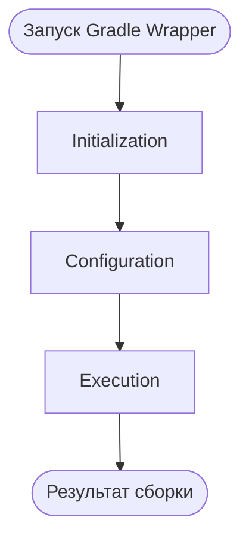
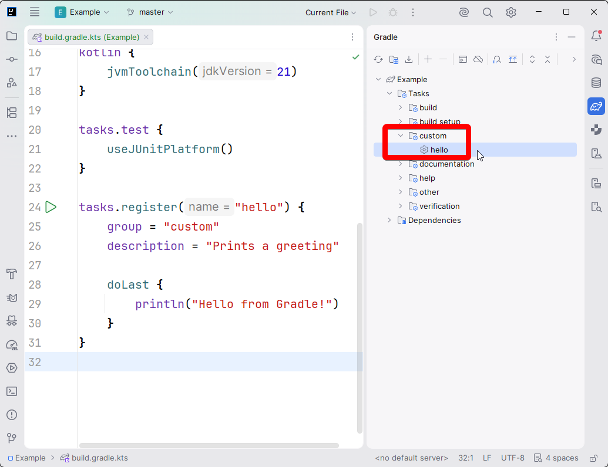
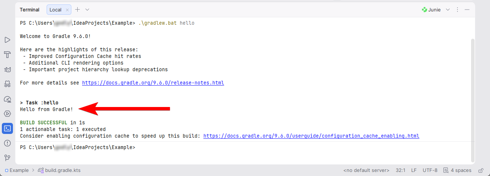
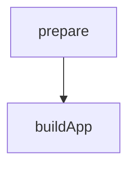
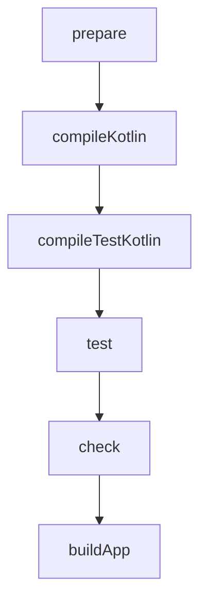

# Теория Gradle III

## Жизненный цикл Gradle

### Что происходит при запуске сборки?

Предположим, мы запускаем команду:

```bash
./gradlew build
```

Что произойдёт после этого?

**Gradle** не начинает немедленно компилировать все файлы проекта. 
Сначала он определяет структуру сборки, читает конфигурацию, формирует 
граф необходимых задач и только затем выполняет их.

Жизненный цикл **Gradle** состоит из трёх основных фаз:

- **Initialization** — инициализация сборки.
- **Configuration** — конфигурация проектов.
- **Execution** — выполнение задач.

Это можно представить следующим образом:



Эти фазы выполняются последовательно. При этом не все зарегистрированные 
задачи обязательно будут выполнены: **Gradle** выбирает задачи, необходимые 
для запрошенной операции, с учётом их зависимостей.

## Фаза 1. Initialization

На этой фазе **Gradle** определяет, какие проекты и сборки участвуют в 
текущем запуске.

В частности, он обрабатывает настройки сборки и определяет корневой проект 
и подключённые подпроекты.

Рассмотрим структуру:


В `settings.gradle.kts`:

```gradle
rootProject.name = "my-project"

include(":app")
include(":core")
```

Благодаря `include()` **Gradle** понимает, что сборка состоит из корневого 
проекта и двух подпроектов: `:app` и `:core`.

Если выполнить:

```bash
./gradlew projects
```

**Gradle** выведет структуру проектов, участвующих в сборке.

Главная задача **Initialization** — определить структуру сборки.

## Фаза 2. Configuration

На этой фазе **Gradle** читает скрипты сборки и настраивает участвующие проекты.

Например, в `app/build.gradle.kts` может быть следующий код:

```gradle
plugins {
    application
}

application {
    mainClass.set("org.example.MainKt")
}
```

Здесь подключается плагин `application` и задаётся класс, с которого можно 
запустить приложение.

**Gradle** также находит и настраивает задачи, предоставленные подключёнными 
плагинами и объявленные разработчиком. На основании связей между задачами 
формируется граф выполнения.

Рассмотрим простой пример:

```gradle
tasks.register("hello") {
    doLast {
        println("Hello from Gradle!")
    }
}
```

На первый взгляд может показаться, что текст сразу появится в консоли при 
запуске любой команды **Gradle**. Но это не так.

При конфигурации **Gradle** регистрирует задачу `hello` и определяет её действие. 
Само действие внутри `doLast` выполняется, когда задача действительно запускается.

Проверить это можно командой:

```bash
./gradlew hello
```

В результате будет выведено:

```text
Hello from Gradle!
```

Главная задача **Configuration** — настроить проекты и определить, какие задачи 
потребуются для сборки.

## Фаза 3. Execution

На этой фазе **Gradle** выполняет задачи, выбранные для текущего запуска.

Например:

```bash
./gradlew test
```

**Gradle** определит задачи, необходимые для запуска тестов, и выполнит их в 
установленном порядке. В **Kotlin/JVM**-проекте это могут быть компиляция тестового 
кода, подготовка ресурсов, запуск тестов и другие операции.

Точный набор задач зависит от подключённых плагинов и конфигурации проекта.

При этом **Gradle** не обязан выполнять все доступные задачи. Если задача не нужна 
для запрошенной операции и не является её зависимостью, она обычно не запускается.

Например, команда:

```bash
./gradlew clean
```

сама по себе не означает, что приложение будет скомпилировано заново. 
Она запускает задачу очистки.

Главная задача **Execution** — выполнить необходимые задачи с учётом зависимостей 
и условий их выполнения.

## Как определить, на какой фазе выполняется код?

Это особенно полезно для понимания **Gradle DSL** и диагностики ошибок.

Рассмотрим пример:

```gradle
println("Configuration script")

tasks.register("example") {
    println("Task configuration")

    doLast {
        println("Task execution")
    }
}
```

При запуске:

```bash
./gradlew example
```

в обычном случае вывод будет таким:

```text
Configuration script
Task configuration
Task execution
```

Первые две строки выводятся во время конфигурации, а последняя — при выполнении задачи.

Если запустить другую задачу, например `help`, скрипт сборки всё равно может быть 
сконфигурирован, поэтому первые две строки могут появиться. Но действие `doLast` у 
`example` не будет выполнено.

Это демонстрирует важное различие между конфигурацией задачи и выполнением её действий.

На практике не следует размещать тяжёлые операции или обычную логику приложения 
непосредственно на верхнем уровне `build.gradle.kts`. 
Такие действия лучше выполнять в соответствующих задачах или плагинах.

## Создание собственной задачи

Создадим простую задачу:

```gradle
tasks.register("hello") {
    group = "custom"
    description = "Prints a greeting"

    doLast {
        println("Hello from Gradle!")
    }
}
```

Разберём код.

- `tasks.register("hello")` регистрирует задачу с именем `hello`.
- `group` задаёт её группу для отображения в списках задач.
- `description` содержит краткое описание задачи.
- `doLast` добавляет действие, которое выполняется при запуске задачи.

Теперь команду можно запустить:

```bash
./gradlew hello
```

Обрати внимание на название метода `register`. Он поддерживает отложенную конфигурацию: 
**Gradle** не обязан немедленно создавать и полностью конфигурировать объект задачи только 
ради её регистрации.

В современных скриптах обычно предпочитают `tasks.register()` и `tasks.named()`, когда это 
уместно, вместо старых подходов с безусловным немедленным созданием и конфигурированием задач.

После синхронизации изменений в **IntelliJ IDEA**, задача `hello` появилась в группе `custom`:



И её можно запустить двойным нажатием, либо написав в терминале:

```bash
./gradlew hello
```

Вывод:



## Зависимости между задачами

Задачи редко существуют изолированно.

Например, прежде чем упаковать приложение, может потребоваться скомпилировать код. 
Перед выполнением некоторых проверок нужно подготовить исходные данные.

Связи между задачами позволяют **Gradle** определить необходимый порядок работы.

Создадим две задачи:

```gradle
tasks.register("prepare") {
    doLast {
        println("Preparing project")
    }
}

tasks.register("buildApp") {
dependsOn("prepare")
    doLast {
        println("Building application")
    }
}
```

Здесь:

```gradle
dependsOn("prepare")
```

указывает, что задача `buildApp` зависит от задачи `prepare`.

Если выполнить:

```bash
./gradlew buildApp
```

результат будет следующим:

```text
Preparing project
Building application
```

**Gradle** сначала выполнит `prepare`, затем `buildApp`.

Схематично это выглядит так:



> Обратите внимание: `dependsOn()` не означает, что одна задача буквально запускает 
> другую из своего тела. Вместо этого **Gradle** учитывает объявленную связь 
> при построении графа задач.

## Граф задач

Когда задач становится много, их связи удобнее представлять в виде графа.

Например, условная сборка может выглядеть так:



Это упрощённая схема. В реальном проекте граф обычно сложнее: несколько задач 
могут выполняться независимо, а некоторые операции могут иметь несколько зависимостей.

**Граф задач** — модель связей между задачами, по которой **Gradle** определяет порядок 
выполнения необходимых операций.

Для одной сборки граф включает задачи разных проектов, если между ними существуют 
необходимые связи.

В **Gradle** используется ориентированный ациклический граф (**DAG**). Это означает, 
что связи между задачами задают направление, а циклическая цепочка зависимостей задач не допускается.

## dependsOn, mustRunAfter и finalizedBy

Эти механизмы похожи по назначению, но решают разные задачи.

### dependsOn

Означает, что для выполнения одной задачи **Gradle** должен также выполнить другую задачу, 
если она ещё не выполнена в рамках текущего графа.

```gradle
tasks.register("report") {
    dependsOn("test")
}
```

При запуске `report` **Gradle** также запустит `test`.

### mustRunAfter

Задаёт порядок выполнения задач, если обе задачи уже участвуют в текущем графе. 
Сам по себе этот механизм не добавляет другую задачу в граф.

```gradle
tasks.named("report") {
    mustRunAfter("test")
}
```

Если и `test`, и `report` выбраны для выполнения, **Gradle** поставит `report` после `test`. 
Но запуск только `report` не обязан запускать `test`.

### finalizedBy

Позволяет указать задачу, которая будет запускаться после другой задачи в качестве 
завершающей операции.

```gradle
tasks.register("cleanup") {
    doLast {
        println("Cleaning temporary data")
    }
}

tasks.register("generateReport") {
    doLast {
        println("Generating report")
    }

    finalizedBy("cleanup")
}
```

При запуске `generateReport` **Gradle** также запланирует `cleanup` как завершающую задачу.

Такой механизм может применяться для очистки временных ресурсов или других завершающих 
операций. Однако конкретную логику очистки в реальных проектах нужно проектировать с 
учётом ошибок и прерываний сборки.

| Механизм       | Назначение                                  |
|----------------|---------------------------------------------|
| `dependsOn`    | Добавляет обязательную задачу-зависимость   |
| `mustRunAfter` | Задаёт порядок двух задач, если обе выбраны |
| `finalizedBy`  | Назначает завершающую задачу                |

## Почему Gradle может пропускать задачи?

При повторной сборке можно увидеть сообщения:
- `UP-TO-DATE`
- `FROM-CACHE`
- `NO-SOURCE`
- `SKIPPED`

Они обозначают разные причины, по которым задача не выполняется обычным способом.

- `UP-TO-DATE` означает, что **Gradle** считает результаты задачи актуальными и 
повторно выполнять её не нужно.
- `FROM-CACHE` означает, что результаты задачи были получены из кэша сборки.
- `NO-SOURCE` означает, что для задачи нет необходимых исходных файлов.
- `SKIPPED` указывает, что задача была пропущена в соответствии с условиями 
выполнения или другой логикой сборки.

Это одна из причин, почему повторная сборка может выполняться значительно быстрее первой.

Важно не путать кэширование результатов задач с **Configuration Cache**. 
Первый механизм позволяет использовать сохранённые результаты задач, 
а второй — повторно использовать состояние конфигурации сборки при выполнении соответствующих условий.

## Version Catalogs — централизованное управление версиями

### Зачем нужен Version Catalog?

Предположим, в проекте несколько модулей:


Все три модуля используют одну и ту же библиотеку. Если каждый модуль хранит её 
координаты и версию в собственном файле `build.gradle.kts`, обновлять проект становится неудобно.

Например:

```gradle
dependencies {
    implementation("com.google.guava:guava:33.4.0-jre")
}
```

Если одна и та же версия указана в нескольких местах, легко допустить расхождения.

Для решения этой задачи **Gradle** поддерживает **Version Catalogs** — каталоги версий, 
которые позволяют хранить координаты библиотек, версии и алиасы плагинов централизованно.

По умолчанию каталог размещается здесь:


### Структура libs.versions.toml

Рассмотрим пример:

```toml
[versions]
kotlin = "2.4.21"
junit = "5.12.2"
guava = "33.4.0-jre"

[libraries]
guava = {
    module = "com.google.guava:guava",
    version.ref = "guava"
}

junit-jupiter = {
    module = "org.junit.jupiter:junit-jupiter",
    version.ref = "junit"
}

[plugins]
kotlin-jvm = {
    id = "org.jetbrains.kotlin.jvm",
    version.ref = "kotlin"
}
```

Здесь используются три основных раздела:
- `[versions]` — версии, на которые можно ссылаться по имени;
- `[libraries]` — координаты библиотек;
- `[plugins]` — идентификаторы и версии Gradle-плагинов.

При необходимости можно добавить раздел `[bundles]`, чтобы сгруппировать набор библиотек.

Примерные версии в этом блоке приведены для демонстрации механизма. 
При использовании в реальном проекте необходимо учитывать совместимость 
версий **Kotlin**, **Gradle**, **JDK** и библиотек.

### Подключение зависимости через каталог версий

Без **Version Catalog**:

```gradle
dependencies {
    implementation("com.google.guava:guava:33.4.0-jre")
}
```

С **Version Catalog**:

```gradle
dependencies {
    implementation(libs.guava)
}
```

**Gradle** создаёт типобезопасные аксессоры для элементов каталога. 
Благодаря этому **IDE** может предлагать варианты автодополнения, а некоторые 
ошибки в именах можно обнаружить раньше.

Например:

```gradle
dependencies {
    implementation(libs.guava)
    testImplementation(libs.junit.jupiter)
}
```

Теперь координаты библиотек не нужно дублировать в каждом модуле.

Если версия **Guava** хранится в `libs.versions.toml`, обновление версии 
выполняется изменением каталога, а не множества скриптов.

### Повторное использование версии

Рассмотрим такую запись:

```toml
[versions]
kotlin = "2.4.21"

[libraries]
kotlin-test = {
    module = "org.jetbrains.kotlin:kotlin-test",
    version.ref = "kotlin"
}
```

`version.ref = "kotlin"` означает, что для зависимости используется версия из 
раздела `[versions]` с ключом `kotlin`.

Это помогает согласованно управлять версиями связанных библиотек.

Однако **Version Catalog** не гарантирует, что **Gradle** обязательно выберет 
указанную версию во всех случаях. Каталог задаёт версии, запрашиваемые зависимостями, 
а окончательное разрешение может учитывать транзитивные зависимости, ограничения 
и другие механизмы управления версиями.

### Bundles — группы зависимостей

Иногда набор библиотек часто подключается вместе. Например, тестовый фреймворк и инструмент для создания mock-объектов.

Для таких случаев предусмотрены `bundles`.

```toml
[versions]
junit = "5.12.2"
mockito = "5.17.0"

[libraries]
junit-jupiter = {
    module = "org.junit.jupiter:junit-jupiter",
    version.ref = "junit"
}

mockito-core = {
    module = "org.mockito:mockito-core",
    version.ref = "mockito"
}

[bundles]
testing = ["junit-jupiter", "mockito-core"]
```

Теперь обе зависимости можно подключить одной строкой:

```gradle
dependencies {
    testImplementation(libs.bundles.testing)
}
```

Такой подход удобен для групп библиотек, которые обычно применяются вместе.

При этом `bundle` не создаёт специальную новую зависимость и не объединяет 
библиотеки в один артефакт. Это просто удобный способ объявить несколько 
зависимостей в одной конфигурации.

### Использование плагинов через Version Catalog

Каталог версий поддерживает не только библиотеки, но и плагины.

В `gradle/libs.versions.toml`:

```toml
[versions]
kotlin = "2.4.21"

[plugins]
kotlin-jvm = {
    id = "org.jetbrains.kotlin.jvm",
    version.ref = "kotlin"
}
```

В `app/build.gradle.kts`:

```gradle
plugins {
    alias(libs.plugins.kotlin.jvm)
    application
}
```

Запись `alias(libs.plugins.kotlin.jvm)` подключает плагин по алиасу из каталога.

В результате версии библиотек и плагинов можно держать в одном месте.
