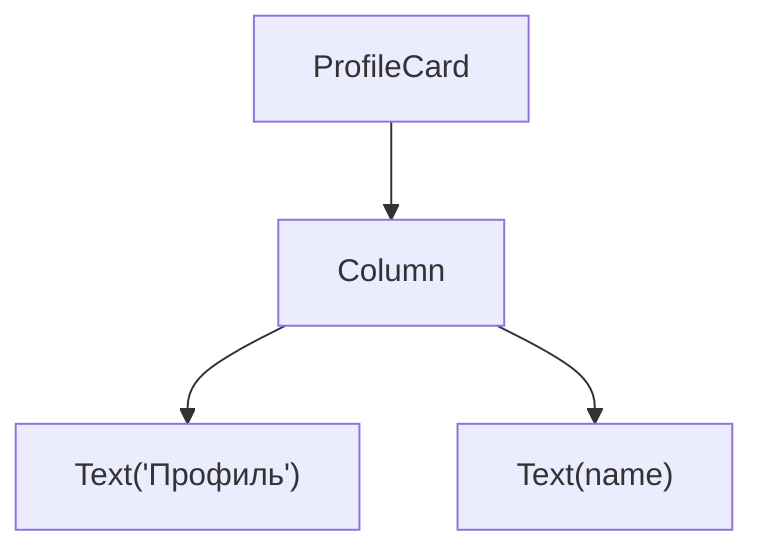
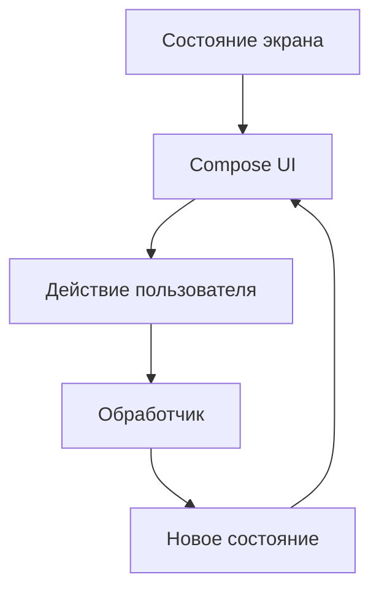
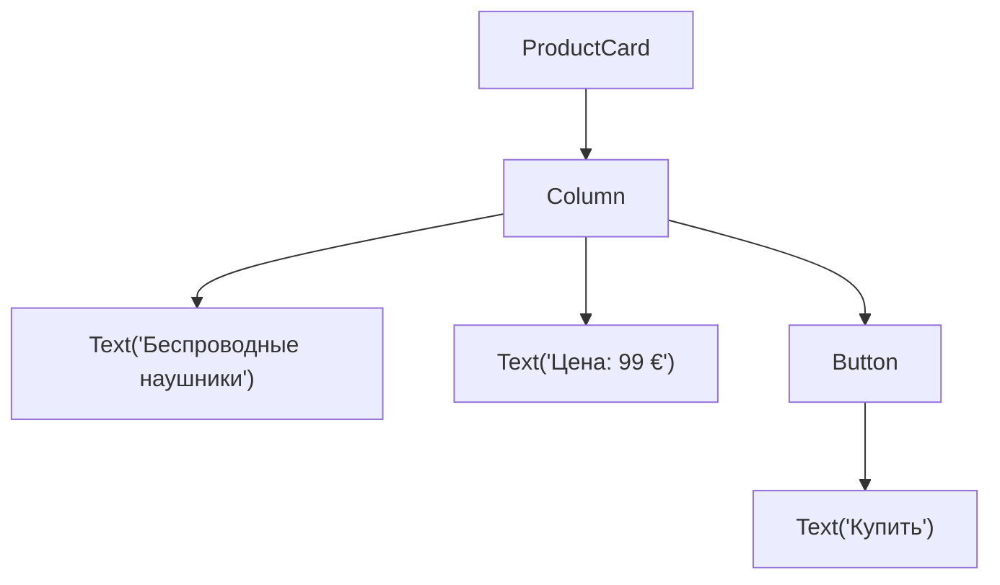

# Глава 1. Модель Jetpack Compose и архитектура интерфейса

**Jetpack Compose** — декларативный инструментарий для построения пользовательских 
интерфейсов Android-приложений.

В основе **Compose** лежат composable-функции. Они описывают, какие элементы 
интерфейса должны отображаться при определённых входных данных и состоянии.

Рассмотрим пример:

```kotlin
@Composable
fun WelcomeMessage(name: String) {
    Text(text = "Привет, $name!")
}
```

Функция `WelcomeMessage` принимает имя и описывает текст, который следует отобразить.

```kotlin
WelcomeMessage(name = "Анна")
```

Результатом будет текст `Привет, Анна!`.

При этом функция не отвечает за непосредственное создание и изменение текстового 
элемента на уровне **Android View System**. Compose самостоятельно управляет 
построением интерфейса и его обновлением.

> **Android View System** — это классический императивный фреймворк пользовательского 
> интерфейса (UI) в операционной системе **Android**, предназначенный для создания и 
> управления визуальными элементами приложений

Аннотация `@Composable` обозначает функцию, которая участвует в композиции **Compose** 
и может описывать интерфейс либо выполнять связанные с ним операции.

Важное ограничение: composable-функция не является обычной Kotlin-функцией, 
которую можно вызывать без учёта правил **Compose**. В частности, composable-функции 
вызываются из других composable-функций либо из соответствующих точек входа, 
предусмотренных **Compose**.

## 1.2. Декларативный подход

В императивной модели разработчик описывает последовательность действий, которая 
приводит интерфейс к необходимому состоянию.

В декларативной модели разработчик описывает, как должен выглядеть интерфейс 
при заданном состоянии.

Удобно выразить основную идею следующим образом:

```text
UI = f(state)
```

где:
- `UI` — пользовательский интерфейс;
- `state` — состояние, определяющее отображение;
- `f` — описание интерфейса в виде composable-функций.

Это концептуальная модель, а не буквальная запись внутреннего алгоритма Compose.

Например, состояние счётчика может быть представлено числом:

```kotlin
@Composable
fun CounterValue(count: Int) {
    Text(text = "Счётчик: $count")
}
```

При `count = 0` отображается `Счётчик: 0`.

При `count = 5` отображается `Счётчик: 5`.

Функция не содержит инструкций о том, как найти ранее созданный текстовый 
элемент и изменить его значение. Она описывает соответствие между состоянием 
и отображением.

При изменении наблюдаемого состояния Compose определяет, какие части 
интерфейса требуется обновить.

## 1.3. Композиция и рекомпозиция

### Композиция

**Композиция** — это структура интерфейса, сформированная при выполнении 
composable-функций.

Например:

```kotlin
@Composable
fun ProfileCard(name: String) {
    Column {
        Text(text = "Профиль")
        Text(text = name)
    }
}
```

Интерфейс содержит вертикальный контейнер и два текстовых элемента.



Вложенные composable-функции позволяют собирать сложные интерфейсы из 
небольших компонентов.

### Рекомпозиция

**Рекомпозиция** — повторное выполнение composable-функций, когда **Compose** 
определяет необходимость обновления интерфейса вследствие изменения наблюдаемого 
состояния или входных данных.

Предположим, на экране отображается значение счётчика. Пользователь нажимает 
кнопку, и значение увеличивается на единицу.

Последовательность следующая:
1. Пользователь нажимает кнопку.
2. Обработчик события инициирует изменение состояния.
3. **Compose** обнаруживает изменение наблюдаемого состояния.
4. Соответствующие composable-функции могут выполняться повторно.
5. Интерфейс отражает новое значение.

Рекомпозиция является штатным механизмом **Compose**, а не ошибкой.

Поэтому composable-функции следует проектировать так, чтобы повторное выполнение 
не приводило к нежелательным побочным эффектам.

Например, не следует выполнять сетевой запрос непосредственно в теле обычной 
composable-функции: такой код может выполняться повторно. Для побочных эффектов 
предусмотрены специальные API **Compose**, которые будут рассмотрены в отдельной главе.

## 1.4. Состояние и события

Для понимания **Compose** необходимо различать состояние интерфейса и события.

### Состояние

Состояние описывает то, что интерфейс должен показать в текущий момент.

Например:
- введённый пользователем текст;
- количество товаров в корзине;
- список полученных сообщений;
- признак загрузки;
- текст ошибки;
- выбранная категория;
- доступность кнопки.

Состояние экрана удобно представлять отдельной неизменяемой моделью:

```kotlin
data class CounterUiState(
    val count: Int = 0
)
```

`CounterUiState` описывает данные, необходимые для отображения счётчика.

По мере развития экрана модель может расширяться:

```kotlin
data class ProfileUiState(
    val name: String = "",
    val isLoading: Boolean = false,
    val errorMessage: String? = null
)
```

Такое представление позволяет явно определить, от каких данных зависит интерфейс.

### События

Событие сообщает о произошедшем действии или изменении, на которое приложение 
должно отреагировать.

Примеры:
- пользователь нажал кнопку;
- пользователь ввёл новый текст;
- пользователь выбрал элемент списка;
- завершилась загрузка данных;
- произошла ошибка запроса.

В **Compose** событие часто представляется лямбда-функцией:

```kotlin
@Composable
fun CounterButton(
    onIncrement: () -> Unit
) {
    Button(onClick = onIncrement) {
        Text("Увеличить")
    }
}
```

Компонент знает, что на кнопку можно нажать, и сообщает об этом через `onIncrement`.

Однако он не определяет, каким образом приложение должно изменять счётчик. 
Такое решение принимает владелец состояния.

Это позволяет повторно использовать компонент в разных местах приложения.

## 1.5. Однонаправленный поток данных

**Однонаправленный поток данных** — UDF (Unidirectional Data Flow) — это подход, при 
котором состояние передаётся в интерфейс в одном направлении, а пользовательские 
действия передаются обратно в виде событий.



В результате интерфейс не изменяет состояние произвольно. Он отображает 
предоставленные данные и сообщает о действиях пользователя.

Это упрощает тестирование, уменьшает количество противоречивых состояний и 
делает поток данных более предсказуемым.

## 1.6. Архитектура MVVM

**MVVM** (`Model` — `View` — `ViewModel`) — архитектурный шаблон, разделяющий представление, 
состояние и логику взаимодействия с данными.

В контексте нашего учебника роли будут следующими.

### View — представление

В **Compose** роль представления выполняют composable-функции.

Их задача — отобразить переданное состояние и сообщить о пользовательских действиях.

Представление по возможности не должно самостоятельно выполнять бизнес-операции, 
обращаться к базе данных или управлять сетевыми запросами.

### ViewModel — состояние и логика экрана

`ViewModel` выступает посредником между UI и остальной частью приложения.

Она может:
- хранить и предоставлять состояние экрана;
- обрабатывать события пользователя;
- выполнять или координировать асинхронные операции;
- обращаться к репозиториям;
- преобразовывать полученные данные в состояние, необходимое интерфейсу.

Для реактивного предоставления состояния в наших примерах будет использоваться `StateFlow`.

### Model — данные и правила предметной области

Термин **Model** в **MVVM** может использоваться по-разному. В методичке мы 
будем явно разделять:
- **Domain** — модели предметной области и бизнес-правила;
- **Data** — получение, хранение и преобразование данных;
- **Repository** — абстракцию доступа к данным.

Репозиторий может получать данные из сети, базы данных или другого источника. 
`ViewModel` не обязана знать детали реализации каждого источника.

В небольшой программе дополнительные слои могут быть избыточны. Мы будем вводить их тогда, 
когда они помогают разделить ответственность и подготовить приложение к расширению.

## 1.7. Пример: счётчик на Compose и MVVM

Рассмотрим небольшой пример, объединяющий рассмотренные концепции.

### Шаг 1. Описываем состояние

```kotlin
data class CounterUiState(
    val count: Int = 0
)
```

Модель содержит единственное значение — текущий счётчик.

### Шаг 2. Создаём ViewModel

```kotlin
class CounterViewModel : ViewModel() {

    private val _uiState = MutableStateFlow(
        CounterUiState()
    )

    val uiState: StateFlow<CounterUiState> =
        _uiState.asStateFlow()

    fun onIncrementClicked() {
        _uiState.update { currentState ->
            currentState.copy(
                count = currentState.count + 1
            )
        }
    }
}
```

Разберём основные части.
- `_uiState` — внутреннее изменяемое состояние. Менять его может `ViewModel`.
- `uiState` — открытое для чтения состояние, предоставляемое через `StateFlow`.
- `onIncrementClicked()` — обработчик события нажатия на кнопку.
- `update` создаёт новое значение состояния на основе текущего. 
Благодаря этому обновление оформлено явно, а само состояние представлено неизменяемым объектом.

Для данного примера потребуются импорты `ViewModel`, `MutableStateFlow`, `StateFlow`, 
`asStateFlow` и `update`. Подключение зависимостей зависит от используемой конфигурации проекта.

> [!NOTE] В **Kotlin 2.3.0** появились **Explicit Backing Fields** (явные поля поддержки) 
> — это экспериментальная возможность, которая позволяет явно объявлять скрытое поле (backing field) 
> прямо внутри объявления свойства.
>
> Например, вместо:
> ```kotlin
> private val _uiState = MutableStateFlow(CounterUiState())
> val uiState: StateFlow<CounterUiState> = _uiState.asStateFlow()
> ```
>
> Можно просто использовать:
> ```kotlin
> val uiState: StateFlow<CounterUiState>
>   field = MutableStateFlow(CounterUiState())
> ```
> 
> И тогда, чтобы обновить значение, используйте:
> ```kotlin
> uiState.value = uiState.value.copy(
>   count = uiState.value.count + 1
> )
> ```
> 
> С версии **Kotlin 2.4.0** — стабильная возможность, доступная автоматически.
> 
> В более ранних версиях, для включения **Explicit Backing Fields** 
> измените `build.gradle.kts`:
> ```gradle
> kotlin {
>    compilerOptions {
>        freeCompilerArgs.add("-Xexplicit-backing-fields")
>    }
>}
> ```


### Шаг 3. Создаём интерфейс

```kotlin
@Composable
fun CounterScreen(
    state: CounterUiState,
    onIncrement: () -> Unit
) {
    Column(
        modifier = Modifier.padding(16.dp)
    ) {
        Text(
            text = "Счётчик: ${state.count}"
        )

        Button(
            onClick = onIncrement
        ) {
            Text("Увеличить")
        }
    }
}
```

Обратите внимание на параметры `CounterScreen`.

Компонент принимает состояние и обработчик события. Он не получает `ViewModel`, 
не знает о репозиториях и не изменяет данные самостоятельно.

Это делает его простым для тестирования и повторного использования.

### Шаг 4. Связываем UI с ViewModel

Для Android-экрана можно использовать composable-функцию уровня маршрута:

```kotlin
@Composable
fun CounterRoute(
    viewModel: CounterViewModel = viewModel()
) {
    val uiState by viewModel.uiState.collectAsStateWithLifecycle()

    CounterScreen(
        state = uiState,
        onIncrement = viewModel::onIncrementClicked
    )
}
```

`CounterRoute` связывает жизненный цикл экрана, `ViewModel` и представление.

`collectAsStateWithLifecycle()` собирает `StateFlow` с учётом жизненного цикла 
Android UI и предоставляет его значение в форме состояния **Compose**.

Когда `ViewModel` публикует обновлённый `uiState`, **Compose** обновляет отображение.

В этом примере используются Android-интеграция `ViewModel` и lifecycle-aware сбор состояния. 
Полный код требует соответствующих зависимостей и импортов.

Что происходит после нажатия
1. Пользователь нажимает кнопку в `CounterScreen`.
2. Вызывается `onIncrement`.
3. Управление передаётся в `CounterViewModel.onIncrementClicked()`.
4. `ViewModel` публикует новое состояние через `StateFlow`.
5. `CounterRoute` получает обновлённое значение.
6. `CounterScreen` отображает новое число.

Так реализуется связь **Compose**, **MVVM** и однонаправленного потока данных.

## 1.8. Подготовка архитектуры к Compose Multiplatform

**Compose Multiplatform** позволяет использовать общий **Compose** UI-код на нескольких платформах, 
включая Android, iOS и desktop. **Kotlin Multiplatform**, в свою очередь, позволяет разделять между 
платформами не только UI, но и бизнес-логику, модели и слой данных.

Поэтому уже в Android-примерах мы будем придерживаться следующих правил.

### Правило 1. Отделяем представление от Android-интеграции

Компонент:

```kotlin
@Composable
fun CounterScreen(
    state: CounterUiState,
    onIncrement: () -> Unit
)
```

не использует `Activity`, `Context` или Android-ресурсы. Его проще перенести в общий 
**Compose Multiplatform**-код.

При этом `CounterRoute`, которая получает `ViewModel` и собирает состояние с учётом Android 
`lifecycle`, может потребовать платформенной интеграции или замены на соответствующую 
multiplatform-реализацию.

### Правило 2. Не помещаем бизнес-логику в UI

Composable-функция должна заниматься представлением данных и передачей пользовательских событий.

Бизнес-правила и работа с данными будут размещаться отдельно. Это позволяет повторно 
использовать их независимо от конкретного интерфейсного фреймворка.

### Правило 3. Определяем границы платформенного кода

Некоторые возможности зависят от платформы: доступ к системным сервисам, разрешения, 
файловая система, интеграции с уведомлениями и другие API.

Такой код следует отделять от общей логики. При переходе к **Kotlin Multiplatform** его 
можно будет реализовать с помощью платформенных модулей или абстракций.

### Правило 4. Не предполагаем, что каждая Android-библиотека переносима

Наличие поддержки **Kotlin** само по себе не означает, что библиотека доступна на iOS 
или других платформах.

Для зависимостей общего кода необходимо отдельно проверять поддержку нужных `targets`. 
То же касается навигации, внедрения зависимостей, ресурсов и API жизненного цикла.

### Правило 5. Различаем архитектурный принцип и конкретную реализацию

**MVVM** — архитектурный подход, а `ViewModel`, `StateFlow` и конкретный способ сбора 
состояния — инструменты его реализации.

На Android мы начнём с привычной интеграции `ViewModel`. При переходе к **Compose 
Multiplatform** отдельно рассмотрим multiplatform-совместимую реализацию `ViewModel` и 
правила использования общего кода.

Это позволит изучить архитектурные принципы до появления платформенных деталей.

## 1.9. Типичные ошибки

### Ошибка 1. Изменять интерфейс напрямую, минуя состояние.

В декларативном UI отображение должно следовать за состоянием. Поэтому источником обновления 
служит изменение наблюдаемых данных, а не произвольная попытка вручную обновить существующий UI-элемент.

### Ошибка 2. Передавать ViewModel каждому дочернему компоненту.

Обычно `ViewModel` связывается с экраном на уровне маршрута, а вложенные composable-функции 
получают необходимые данные и обработчики через параметры.

### Ошибка 3. Считать все данные состоянием UI.

Данные предметной области, состояние экрана и локальное состояние компонента имеют разное 
назначение. Не следует автоматически хранить всё в одном объекте или одной `ViewModel`.

### Ошибка 4. Выполнять побочные эффекты при каждой рекомпозиции.

Сетевые запросы, подписки и другие операции должны выполняться в подходящих для них точках 
жизненного цикла или в соответствующих механизмах эффектов.

### Ошибка 5. Считать любой код на Kotlin пригодным для общего модуля.

Код может зависеть от Android API или платформенной библиотеки. При проектировании общего 
кода необходимо следить за зависимостями и границами модулей.

# Глава 2. Composable-функции, композиция и рекомпозиция

## 2.1. Устройство composable-функции

В предыдущей главе мы познакомились с декларативной моделью: интерфейс описывается на 
основе входных данных и состояния.

Теперь рассмотрим, как организовывать сами composable-функции.

Начнём с простого компонента:

```kotlin
@Composable
fun UserGreeting(name: String) {
    Text(
        text = "Привет, $name!"
    )
}
```

У него есть три основные характеристики:
- Функция принимает входные данные — `name`.
- Функция описывает интерфейс с помощью `Text`.
- Функция не определяет, откуда получено имя и как оно изменяется.

Последний пункт особенно важен.

Компонент не должен знать, загружено ли имя с сервера, получено ли оно из базы данных или 
введено пользователем. Для него это просто входное значение.

Например, такой компонент можно использовать на разных экранах:

```kotlin
@Composable
fun ProfileHeader(userName: String) {
    UserGreeting(name = userName)
}

@Composable
fun WelcomeScreen(userName: String) {
    Column {
        Text("Добро пожаловать!")

        UserGreeting(name = userName)
    }
}
```

Обе функции используют один компонент, но определяют собственную структуру интерфейса.

### Почему composable-функции удобно делать небольшими

Представим экран профиля, который содержит заголовок, аватар, имя пользователя, описание 
и кнопку редактирования.

Можно описать весь экран одной большой функцией. Однако по мере усложнения интерфейса 
читать и сопровождать такой код станет труднее.

Вместо этого выделим отдельные компоненты:

```kotlin
@Composable
fun ProfileScreen(
    state: ProfileUiState,
    onEditClick: () -> Unit
) {
    Column {
        ProfileHeader(
            name = state.name
        )

        ProfileDescription(
            description = state.description
        )

        Button(
            onClick = onEditClick
        ) {
            Text("Редактировать")
        }
    }
}
```

Здесь `ProfileScreen` отвечает за структуру экрана, а отдельные компоненты — за представление 
конкретных частей.

Такой подход даёт несколько преимуществ:
- компоненты легче читать;
- повторяющиеся элементы можно переиспользовать;
- UI проще тестировать;
- изменения в одном компоненте меньше затрагивают остальные;
- проще отделить общий **Compose** UI от Android-специфичной интеграции.

Не стоит, однако, создавать отдельную функцию для каждой строки кода. Компонент имеет смысл 
выделять, когда у него есть самостоятельная ответственность, полезная граница повторного 
использования или собственная логика представления.

## 2.2. Правила вызова composable-функций

Composable-функции участвуют в специальном механизме выполнения **Compose**.

Например, из одной composable-функции можно вызвать другую:

```kotlin
@Composable
fun ProfileTitle(name: String) {
    Text(text = name)
}

@Composable
fun ProfileSection(name: String) {
    Column {
        ProfileTitle(name = name)
    }
}
```

В данном случае `ProfileSection` вызывает `ProfileTitle`, а `ProfileTitle` описывает текстовый элемент.

Но composable-функцию нельзя произвольно вызывать из любой обычной функции или обработчика события.

Рассмотрим ошибочную идею:

```kotlin
@Composable
fun ExampleScreen() {
    Button(
        onClick = {
            // Здесь нельзя напрямую вызывать
            // composable-функцию Text.
        }
    ) {
        Text("Нажми меня")
    }
}
```

Лямбда `onClick` предназначена для обработки события. Она не является composable-контекстом, 
поэтому внутри неё нельзя напрямую описывать новый UI с помощью `Text()`.

**Правильный подход** — обработать событие, изменить состояние или передать действие дальше, а 
отображение оставить composable-функциям.

Например:

```kotlin
@Composable
fun ExampleScreen(
    isMessageVisible: Boolean,
    onShowMessage: () -> Unit
) {
    Column {
        Button(
            onClick = onShowMessage
        ) { 
            Text("Показать сообщение")
        }

        if (isMessageVisible) {
            Text("Сообщение отображено")
        }
    }
}
```

Здесь обработчик сообщает о нажатии, а наличие сообщения определяется значением `isMessageVisible`.

Состояние и обработку события мы подробнее разберём в следующих главах.

## 2.3. Параметры composable-функций

Параметры определяют, какие данные компонент получает извне.

При разработке повторно используемых UI-компонентов полезно придерживаться следующих принципов:
- передавать только те данные, которые действительно нужны компоненту;
- не передавать целую `ViewModel`, если достаточно нескольких значений и обработчиков;
- по возможности использовать неизменяемые модели;
- передавать пользовательские действия в виде функций обратного вызова;
- не связывать универсальные UI-компоненты с Android-контекстом без необходимости.

Например, компонент строки пользователя:

```kotlin
data class UserUiModel(
    val id: String,
    val name: String,
    val isOnline: Boolean
)

@Composable
fun UserRow(
    user: UserUiModel,
    onClick: () -> Unit
) {
    Row {
        Column {
            Text(user.name)

            Text(
                text = if (user.isOnline) {
                    "В сети"
                } else {
                    "Не в сети"
                }
            )
        }

        Button(
            onClick = onClick
        ) {
            Text("Открыть")
        }
    }
}
```

Компонент знает о пользователе ровно столько, сколько необходимо для отображения строки.

Он не обязан знать, как выполняется переход на экран профиля. Это решает вызывающая сторона.

Такой компонент можно использовать в Android-приложении и, при наличии совместимых зависимостей, 
в общем UI-коде **Compose Multiplatform**.

## Композиция как дерево компонентов

**Compose** формирует структуру интерфейса, которую обычно представляют в виде дерева.

Рассмотрим пример:

```kotlin
@Composable
fun ProductCard() {
    Column {
        Text("Беспроводные наушники")

        Text("Цена: 99 €")

        Button(
            onClick = {}
        ) {
            Text("Купить")
        }
    }
}
```

Дерево будет выглядеть так:



Каждый компонент описывает свою часть интерфейса и может включать другие компоненты.

Когда приложение запускает экран впервые, **Compose** выполняет соответствующие 
composable-функции и создаёт композицию.

В дальнейшем структура может обновляться вследствие изменения состояния и входных данных.

Важно понимать, что композиция — не просто список вызовов функций. **Compose** отслеживает 
идентичность компонентов, их положение в структуре и связи с наблюдаемым состоянием.

Это позволяет определять, какие части интерфейса требуется обновлять.

## 2.5. Жизненный цикл composable-функции

Жизненный цикл экземпляра composable-функции состоит из трёх основных событий:
1. Компонент входит в композицию.
2. Компонент может рекомпозироваться ноль или более раз.
3. Компонент покидает композицию.

Например, рассмотрим условное отображение:

```kotlin
@Composable
fun AccountScreen(
    isAuthorized: Boolean
) {
    Column {
        Text("Аккаунт")

        if (isAuthorized) {
            ProfileContent()
        } else {
            SignInContent()
        }
    }
}
```

Если `isAuthorized` имеет значение `true`, в композиции присутствует `ProfileContent`.

Если значение изменяется на `false`, отображение профиля заменяется формой входа.

В этом случае один компонент выходит из композиции, а другой входит в неё.

Это не то же самое, что изменение текста внутри уже отображаемого компонента.
Изменяется сама структура интерфейса.

### Почему жизненный цикл имеет значение

Некоторые операции связаны не только с данными, но и с присутствием компонента в интерфейсе.

Например:
- подписка на поток данных;
- запуск анимации;
- регистрация обработчика;
- временная операция, необходимая только при отображении конкретного экрана.

Такие операции необходимо правильно связывать с жизненным циклом и отменять, когда это требуется.

Обычное тело composable-функции для управления такими операциями не подходит. 
Для этого в **Compose** существуют API эффектов, которые будут рассмотрены отдельно.

Подробнее о жизненном цикле можно прочитать в 
[официальной документации Android](https://developer.android.com/develop/ui/compose/lifecycle?hl=ru).

## 2.6. Что такое рекомпозиция на практике

**Рекомпозиция** — повторное выполнение composable-функций, необходимых для обновления композиции 
после изменения наблюдаемых данных или других входных параметров.

Рассмотрим следующий пример:

```kotlin
@Composable
fun CounterDisplay(
    count: Int
) {
    Text("Текущее значение: $count")
}
```

Предположим, вызывающая сторона передала сначала `count = 1`, а затем `count = 2`.

При необходимости **Compose** повторно выполнит соответствующую часть UI, и текст сможет 
отобразить новое значение.

При этом рекомпозиция не означает, что всё приложение запускается заново.

**Compose** использует информацию о композиции и наблюдаемом состоянии, чтобы обновлять 
нужные части интерфейса.

Рекомпозиция не обязательно означает видимое изменение

Composable-функция может выполняться повторно, даже если итоговое изображение визуально 
не изменилось.

Например, функция может получить новые входные данные, которые не влияют на конкретный 
текстовый элемент, или быть вызвана в рамках обновления родительского компонента.

Поэтому не следует исходить из предположения, что каждая рекомпозиция обязательно изменяет 
пиксели на экране.

Не следует также считать рекомпозицию проблемой производительности сама по себе. 
Небольшие composable-функции, которые быстро выполняются и не вызывают тяжёлых операций, 
могут рекомпозироваться достаточно часто без заметных проблем.

### Рекомпозиция и другие фазы UI

Обновление интерфейса можно упрощённо рассматривать как несколько отдельных этапов:
- **Composition** — определение структуры UI;
- **Layout** — измерение и размещение элементов;
- **Drawing** — отрисовка элементов.

Это разделение важно для понимания производительности.

Например, изменение некоторых параметров может потребовать повторного размещения или 
отрисовки, не требуя заново выполнять всю композицию.

Следовательно, рекомпозиция, перерасчёт размеров и отрисовка — связанные, но не тождественные процессы.

## 2.7. Почему нельзя выполнять произвольные действия в теле composable-функции

Главное практическое правило этой главы:

Composable-функция должна описывать интерфейс, а не использоваться как место для произвольного 
выполнения бизнес-операций.

Рассмотрим условный пример:

```kotlin
@Composable
fun BadProfileScreen() {
val profile = loadProfileFromNetwork()

    Text(profile.name)
}
```

Такое устройство проблематично, потому что `loadProfileFromNetwork()` находится непосредственно в 
теле функции, которая может выполняться повторно.

В результате сетевой запрос может запускаться больше одного раза, а UI будет напрямую зависеть от 
механизма загрузки данных.

Кроме того, синхронная загрузка может блокировать выполнение кода и приводить к задержкам.

В архитектуре **MVVM** подобные операции следует размещать за пределами UI-компонента — обычно в 
слое данных и соответствующем взаимодействии с `ViewModel`.

Composable-функция получает уже подготовленное состояние:

```kotlin
data class ProfileUiState(
    val name: String = "",
    val isLoading: Boolean = false,
    val errorMessage: String? = null
)
```

После этого она описывает необходимые состояния экрана:

```kotlin
@Composable
fun ProfileContent(
    state: ProfileUiState
) {
    when {
        state.isLoading -> {
            CircularProgressIndicator()
        }

        state.errorMessage != null -> {
            Text(state.errorMessage)
        }

        else -> {
            Text(state.name)
        }
    }
}
```

В этом примере UI не выполняет запросы. Он отображает соответствующую ветку в зависимости 
от предоставленного состояния.

Реализация загрузки, отмены операций и преобразования результата в `ProfileUiState` будет 
рассматриваться в главах об эффектах и **MVVM**.

## 2.8. Идентичность composable-функции

Для **Compose** важно не только то, какую функцию мы вызываем, но и то, где и как она вызывается.

Положение вызова в исходном коде называется **call site** — местом вызова. Оно участвует в 
определении идентичности экземпляра в композиции.

Рассмотрим пример:

```kotlin
@Composable
fun Screen() {
    Column {
        Text("Заголовок")

        UserBadge()

        Text("Подвал")
    }
}
```

В этой структуре вызов `UserBadge()` находится между заголовком и подвалом.

Если другая composable-функция тоже вызывает `UserBadge()`, это будет отдельный экземпляр 
компонента со своим местом в композиции.

Это важно, когда компонент содержит локальное состояние, например введённый текст или 
состояние раскрытия. Вопрос о сохранении такого состояния мы подробно рассмотрим при изучении remember.

### Идентичность в списках

Сложнее становится при отображении динамических коллекций.

Предположим, список содержит пользователей:

```kotlin
data class UserUiModel(
    val id: String,
    val name: String
)
```

Если порядок элементов меняется, **Compose** должен определить, какой экземпляр компонента 
соответствует какому пользователю.

Для коллекций с изменяемым порядком обычно следует задавать стабильные уникальные ключи, 
связанные с идентификаторами элементов.

Например, при использовании `LazyColumn`:

```kotlin
@Composable
fun UserList(
    users: List<UserUiModel>,
    onUserClick: (String) -> Unit
) {
    LazyColumn {
        items(
            items = users,
            key = { user -> user.id }
        ) { user ->
            UserRow(
                user = UserUiModel(
                    id = user.id,
                    name = user.name,
                    isOnline = false
                ),
                onClick = {
                    onUserClick(user.id)
                }
            )
        }
    }
}
```

Этот фрагмент демонстрирует принцип ключей, но для реального проекта модель пользователя 
и `UserRow` целесообразно согласовать так, чтобы не создавать лишние преобразования модели внутри списка.

Главное здесь — `key = { user -> user.id }`.

Ключ должен быть уникальным среди элементов списка. Он помогает **Compose** сохранять связь 
между элементом данных и соответствующим UI при перестановке, добавлении или удалении записей.

Ключ не обязан быть числовым индексом. Напротив, индекс часто оказывается плохим выбором, 
поскольку при изменении порядка он начинает указывать на другой объект.

Это особенно важно для списков, в которых строки содержат собственное состояние или анимации.

## 2.9. Стабильность параметров

Теперь перейдём к одному из важных понятий, связанных с оптимизацией **Compose**.

**Compose** анализирует параметры composable-функций, чтобы определить, может ли она 
быть пропущена при рекомпозиции.

Для этого используется понятие стабильности.

В общих чертах:
- неизменяемый объект гарантирует, что его значения нельзя поменять после создания;
- стабильный тип предоставляет **Compose** необходимые гарантии о сравнении значений и 
- наблюдении за изменениями;
- нестабильный тип не предоставляет таких гарантий в полном объёме.

Стабильность влияет на то, как **Compose** сравнивает параметры и решает, нужно ли повторно 
выполнять функцию.

Пример неизменяемой модели

```kotlin
data class UserUiModel(
    val id: String,
    val name: String,
    val isOnline: Boolean
)
```

Значения всех свойств здесь задаются при создании экземпляра и не переназначаются через `var`.

Такая модель хорошо подходит для передачи состояния в UI.

Если создаётся новый экземпляр с изменённым именем, это явно отражает изменение данных.

Пример изменяемой модели

```kotlin
data class UserUiModel(
    var name: String
)
```

Здесь свойство `name` можно изменить непосредственно у существующего экземпляра.

Если выполнить:

```kotlin
user.name = "Новое имя"
```

**Compose** автоматически не узнает об изменении обычного **Kotlin**-свойства. Оно не является 
наблюдаемым состоянием **Compose**.

Поэтому подобная мутация может привести к тому, что UI не обновится в ожидаемый момент.

Предпочтительнее использовать неизменяемые модели состояния и публиковать новое значение, 
когда данные меняются.

Например:

```kotlin
data class ProfileUiState(
    val name: String
)
```

При изменении имени создаётся новое значение `ProfileUiState`, а не изменяется поле существующего объекта.

Важно учитывать, что `val` само по себе не гарантирует глубокой неизменяемости. 
Если свойство хранит ссылку на изменяемую коллекцию, содержимое этой коллекции всё ещё может меняться.

Поэтому при моделировании состояния нужно учитывать не только модификаторы `val` и `var`, 
но и типы вложенных объектов.

## 2.10. Пропуск рекомпозиции: Skipping

Если **Compose** определяет, что входные значения composable-функции не изменились в соответствии 
с правилами сравнения, она может пропустить повторное выполнение этой функции.

Это называется **skipping**.

Предположим, родительский компонент был рекомпозирован:

```kotlin
@Composable
fun ProfileSection(
    user: UserUiModel
) {
    Column {
        UserName(user.name)

        StaticInformation()
    }
}
```

Если данные `StaticInformation` не зависят от изменившегося состояния, **Compose** при подходящих 
условиях может пропустить повторное выполнение этой функции.

Однако важно не превращать **skipping** в обязательное предположение.

Приложение должно оставаться корректным независимо от того, была ли конкретная composable-функция 
пропущена или повторно выполнена.

### Что сравнивает Compose

Правила зависят от стабильности параметров и настроек компилятора **Compose**.

В современных конфигурациях **Kotlin 2.0.20** и новее режим **Strong Skipping** включён по умолчанию.

При его использовании все подходящие restartable composable-функции становятся пропускаемыми, 
в том числе при нестабильных параметрах. Для стабильных параметров применяется структурное сравнение, 
а для нестабильных — сравнение по идентичности экземпляра.

Это означает, что прежнее упрощённое правило "нестабильный параметр всегда приводит к рекомпозиции" 
для современных конфигураций неверно.

Более того, лишнее создание новых объектов или коллекций может влиять на возможность пропуска 
функции, поэтому важны не только типы, но и характер передачи данных.

Официальная документация подробно описывает режим 
[Strong Skipping](https://developer.android.com/develop/ui/compose/performance/stability/strongskipping?hl=ru).

### 2.11. Нужно ли помечать модели аннотациями @Stable и @Immutable?

**Compose** предоставляет аннотации `@Stable` и `@Immutable`, связанные с контрактами стабильности типов.

Их не следует использовать просто ради попытки ускорить приложение.

`@Immutable` сообщает, что значения объекта и его публичные свойства неизменяемы после создания.

`@Stable` задаёт другой контракт: идентичность и сравнение объекта должны быть предсказуемыми, 
а изменения публичных свойств должны корректно сообщаться **Compose**.

При использовании этих аннотаций разработчик обязан соблюдать соответствующие гарантии.

Если пометить изменяемую модель как `@Immutable`, это не сделает её действительно неизменяемой. 
Такая аннотация может привести к некорректным предположениям компилятора об изменениях данных.

Будем придерживаться следующих рекомендаций:
- Использовать неизменяемые модели состояния.
- Избегать прямой мутации объектов, которые передаются в UI.
- Не добавлять `@Stable` и `@Immutable` без понимания контрактов.
- Сначала измерять и диагностировать проблему производительности, а уже затем оптимизировать стабильность.

Подробности приведены в [официальном руководстве по стабильности **Compose**](https://developer.android.com/develop/ui/compose/performance/stability?hl=ru).

## 2.12. Практические правила написания composable-функций

Подведём итог главы в виде правил, которые будем использовать в дальнейшем.

### Правило 1. Composable-функция описывает интерфейс.

Она может вычислять значения, необходимые для построения UI, но не должна запускать произвольные 
операции с внешними эффектами при каждом выполнении.

### Правило 2. Передавайте данные через параметры.

Это делает зависимости компонента явными и упрощает повторное использование.

### Правило 3. Разделяйте представление и обработку действий.

UI отображает состояние и передаёт события вызывающей стороне.

### Правило 4. Используйте неизменяемые модели состояния.

При изменении данных лучше создавать новое состояние, чем изменять поля существующего объекта.

### Правило 5. Не полагайтесь на определённое число рекомпозиций.

Они могут происходить чаще, чем ожидается, и не обязаны приводить к видимым изменениям.

### Правило 6. Учитывайте идентичность компонентов.

Это особенно важно при условном отображении, работе со списками и использовании локального состояния.

### Правило 7. Не занимайтесь преждевременной оптимизацией.

В первую очередь пишите понятные компоненты. Оптимизацию выполняйте на основе измерений и выявленных узких мест.

### Правило 8. По возможности отделяйте общий UI от платформенных деталей.

Composable-функции, которые принимают состояние и обработчики через параметры и не используют 
платформенные API, проще повторно использовать при переходе к **Compose Multiplatform**.