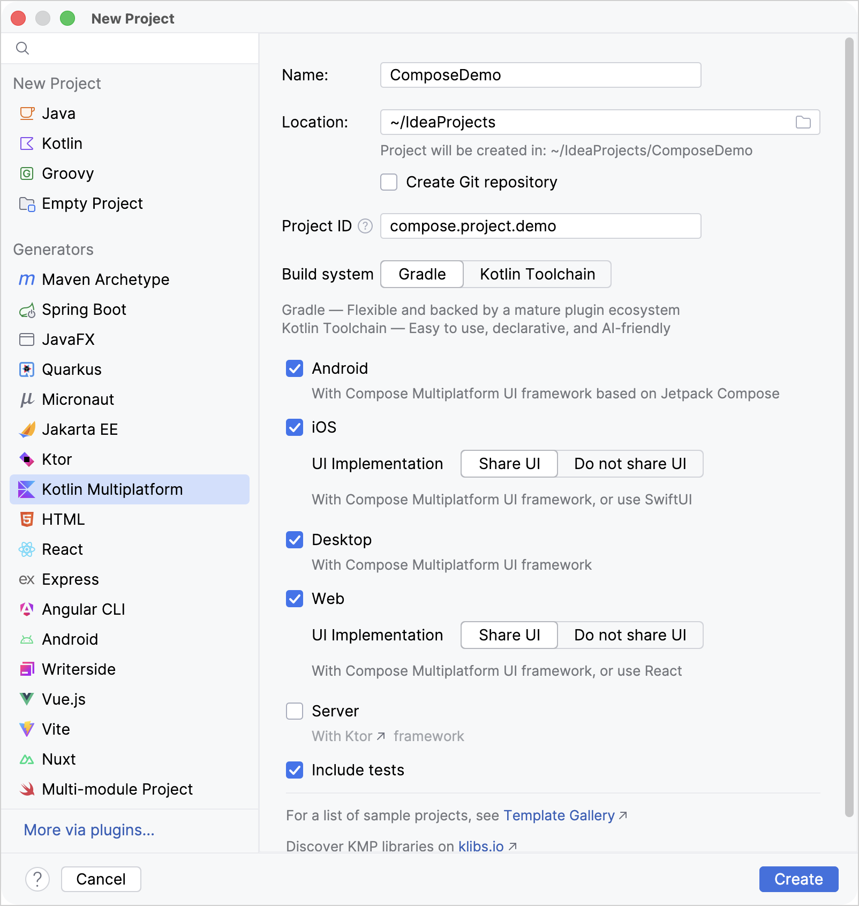
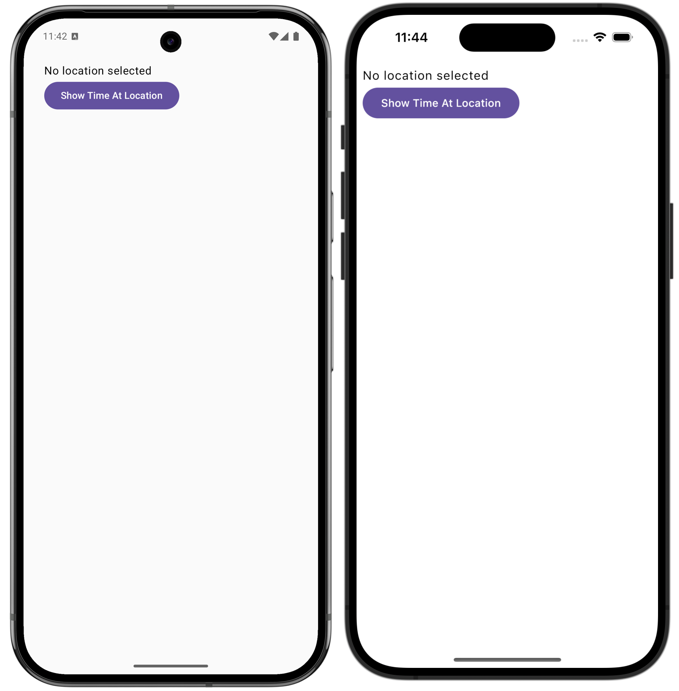

# Kotlin Multiplatform II

В этом руководстве основное внимание уделяется максимально возможному совместному 
использованию кода между платформами: пользовательский интерфейс реализован в общем 
коде с использованием **Compose Multiplatform**, а функциональность основана на 
многоплатформенных библиотеках.

## Создание проекта

После установки **IDE** и плагина **Kotlin Multiplatform IDE** создайте новый проект
**Compose Multiplatform**:

1. В **IntelliJ IDEA** выберите **Файл | Новый | Проект**.
2. На левой панели выберите **Kotlin Multiplatform**.
3. В окне **New Project** укажите следующие поля:
- Имя: `ComposeDemo`
- Идентификатор проекта (используется в качестве имени пакета): `compose.project.demo`
4. Выберите целевые платформы **Android**, **iOS** и **Desktop**. Убедитесь, 
что для **iOS** выбран параметр **Share UI**.
5. После указания всех полей и целевых платформ нажмите **Создать**.



Первый импорт занимает пару минут.

## Реализуйте базовый интерфейс

Сгенерированный проект **Compose Multiplatform** организован в виде модулей приложения, 
специфичных для каждой платформы, и общего модуля пользовательского интерфейса. 
Каждый модуль приложения определяет точку входа, которая вызывает общий 
модуль `App()`.

В этом руководстве все функциональные изменения в общем коде (`shared`) 
пользовательского интерфейса плавно распространяются на все приложения, но вы увидите 
несколько изменений, необходимых для корректной работы платформы.

Для начала реализуйте базовую структуру в общем компоненте `App()`:

1. В папке `shared/src/commonMain/kotlin` откройте файл `compose.project.demo/App.kt` 
и замените реализуемый объект `App()` на новую реализацию:

```kotlin
// @Composable обозначает composable-функцию: функция, которая 
// генерирует элементы пользовательского интерфейса в Compose.
// @Preview обозначает функцию для предпросмотра интерфейса прямо в 
// IDE без необходимости пересборки проекта при изменениях в коде.
@Composable
@Preview
fun App() {
    MaterialTheme {
        var timeAtLocation by remember { mutableStateOf("No location selected") }

        // Объявляет пользовательский интерфейс в виде столбца (Column),
        // содержащего текст (Text) над кнопкой (Button)
        Column(
            // Внесены основные улучшения в компоновку, гарантирующие, 
            // что столбец (Column()) заполняет все доступное пространство, 
            // не перекрывая системные бары (system bars).
            modifier = Modifier
                .safeContentPadding()
                .fillMaxSize(),
        ) {
            // Объявляет объект Text(), который отслеживает состояние timeAtLocation.
            Text(timeAtLocation)
            
            // Объявляет объект Button(), который также отслеживает состояние timeAtLocation.
            // но на данный момент отображает жестко заданное время
            Button(onClick = { timeAtLocation = "13:30" }) {
                Text("Show Time At Location")
            }
        }
    }
}
```

> [!NOTE]
> `remember` API реализует специфичное для **Compose** управление состоянием. Объект состояния 
> оборачивается вызовом `remember()`, который создает состояние один раз и сохраняет его между 
> композициями. Когда значение состояния изменяется, все компонуемые объекты, которые его 
> отслеживают, вызываются повторно и перерисовываются. Это называется **рекомпозицией**.
>
> Более подробное описание мы разберём в следующих лабораторных работах.

2. Запустите приложение на Android и iOS:



При запуске приложения и нажатии кнопки приложение отображает заданное время — 13:30.

3. Запустите desktop приложение с помощью функции **Compose Hot Reload**, 
запустив конфигурацию запуска `desktopApp [hot] 🔥`. 
Приложение работает, но окно слишком большое, и с ним неудобно работать:


Благодаря функции **Compose Hot Reload** вы можете исправить это без полной перезагрузки.

## Используйте Compose Hot Reload

Вы можете исправить проблемы с пользовательским интерфейсом на рабочем столе и 
проверить эффективность исправления без перезапуска приложения:

1. Обновите файл `main.kt` в каталоге настольного приложения `desktopApp/src/` 
следующим образом:

```kotlin
fun main() = application {
    // Задает начальный размер и положение
    // окна на экране
    val state = rememberWindowState(
        size = DpSize(400.dp, 350.dp),
        position = WindowPosition(300.dp, 300.dp)
    )
    // Задает заголовок окна приложения
    // и использует состояние окна, инициализированное выше
    Window(
        title = "Local Time App",
        onCloseRequest = ::exitApplication,
        state = state,
        // Устанавливаем, чтобы окно всегда находилось сверху
        // чтобы упростить отладку пользовательского интерфейса.
        alwaysOnTop = true
    ) {
        App()
    }
}
```

2. Следуйте рекомендациям **IDE** для импорта недостающих символов. 
Для функции `rememberWindowState()` выберите версию `androidx.compose.ui.window`.

3. Чтобы приложение автоматически обновилось, сохраните измененные файлы 
(`⌘ S`/`Ctrl+S`). Окно должно отобразиться:


