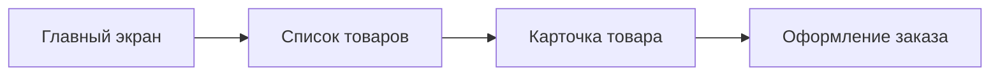
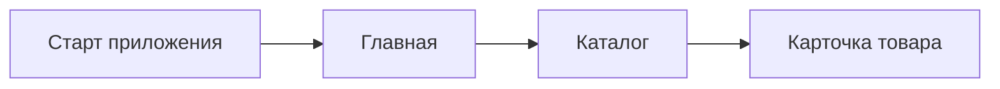
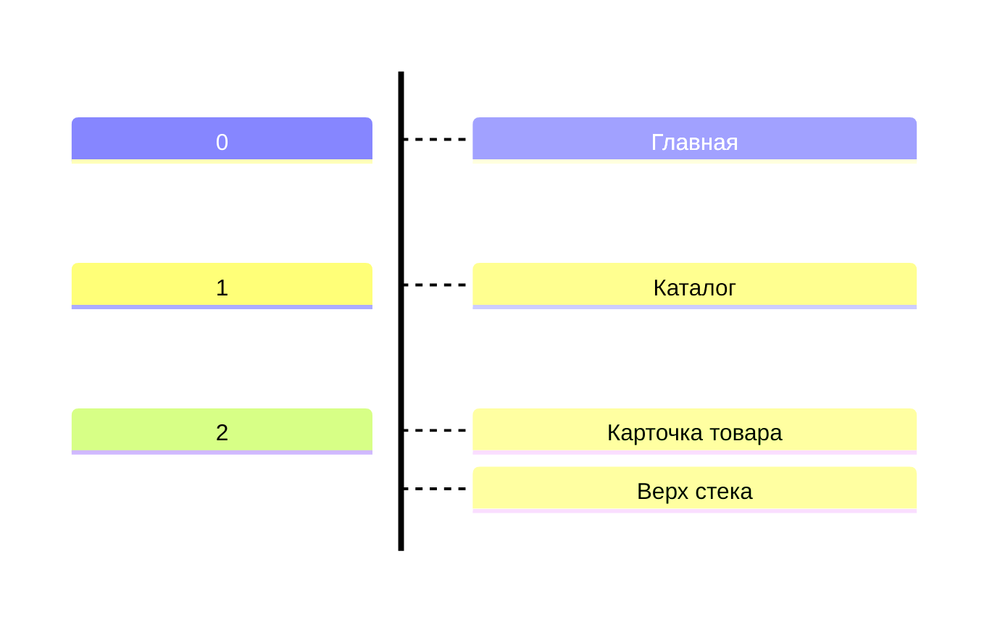
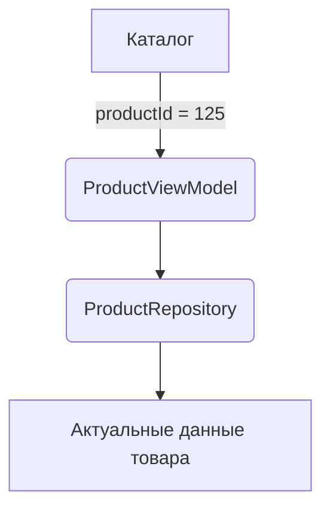

# Глава 7. Списки, навигация и сложные экраны

## 7.1. От обычных контейнеров к спискам

В предыдущих главах мы использовали `Column` и `Row` для размещения компонентов.

Однако существует важная особенность обычных контейнеров.

Рассмотрим:

```kotlin
@Composable
fun UserList(
    users: List<UserUiModel>
) {
    Column {
        users.forEach { user ->
            UserRow(user)
        }
    }
}
```

Если список содержит `10` элементов, **Compose** создаёт соответствующее содержимое для всех `10` элементов.

Если список содержит `10_000` элементов, такой подход становится неоптимальным.

Для больших и динамических списков предусмотрены ленивые контейнеры.

## 7.2. LazyColumn

`LazyColumn` отображает вертикальный список, создавая содержимое элементов по мере необходимости в соответствии с видимой областью.

Пример:

```kotlin
@Composable
fun UserList(
    users: List<UserUiModel>
) {
    LazyColumn {
        items(users) { user ->
            UserRow(user)
        }
    }
}
```

В отличие от обычного `Column`, не требуется заранее создавать UI для всей коллекции.

Это особенно полезно для:

- списка пользователей;
- каталога товаров;
- новостной ленты;
- переписки;
- списка заказов;
- истории операций.

### 7.2.1. items и item

В `LazyColumn` используется специальный DSL `LazyListScope`.

Для одного элемента применяется `item`:

```kotlin
LazyColumn {
    item {
        Text("Заголовок списка")
    }
}
```

Для коллекции используется `items`:

```kotlin
LazyColumn {
    items(users) { user ->
        UserRow(user)
    }
}
```

Можно использовать оба варианта:

```kotlin
LazyColumn {
    item {
        Text("Пользователи")
    }

    items(users) { user ->
        UserRow(user)
    }

    item {
        Text("Конец списка")
    }
}
```

### 7.2.2. keys

В предыдущих главах мы рассматривали идентичность composable-компонентов.

В списках важно задавать стабильные уникальные ключи.

```kotlin
LazyColumn {
    items(
        items = users,
        key = { user -> user.id }
    ) { user ->
        UserRow(user)
    }
}
```

Ключ позволяет Compose связать конкретный UI-элемент с конкретной записью данных.

При перестановке или удалении элементов это помогает корректно сохранять соответствующее состояние компонентов.

Ключи должны быть:

- стабильными;
- уникальными в пределах списка;
- не зависящими от текущей позиции элемента.

Не рекомендуется использовать индекс элемента как ключ, если порядок списка может изменяться.

### 7.2.3. contentType

Если список содержит несколько типов элементов, можно передавать `contentType`.

```kotlin
LazyColumn {
    items(
        items = feedItems,
        key = { it.id },
        contentType = { it.type }
    ) { item ->
        when (item.type) {
            FeedType.ARTICLE -> ArticleItem(item)
            FeedType.ADVERTISEMENT -> AdvertisementItem(item)
            FeedType.HEADER -> HeaderItem(item)
        }
    }
}
```

`contentType` позволяет Lazy Layout повторно использовать композиции между элементами одинаковой структуры.

Например, карточку статьи не стоит переиспользовать как карточку рекламного объявления с совершенно другой структурой.

## 7.3. LazyRow

`LazyRow` работает аналогично `LazyColumn`, но размещает элементы горизонтально.

```kotlin
@Composable
fun CategoryList(
    categories: List<CategoryUiModel>,
    onCategoryClick: (CategoryUiModel) -> Unit
) {
    LazyRow(
        horizontalArrangement = Arrangement.spacedBy(8.dp)
    ) {
        items(
            items = categories,
            key = { it.id }
        ) { category ->
            CategoryChip(
                category = category,
                onClick = {
                    onCategoryClick(category)
                }
            )
        }
    }
}
```

Типичные сценарии:

- список категорий;
- горизонтальная лента изображений;
- подборки товаров;
- фильтры;
- список недавно просмотренных элементов.

## 7.4. LazyVerticalGrid

Для сеток используется `LazyVerticalGrid`.

```kotlin
@Composable
fun ProductGrid(
    products: List<ProductUiModel>
) {
    LazyVerticalGrid(
        columns = GridCells.Fixed(2),
        contentPadding = PaddingValues(16.dp),
        horizontalArrangement = Arrangement.spacedBy(12.dp),
        verticalArrangement = Arrangement.spacedBy(12.dp)
    ) {
        items(
            items = products,
            key = { it.id }
        ) { product ->
            ProductCard(product)
        }
    }
}
```

`GridCells.Fixed(2)` означает две колонки.

Также доступен `GridCells.Adaptive`, который позволяет создавать количество колонок в зависимости от доступной ширины.

```kotlin
LazyVerticalGrid(
    columns = GridCells.Adaptive(
        minSize = 160.dp
    )
) {
    items(products) { product ->
        ProductCard(product)
    }
}
```

Этот вариант удобен для адаптивного каталога.

## 7.5. LazyListState

Для управления прокруткой используется `LazyListState`.

Создаётся он через `rememberLazyListState()`.

```kotlin
@Composable
fun UserList(
    users: List<UserUiModel>
) {
    val listState = rememberLazyListState()

    LazyColumn(
        state = listState
    ) {
        items(users) { user ->
            UserRow(user)
        }
    }
}
```

Объект позволяет получать информацию о прокрутке:

- индекс первого видимого элемента;
- смещение первого видимого элемента;
- состояние прокрутки.

### Прокрутка к элементу

```kotlin
val scope = rememberCoroutineScope()

Button(
    onClick = {
        scope.launch {
            listState.animateScrollToItem(0)
        }
    }
) {
    Text("В начало")
}
```

Для программного перемещения можно использовать:

- `scrollToItem()` — мгновенная прокрутка;
- `animateScrollToItem()` — анимированная прокрутка.

### Сохранение позиции

`rememberLazyListState()` позволяет сохранять состояние прокрутки в рамках механизма сохранения Compose.

При необходимости восстановления после пересоздания экрана используется механизм Saver, встроенный в `rememberLazyListState()`.

## 7.6. Sticky Headers

В группированных списках часто требуется закреплять заголовки секций во время прокрутки.

Для этого используется `stickyHeader`.

```kotlin
@Composable
fun ContactsList(
    groupedContacts: Map<Char, List<ContactUiModel>>
) {
    LazyColumn {
        groupedContacts.forEach { (letter, contacts) ->
            stickyHeader {
                Text(
                    text = letter.toString(),
                    modifier = Modifier
                        .fillMaxWidth()
                        .background(
                            MaterialTheme.colorScheme.surface
                        )
                        .padding(12.dp)
                )
            }

            items(
                items = contacts,
                key = { it.id }
            ) { contact ->
                ContactRow(contact)
            }
        }
    }
}
```

Заголовок соответствующей секции остаётся закреплённым у верхней границы списка, пока его не сменит следующий заголовок.

Это удобно для:

- телефонной книги;
- списка городов;
- истории операций;
- каталога товаров по категориям.

## 7.7. Пагинация

Когда список содержит большое количество записей, загрузка всех элементов одновременно может быть неэффективной.

Для этого используется пагинация.

Пагинация — механизм получения данных небольшими частями.

Например:

1. Пользователь открывает список.
2. Загружается первая страница.
3. Пользователь прокручивает список.
4. Приложение запрашивает следующую страницу.
5. Новые данные добавляются в список.

В **Android** для этого существует **Paging 3** с **Compose**-интеграцией.

Принцип использования:

```kotlin
@Composable
fun MessagesScreen(
    messages: LazyPagingItems<MessageUiModel>
) {
    LazyColumn {
        items(
            count = messages.itemCount,
            key = messages.itemKey {
                it.id
            }
        ) { index ->
            val message = messages[index]

            if (message != null) {
                MessageRow(message)
            } else {
                MessagePlaceholder()
            }
        }
    }
}
```

`LazyPagingItems` предоставляет элементы с учётом текущего состояния загрузки.

В реальном приложении дополнительно нужно обрабатывать:

- состояние первоначальной загрузки;
- ошибки;
- повторные запросы;
- состояние конца списка;
- placeholders;
- refresh и append.

> [!WARNING] Для общего **Compose Multiplatform**-кода необходимо отдельно проверить доступность и совместимость используемой Paging-библиотеки на требуемых платформах. Не следует автоматически считать Android Paging API переносимым целиком.

## 7.8. Навигация между экранами

Большинство приложений состоит из нескольких экранов.

Например:



Для организации переходов используется навигация.

Навигация отвечает за:

- переходы между экранами;
- хранение истории посещения;
- возврат на предыдущий экран;
- передачу аргументов;
- обработку внешних ссылок;
- восстановление навигационного состояния.

## 7.9. Back Stack

**Back Stack** — стек экранов, определяющий историю навигации.

Например:



Стек можно представить так:



При вызове `Back` текущий экран удаляется из стека, после чего отображается предыдущий.

Важно понимать, что **Back Stack** — не просто список composable-функций. Он представляет состояние навигации приложения.

## 7.10. Navigation Compose

Для навигации в **Compose** применяется **Navigation library**.

Принцип работы:

1. Определяются маршруты.
2. Создаётся `NavController`.
3. Создаётся `NavHost`.
4. Для каждого маршрута описывается соответствующий экран.
5. Переходы выполняются через `NavController`.

Простой пример:

```kotlin
@Composable
fun AppNavigation() {
    val navController = rememberNavController()

    NavHost(
        navController = navController,
        startDestination = "home"
    ) {
        composable("home") {
            HomeScreen(
                onOpenCatalog = {
                    navController.navigate("catalog")
                }
            )
        }

        composable("catalog") {
            CatalogScreen(
                onBack = {
                    navController.popBackStack()
                }
            )
        }
    }
}
```

Здесь:

- `NavController` управляет навигацией;
- `NavHost` отображает текущий destination;
- `composable()` связывает маршрут с UI;
- `navigate()` добавляет маршрут в стек;
- `popBackStack()` возвращает пользователя назад.

### 7.10.1. Почему NavController не следует передавать во все компоненты

Плохой подход:

```kotlin
@Composable
fun ProductCard(
    navController: NavHostController,
    product: ProductUiModel
) {
    Button(
        onClick = {
            navController.navigate("product/${product.id}")
        }
    ) {
        Text("Открыть")
    }
}
```

Теперь карточка зависит от конкретной реализации навигации.

Гораздо лучше:

```kotlin
@Composable
fun ProductCard(
    product: ProductUiModel,
    onClick: (String) -> Unit
) {
    Button(
        onClick = {
            onClick(product.id)
        }
    ) {
        Text("Открыть")
    }
}
```

А навигация определяется уровнем выше:

```kotlin
ProductCard(
    product = product,
    onClick = { id ->
        navController.navigate("product/$id")
    }
)
```

Так компоненты становятся независимыми от навигационного механизма.

## 7.11. Передача параметров между экранами

Допустим, необходимо открыть карточку товара и передать его идентификатор.

Маршрут:

```kotlin
composable("product/{productId}") { entry ->
    val productId = entry.arguments
        ?.getString("productId")

    ProductRoute(
        productId = productId.orEmpty()
    )
}
```

Переход:

```kotlin
navController.navigate(
    "product/${product.id}"
)
```

### Почему не стоит передавать целую модель

Вместо передачи всей модели товара обычно лучше передать идентификатор.

Причины:

- меньше данных в навигационном состоянии;
- модель может обновиться;
- экран может самостоятельно получить актуальные данные;
- уменьшается зависимость экранов друг от друга.

Пример:



Такое устройство лучше подходит для **MVVM** и работы с данными.

## 7.12. Навигация и MVVM

Навигацию следует отделять от бизнес-логики.

Экран сообщает о пользовательском действии, а уровень приложения определяет, какой маршрут открыть.

Например:

```kotlin
@Composable
fun LoginScreen(
    onLoginClick: () -> Unit
) {
    Button(
        onClick = onLoginClick
    ) {
        Text("Войти")
    }
}
```

`Route`:

```kotlin
composable("login") {
    LoginScreen(
        onLoginClick = {
            navController.navigate("profile")
        }
    )
}
```

Если переход зависит от результата авторизации, `ViewModel` сначала обрабатывает авторизацию и публикует соответствующее состояние. UI принимает решение о навигации на основании актуального состояния.

Не следует считать навигацию частью бизнес-логики `ViewModel` по умолчанию.

`ViewModel` не должна знать о конкретном `NavController`.

## 7.13. Navigation 3 и Compose Multiplatform

В современном Android-развитии существует **Navigation 3** — более новая библиотека навигации, ориентированная на тесную интеграцию с **Compose** и прямое управление `back stack`.

В отличие от классической модели **Navigation Compose**, **Navigation 3** предоставляет более явную модель стека и механизм отображения его содержимого через `NavDisplay`.

Для Android-проектов стоит рассматривать **Navigation 3** при проектировании новых приложений.

В официальной документации **Compose Multiplatform** описан вариант **Navigation Compose**, подключаемый в `commonMain`:

```kotlin
commonMain.dependencies {
    implementation(
        "org.jetbrains.androidx.navigation:navigation-compose:2.10.0-rc01"
    )
}
```

Версию следует сверять с актуальной документацией на момент разработки.

Таким образом:

- **Android Navigation 3** — отдельный современный вариант для **Android**;
- **Navigation Compose** с multiplatform-поддержкой — вариант для общего кода;
- сама архитектура приложения не должна зависеть от конкретного навигационного API.

В нашем практическом проекте навигационные решения будем изолировать на уровне приложения.

## 7.14. Диалоги и нижние панели

Сложные экраны часто используют дополнительные UI-слои.

### AlertDialog

Диалог подтверждения действия:

```kotlin
@Composable
fun DeleteDialog(
    visible: Boolean,
    onConfirm: () -> Unit,
    onDismiss: () -> Unit
) {
    if (visible) {
        AlertDialog(
            onDismissRequest = onDismiss,
            title = {
                Text("Удалить элемент?")
            },
            text = {
                Text("Это действие нельзя отменить.")
            },
            confirmButton = {
                TextButton(
                    onClick = onConfirm
                ) {
                    Text("Удалить")
                }
            },
            dismissButton = {
                TextButton(
                    onClick = onDismiss
                ) {
                    Text("Отмена")
                }
            }
        )
    }
}
```

### ModalBottomSheet

Нижняя модальная панель:

```kotlin
@OptIn(ExperimentalMaterial3Api::class)
@Composable
fun FilterSheet(
    onDismiss: () -> Unit
) {
    val sheetState = rememberModalBottomSheetState()

    ModalBottomSheet(
        onDismissRequest = onDismiss,
        sheetState = sheetState
    ) {
        Column(
            modifier = Modifier.padding(16.dp)
        ) {
            Text("Фильтры")

            Text("Выберите параметры")
        }
    }
}
```

> [!WARNING] Некоторые **API Material 3** могут оставаться экспериментальными в конкретной версии библиотеки. Аннотацию и статус следует проверять по используемой версии.

### Где хранить состояние диалога

Если диалог отражает UI-решение, например подтверждение удаления, его видимость может храниться в локальном состоянии composable.

Если состояние диалога связано с бизнес-сценарием или должно восстанавливаться, оно может быть частью `UiState`.

Главное — определить владельца состояния осознанно.

## 7.16. Типичные ошибки

1. Использовать `Column` с тысячами элементов вместо `LazyColumn`.
2. Не задавать уникальные ключи для динамических списков.
3. Использовать индекс в качестве ключа, если список меняет порядок.
4. Не использовать `contentType` для разнородных списков, где это помогает повторному использованию.
5. Передавать целые модели через маршруты без необходимости.
6. Передавать `NavController` в каждый UI-компонент.
7. Помещать навигационную логику в репозитории или бизнес-модели.
8. Не обрабатывать пустые состояния и ошибки загрузки.
9. Смешивать состояние диалога с состоянием бизнес-операции.
