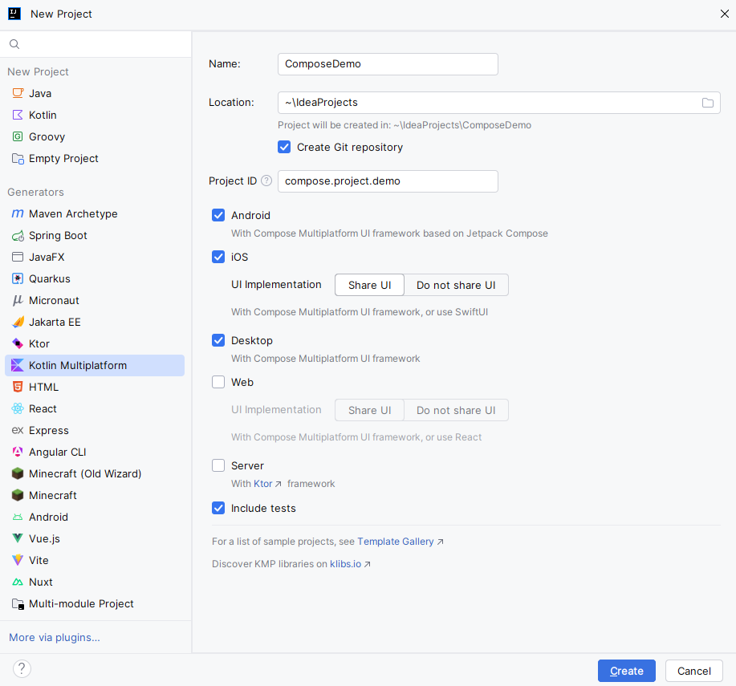
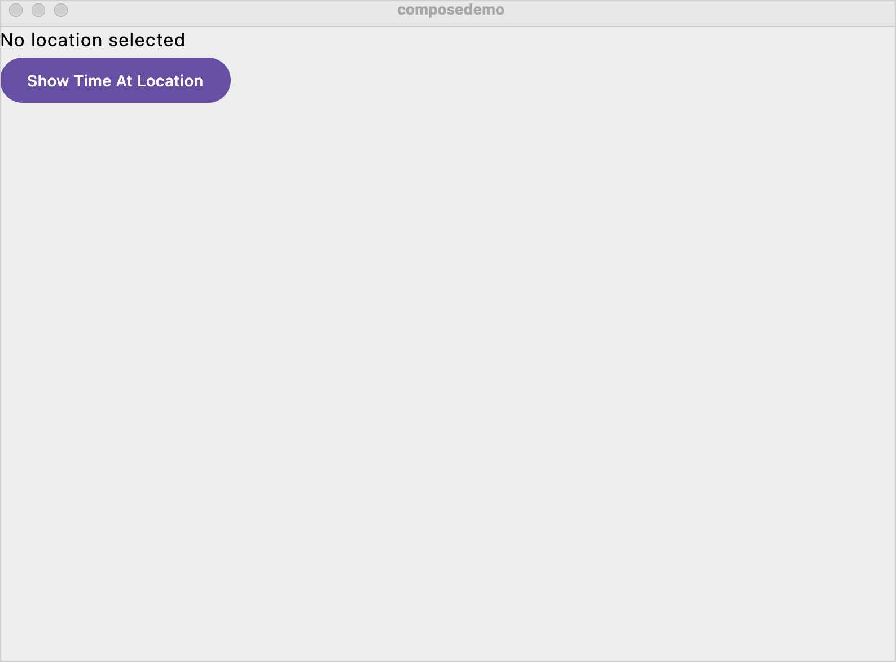

# Создание KMP приложения

В этом руководстве основное внимание уделяется максимально возможному совместному 
использованию кода между платформами: пользовательский интерфейс реализован в общем 
коде с использованием **Compose Multiplatform**, а функциональность основана на 
многоплатформенных библиотеках.

## Создание проекта

После установки **IDE** и плагина **Kotlin Multiplatform IDE** создайте новый проект
**Compose Multiplatform**:

1. В **IntelliJ IDEA** выберите **Файл | Новый | Проект**.
2. На левой панели выберите **Kotlin Multiplatform**.
3. В окне **New Project** укажите следующие поля:
- Имя: `ComposeDemo`
- Идентификатор проекта (используется в качестве имени пакета): `compose.project.demo`
4. Выберите целевые платформы **Android**, **iOS** и **Desktop**. Убедитесь, 
что для **iOS** выбран параметр **Share UI**.
5. После указания всех полей и целевых платформ нажмите **Создать**.



Первый импорт занимает пару минут.

## Реализуйте базовый интерфейс

Сгенерированный проект **Compose Multiplatform** организован в виде модулей приложения, 
специфичных для каждой платформы, и общего модуля пользовательского интерфейса. 
Каждый модуль приложения определяет точку входа, которая вызывает общий 
модуль `App()`.

В этом руководстве все функциональные изменения в общем коде (`shared`) 
пользовательского интерфейса плавно распространяются на все приложения, но вы увидите 
несколько изменений, необходимых для корректной работы платформы.

Для начала реализуйте базовую структуру в общем компоненте `App()`:

1. В папке `shared/src/commonMain/kotlin` откройте файл `compose.project.demo/App.kt` 
и замените реализуемый объект `App()` на новую реализацию:

```kotlin
// @Composable обозначает composable-функцию: функция, которая 
// генерирует элементы пользовательского интерфейса в Compose.
// @Preview обозначает функцию для предпросмотра интерфейса прямо в 
// IDE без необходимости пересборки проекта при изменениях в коде.
@Composable
@Preview
fun App() {
    MaterialTheme {
        var timeAtLocation by remember { mutableStateOf("No location selected") }

        // Объявляет пользовательский интерфейс в виде столбца (Column),
        // содержащего текст (Text) над кнопкой (Button)
        Column(
            // Внесены основные улучшения в компоновку, гарантирующие, 
            // что столбец (Column()) заполняет все доступное пространство, 
            // не перекрывая системные бары (system bars).
            modifier = Modifier
                .safeContentPadding()
                .fillMaxSize(),
        ) {
            // Объявляет объект Text(), который отслеживает состояние timeAtLocation.
            Text(timeAtLocation)
            
            // Объявляет объект Button(), который также отслеживает состояние timeAtLocation.
            // но на данный момент отображает жестко заданное время
            Button(onClick = { timeAtLocation = "13:30" }) {
                Text("Show Time At Location")
            }
        }
    }
}
```

> [!NOTE]
> `remember` API реализует специфичное для **Compose** управление состоянием. Объект состояния 
> оборачивается вызовом `remember()`, который создает состояние один раз и сохраняет его между 
> композициями. Когда значение состояния изменяется, все компонуемые объекты, которые его 
> отслеживают, вызываются повторно и перерисовываются. Это называется **рекомпозицией**.
>
> Более подробное описание мы разберём в следующих лабораторных работах.

2. Запустите приложение на Android и iOS:


При запуске приложения и нажатии кнопки приложение отображает заданное время — 13:30.

3. Запустите desktop приложение с помощью функции **Compose Hot Reload**, 
запустив конфигурацию запуска `desktopApp [hot] 🔥`. 
Приложение работает, но окно слишком большое, и с ним неудобно работать:



Благодаря функции **Compose Hot Reload** вы можете исправить это без полной перезагрузки.

## Используйте Compose Hot Reload

Вы можете исправить проблемы с пользовательским интерфейсом на рабочем столе и 
проверить эффективность исправления без перезапуска приложения:

1. Обновите файл `main.kt` в каталоге настольного приложения `desktopApp/src/` 
следующим образом:

```kotlin
fun main() = application {
    // Задает начальный размер и положение
    // окна на экране
    val state = rememberWindowState(
        size = DpSize(400.dp, 350.dp),
        position = WindowPosition(300.dp, 300.dp)
    )
    // Задает заголовок окна приложения
    // и использует состояние окна, инициализированное выше
    Window(
        title = "Local Time App",
        onCloseRequest = ::exitApplication,
        state = state,
        // Устанавливаем, чтобы окно всегда находилось сверху
        // чтобы упростить отладку пользовательского интерфейса.
        alwaysOnTop = true
    ) {
        App()
    }
}
```

2. Следуйте рекомендациям **IDE** для импорта недостающих символов. 
Для функции `rememberWindowState()` выберите версию `androidx.compose.ui.window`.

3. Чтобы приложение автоматически обновилось, сохраните измененные файлы 
(`⌘ S`/`Ctrl+S`). Окно должно отобразиться:


## Добавьте зависимость kotlinx-datetime

Для работы с часовыми поясами и расчетом времени вы будете использовать классы
`kotlin.time` вместе с многоплатформенной библиотекой `kotlinx-datetime`.

В то время как `kotlin.time` всегда доступен как часть стандартной библиотеки,
`kotlinx-datetime` необходимо явно указать в качестве зависимости.
Это многоплатформенная библиотека, и вы будете использовать ее только в общем коде.
Поэтому вам нужно указать зависимость только один раз.

1. Откройте файл `gradle/libs.versions.toml` и добавьте зависимость `kotlinx-datetime`
в каталог версий:

```toml
[versions]
kotlinx-datetime = "0.8.0"

[libraries]
kotlinx-datetime = { 
    module = "org.jetbrains.kotlinx:kotlinx-datetime", 
    version.ref = "kotlinx-datetime" 
}
```

2. Откройте файл `shared/build.gradle.kts` и добавьте ссылку на запись каталога версий
в конфигурацию набора исходных файлов `commonMain`.

```gradle
kotlin {
    // ...
    sourceSets {
        commonMain.dependencies {
            // ...
            implementation(libs.kotlinx.datetime)
        }
    }
}
```

3. Синхронизируйте **Gradle**, чтобы обновить зависимости.

## Выбор временной зоны

Для простоты вам не придётся реализовывать сложную логику для указания и проверки часовых 
поясов. Приложение предложит на выбор несколько стран и отобразит время в столице 
выбранной страны:

1. В `shared/src/commonMain/kotlin` откройте файл `compose.project.demo/App.kt` и добавьте 
класс данных для хранения информации о странах перед составным объектом `App()`:

```kotlin
// Представление часовых поясов для данного примера
data class Country(val name: String, val zone: TimeZone)

// Hard-codes список поддерживаемых
// с указанием конкретных часовых поясов
fun defaultCountries() = listOf(
    Country("Россия", TimeZone.of("Europe/Russia")),
    Country("Япония", TimeZone.of("Asia/Tokyo")),
    Country("Франция", TimeZone.of("Europe/Paris")),
    Country("Мексика", TimeZone.of("America/Mexico_City")),
    Country("Индонезия", TimeZone.of("Asia/Jakarta")),
    Country("Египет", TimeZone.of("Africa/Cairo")),
)
```

2. В том же `App.kt` добавьте функцию `currentTimeAt()`, которая вычисляет местное 
время для заданного часового пояса. Чтобы отобразить время в формате `HH:MM:SS`, функция 
описывает формат с помощью [построителя форматов](https://github.com/Kotlin/kotlinx-datetime#working-with-other-string-formats) 
`kotlinx-datetime`, который дополняет каждый компонент нулями до двух цифр:

```kotlin
// Принимает параметр "Часовой пояс" для расчета времени.
fun currentTimeAt(location: String, zone: TimeZone): String {
    // Указывается формат времени: часы, минуты и секунды,
    // каждая цифра дополняется нулями до двух знаков после 
    // запятой и разделяется двоеточиями.
    val timeFormat = LocalTime.Format {
        hour()
        char(':')
        minute()
        char(':')
        second()
    }

    val time = Clock.System.now()
    val localTime = time.toLocalDateTime(zone).time

    return "$location ${localTime.format(timeFormat)}"
}
```

3. Обновите composable `App()`, чтобы использовать добавленную функциональность: 
отображайте список стран в виде выпадающего списка и рассчитывайте время вместо того, 
чтобы прописывать его вручную. Замените всю функцию `App()` следующим кодом: 

```kotlin
// Теперь для отображения в выпадающем меню требуется список стран
@Composable
@Preview
fun App(countries: List<Country> = defaultCountries()) {
  MaterialTheme {
      var showCountries by remember { mutableStateOf(false) }
      var timeAtLocation by remember { mutableStateOf("Местоположение не выбрано") }


      // Компоненты класса Composable получают модификатор 
      // .padding() для добавления некоторого пространства
      // между элементами управления и вокруг них
      Column(
          modifier = Modifier
              .padding(20.dp)
              .safeContentPadding()
              .fillMaxSize(),
      ) {
          Text(
              timeAtLocation,
              style = TextStyle(fontSize = 20.sp),
              textAlign = TextAlign.Center,
              modifier = Modifier.fillMaxWidth().align(Alignment.CenterHorizontally),
          )
          Row(modifier = Modifier.padding(start = 20.dp, top = 10.dp)) {
              DropdownMenu(
                  // Использует запомненное значение для 
                  // управления видимостью выпадающего меню
                  expanded = showCountries,
                  onDismissRequest = { showCountries = false }
              ) {
                  // Создает пункт выпадающего меню для каждой страны.
                  countries.forEach { (name, zone) ->
                      DropdownMenuItem(
                          text = { Text(name) },
                          onClick = {
                              timeAtLocation = currentTimeAt(name, zone)
                              showCountries = false
                          }
                      )
                  }
              }
          }

          Button(modifier = Modifier.padding(start = 20.dp, top = 10.dp),
              onClick = { showCountries = !showCountries }) {
              Text("Выбрать местоположение")
          }
      }
  }
}
```

4. Следуйте рекомендациям IDE для импорта недостающих символов:
- При импорте `Row()` выберите версию с аннотацией `@Composable`.
- При импорте `Clock` выберите версию из пакета `kotlin.time`.

Запустите приложение, чтобы увидеть обновленную версию.


## Добавим картинки

Для более наглядного представления разных стран добавьте изображения флагов рядом с 
названиями стран в выпадающем списке.

Для этого поместите изображения в соответствующую директорию, а затем добавьте код 
для их загрузки и отображения:

1. Загрузите изображения флагов с [Flag CDN](https://flagcdn.com/), соответствующие 
списку уже созданных вами стран. В данном случае это
[Россия](https://flagcdn.com/w320/ru.png),
[Япония](https://flagcdn.com/w320/jp.png),
[Франция](https://flagcdn.com/w320/fr.png), 
[Мексика](https://flagcdn.com/w320/mx.png), 
[Индонезия](https://flagcdn.com/w320/id.png) и 
[Египет](https://flagcdn.com/w320/eg.png).

2. Переместите изображения в каталог `shared/src/commonMain/composeResources/drawable`, 
чтобы одни и те же флаги были доступны на всех платформах:


3. Убедитесь, что имена изображений точно соответствуют приведенным выше: **Compose 
Multiplatform** генерирует методы доступа на основе имен файлов.

4. Обновите код пользовательского интерфейса, чтобы использовать изображения. 
Замените весь код в файле `commonMain/kotlin/.../App.kt` следующим:

```kotlin
package compose.project.demo

import androidx.compose.foundation.Image
import androidx.compose.foundation.layout.Column
import androidx.compose.foundation.layout.Row
import androidx.compose.foundation.layout.fillMaxSize
import androidx.compose.foundation.layout.fillMaxWidth
import androidx.compose.foundation.layout.padding
import androidx.compose.foundation.layout.safeContentPadding
import androidx.compose.foundation.layout.size
import androidx.compose.material3.Button
import androidx.compose.material3.DropdownMenu
import androidx.compose.material3.DropdownMenuItem
import androidx.compose.material3.MaterialTheme
import androidx.compose.material3.Text
import androidx.compose.runtime.*
import androidx.compose.ui.Alignment
import androidx.compose.ui.Modifier
import androidx.compose.ui.text.TextStyle
import androidx.compose.ui.text.style.TextAlign
import androidx.compose.ui.tooling.preview.Preview
import androidx.compose.ui.unit.dp
import androidx.compose.ui.unit.sp
import kotlinx.datetime.LocalTime
import kotlinx.datetime.TimeZone
import kotlinx.datetime.format
import kotlinx.datetime.format.char
import kotlinx.datetime.toLocalDateTime
import kotlin.time.Clock
import composedemo.shared.generated.resources.Res
import composedemo.shared.generated.resources.eg
import composedemo.shared.generated.resources.fr
import composedemo.shared.generated.resources.id
import composedemo.shared.generated.resources.jp
import composedemo.shared.generated.resources.mx
import org.jetbrains.compose.resources.DrawableResource
import org.jetbrains.compose.resources.painterResource

// Теперь этот шрифт также содержит отсылку к изображению флага
data class Country(val name: String, val zone: TimeZone, val image: DrawableResource)

fun currentTimeAt(location: String, zone: TimeZone): String {
    val timeFormat = LocalTime.Format {
        hour()
        char(':')
        minute()
        char(':')
        second()
    }

    val time = Clock.System.now()
    val localTime = time.toLocalDateTime(zone).time

    return "The time in $location is ${localTime.format(timeFormat)}"
}

// Инициализирует список импортированными ресурсами 
// Compose Multiplatform и возвращает его
fun defaultCountries() = listOf(
    Country("Japan", TimeZone.of("Asia/Tokyo"), Res.drawable.jp),
    Country("France", TimeZone.of("Europe/Paris"), Res.drawable.fr),
    Country("Mexico", TimeZone.of("America/Mexico_City"), Res.drawable.mx),
    Country("Indonesia", TimeZone.of("Asia/Jakarta"), Res.drawable.id),
    Country("Egypt", TimeZone.of("Africa/Cairo"), Res.drawable.eg)
)

@Composable
@Preview
fun App(countries: List<Country> = defaultCountries()) {
    MaterialTheme {
        var showCountries by remember { mutableStateOf(false) }
        var timeAtLocation by remember { mutableStateOf("Местоположение не выбрано") }

        Column(
            modifier = Modifier
                .padding(20.dp)
                .safeContentPadding()
                .fillMaxSize(),
        ) {
            Text(
                timeAtLocation,
                style = TextStyle(fontSize = 20.sp),
                textAlign = TextAlign.Center,
                modifier = Modifier.fillMaxWidth().align(Alignment.CenterHorizontally),
            )
            Row(modifier = Modifier.padding(start = 20.dp, top = 10.dp)) {
                DropdownMenu(
                    expanded = showCountries,
                    onDismissRequest = { showCountries = false }
                ) {
                    countries.forEach { (name, zone, image) ->
                        // Каждая страна отображается в виде 'DropdownMenuItem'
                        // как флаг ('Image()') и название ('Text()')
                        DropdownMenuItem(
                            text = { Row(verticalAlignment = Alignment.CenterVertically) {
                                Image(
                                    // 'painterResource()' предоставляет объект Painter
                                    // требуемый 'Image()'
                                    painterResource(image),
                                    modifier = Modifier.size(50.dp).padding(end = 10.dp),
                                    contentDescription = "$name flag"
                                )
                                Text(name)
                            } },
                            onClick = {
                                timeAtLocation = currentTimeAt(name, zone)
                                showCountries = false
                            }
                        )
                    }
                }
            }

            Button(modifier = Modifier.padding(start = 20.dp, top = 10.dp),
                onClick = { showCountries = !showCountries }) {
                Text("Выбрать местоположение")
            }
        }
    }
}
```

5. Запустите приложение, чтобы увидеть новое поведение.

> [!NOTE] Если у вас возникли проблемы, вы можете посетить официальный репозиторий
> этого проекта на [GitHub](https://github.com/kotlin-hands-on/get-started-with-cm/)