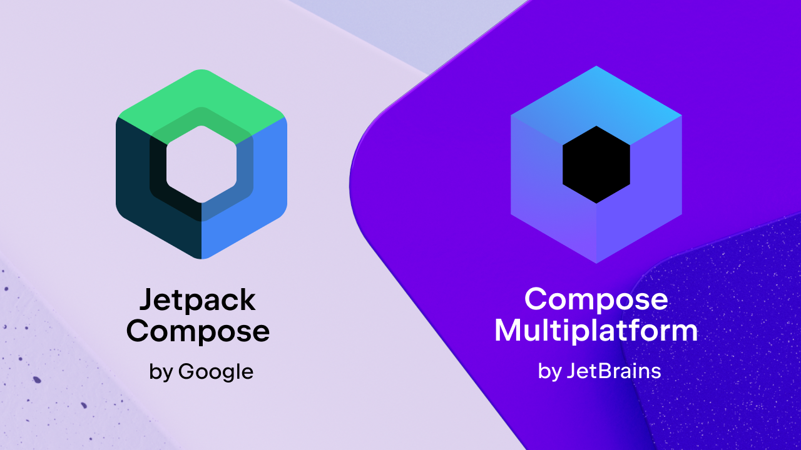

# Взаимосвязь между Compose Multiplatform и Jetpack Compose

**Compose Multiplatform** — это кроссплатформенный инструментарий для создания 
пользовательского интерфейса, разработанный компанией JetBrains. Он расширяет 
инструментарий Google **Jetpack Compose** для Android, поддерживая дополнительные 
целевые платформы.

**Compose Multiplatform** делает **API Compose** доступными из общего кода **Kotlin**, 
позволяя писать общий код **Compose UI**, который может работать на Android, iOS, 
настольных компьютерах и в веб-среде.

|             | Compose Multiplatform      | Jetpack Compose |
|-------------|----------------------------|-----------------|
| Платформы   | Android, iOS, desktop, web | Android         |
| Разработчик | JetBrains                  | Google          |

## Jetpack Compose и composables

**Jetpack Compose** — это декларативный инструментарий для создания нативных интерфейсов 
Android. Его основой являются компонуемые функции, помеченные аннотацией `@Composable`. 
Эти функции определяют части пользовательского интерфейса и автоматически обновляются 
при изменении базовых данных. Вы можете комбинировать компонуемые элементы для создания 
макетов, обработки пользовательского ввода, управления состоянием и применения анимаций. 
**Jetpack Compose** включает в себя распространенные компоненты пользовательского интерфейса, 
такие как `Text`, `Button`, `Row` и `Column`, которые можно настраивать с помощью модификаторов.

**Compose Multiplatform** основан на тех же принципах. Он использует тот же компилятор и 
среду выполнения **Compose**, что и **Jetpack Compose**, и те же API — функции `@Composable`, 
инструменты управления состоянием, такие как `remember`, компоненты макета, модификаторы 
и поддержку анимации. Это означает, что вы можете использовать свои знания **Jetpack Compose** 
с **Compose Multiplatform** для создания кроссплатформенных пользовательских интерфейсов для 
Android, iOS, настольных компьютеров и веб-приложений.

## Функции Compose Multiplatform и Jetpack Compose

Естественно, **Compose Multiplatform** имеет специфические для каждой платформы 
особенности и решения:

- На странице компонентов, предназначенных только для Android, перечислены API, тесно 
связанные с платформой Android и, следовательно, недоступные из обычного кода 
**Compose Multiplatform**.
- Некоторые специфичные для платформы API, такие как API обработки окон для настольных 
компьютеров или API совместимости `UIKit` для iOS, доступны только на соответствующих 
платформах.

Вот обзор доступности популярных компонентов и API:

|                                                                                                             | **Compose Multiplatform**                                                                  | **Jetpack Compose**                             |
|-------------------------------------------------------------------------------------------------------------|--------------------------------------------------------------------------------------------|-------------------------------------------------|
| Compose Animation                                                                                           | Да                                                                                         | Да                                              |
| Compose Compiler                                                                                            | Да                                                                                         | Да                                              |
| Compose Foundation                                                                                          | Да                                                                                         | Да                                              |
| Compose Material                                                                                            | Да                                                                                         | Да                                              |
| Compose Material 3                                                                                          | Да                                                                                         | Да                                              |
| Compose Runtime                                                                                             | Да, за исключением `androidx.compose.runtime.rxjava2` и `androidx.compose.runtime.rxjava3` | Да                                              |
| Compose UI                                                                                                  | Да                                                                                         | Да                                              |
| Jetpack Lifecycle                                                                                           | Да                                                                                         | Да                                              |
| Jetpack ViewModel                                                                                           | Да                                                                                         | Да                                              |
| Jetpack Navigation Compose                                                                                  | Да                                                                                         | Да                                              |
| Resources                                                                                                   | **Compose Multiplatform** библиотека ресурсов использует `Res` класс                       | Система ресурсов Android использует класс `R`   |
| Maps Compose                                                                                                | Нет                                                                                        | Да                                              |
| Сторонние библиотеки для компонентов пользовательского интерфейса, навигации, архитектуры и многого другого | **Compose Multiplatform** библиотеки                                                       | **Jetpack Compose** и **Compose Multiplatform** |

## Технические детали

**Compose Multiplatform** основан на коде и релизах, опубликованных Google. Хотя Google 
сосредоточен на **Jetpack Compose** для Android, существует тесное сотрудничество между 
Google и JetBrains для обеспечения работы **Compose Multiplatform**.

**Jetpack** включает в себя собственные библиотеки, такие как Foundation и Material, 
которые Google публикует для Android. Чтобы сделать API, предоставляемые этими 
библиотеками, доступными из общего кода, JetBrains поддерживает многоплатформенные 
версии этих библиотек, которые публикуются для целевых платформ, отличных от Android.

При сборке вашего многоплатформенного приложения **Compose** для Android вы используете 
артефакты **Jetpack Compose**, опубликованные Google. Например, если вы добавите 
`compose.material3` в свои зависимости, ваш проект будет использовать 
`androidx.compose.material3:material3` в целевом объекте Android и 
`org.jetbrains.compose.material3:material3` в других целевых объектах. Это происходит 
автоматически на основе метаданных модулей Gradle в многоплатформенных артефактах.

## Библиотеки для Compose Multiplatform

Используя **Compose Multiplatform**, вы можете публиковать свои библиотеки, использующие 
API **Compose**, как многоплатформенные библиотеки **Kotlin**. Это делает их доступными для 
использования в обычном коде **Kotlin**, ориентированном на несколько платформ.

Поэтому, если вы создаёте новую библиотеку с API **Compose**, воспользуйтесь этим 
преимуществом и создайте её как многоплатформенную библиотеку с помощью 
**Compose Multiplatform**. Если вы уже создали библиотеку **Jetpack Compose** для Android, 
подумайте о том, чтобы сделать эту библиотеку многоплатформенной. В экосистеме уже 
[доступно множество библиотек](https://github.com/terrakok/kmp-awesome#-compose-ui) 
**Compose Multiplatform**.

Когда библиотека опубликована с помощью **Compose Multiplatform**, приложения, использующие 
только **Jetpack Compose**, всё равно смогут беспрепятственно её использовать; они просто 
будут использовать артефакты Android этой библиотеки.