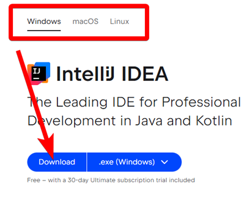
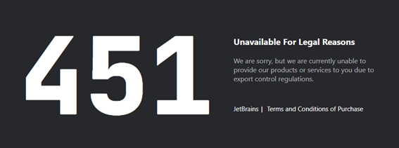
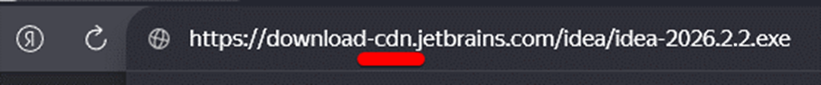

# Глава 1. Установка IDE

> **Kotlin** — это кроссплатформенный и статически типизированный язык программирования общего назначения, который работает поверх виртуальной машины Java (JVM) и создан компанией **JetBrains**.

> **Kotlin Multiplatform** (KMP) — это **SDK** от компании JetBrains, который используется для создания кроссплатформенных приложений на языке **Kotlin**.

> **SDK** (от англ. Software Development Kit) — это комплект средств для разработки программного обеспечения, который помогает создавать приложения под конкретную платформу, операционную систему или сервис.

**Kotlin Multiplatform** полностью поддерживается в **IDE** IntelliJ IDEA и Android Studio. Для работы с плагинами, необходимыми для **Kotlin Multiplatform**, требуется как минимум IntelliJ IDEA версии 2025.2.2 или Android Studio версии Otter 2025.2.1.

> **IDE** (от англ. Integrated Development Environment) — это интегрированная среда разработки, специальная программа для написания, тестирования и запуска кода.

Разберём процесс скачивания и установки **IntelliJ IDEA**.

## Шаг 1: Скачивание установочного файла

Перейдите по ссылке: https://www.jetbrains.com/idea/download.

Выберите вашу платформу и нажмите **Download**.

## Шаг 2: Ошибка 451

Если установочный файл скачался и **не появилась** ошибка 451, переходите к [Шагу 3](#Шаг-3-Запуск-установщика).

Если ошибка 451 появилась, нажмите на адресную строку и добавьте `-cdn` после `download`.

## Шаг 3: Запуск установщика

Запустите скачанный установочный файл.

## Шаг 4: Установка IDE

Везде нужно нажать **Next >**, и затем **Install**. Ждать пока установка завершится
и нажать **Finish**.

## Шаг 5: Запуск IDE

Запустите **IntelliJ IDEA**.

<!-- prettier-ignore -->
> [!NOTE]
> Для работы с **Kotlin** и **Java** платная подписка **Ultimate** не нужна.