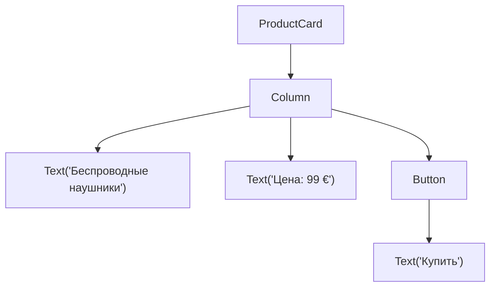

# Глава 2. Composable-функции, композиция и рекомпозиция

## 2.1. Устройство composable-функции

В предыдущей главе мы познакомились с декларативной моделью: интерфейс описывается на 
основе входных данных и состояния.

Теперь рассмотрим, как организовывать сами composable-функции.

Начнём с простого компонента:

```kotlin
@Composable
fun UserGreeting(name: String) {
    Text(
        text = "Привет, $name!"
    )
}
```

У него есть три основные характеристики:
- Функция принимает входные данные — `name`.
- Функция описывает интерфейс с помощью `Text`.
- Функция не определяет, откуда получено имя и как оно изменяется.

Последний пункт особенно важен.

Компонент не должен знать, загружено ли имя с сервера, получено ли оно из базы данных или 
введено пользователем. Для него это просто входное значение.

Например, такой компонент можно использовать на разных экранах:

```kotlin
@Composable
fun ProfileHeader(userName: String) {
    UserGreeting(name = userName)
}

@Composable
fun WelcomeScreen(userName: String) {
    Column {
        Text("Добро пожаловать!")

        UserGreeting(name = userName)
    }
}
```

Обе функции используют один компонент, но определяют собственную структуру интерфейса.

### Почему composable-функции удобно делать небольшими

Представим экран профиля, который содержит заголовок, аватар, имя пользователя, описание 
и кнопку редактирования.

Можно описать весь экран одной большой функцией. Однако по мере усложнения интерфейса 
читать и сопровождать такой код станет труднее.

Вместо этого выделим отдельные компоненты:

```kotlin
@Composable
fun ProfileScreen(
    state: ProfileUiState,
    onEditClick: () -> Unit
) {
    Column {
        ProfileHeader(
            name = state.name
        )

        ProfileDescription(
            description = state.description
        )

        Button(
            onClick = onEditClick
        ) {
            Text("Редактировать")
        }
    }
}
```

Здесь `ProfileScreen` отвечает за структуру экрана, а отдельные компоненты — за представление 
конкретных частей.

Такой подход даёт несколько преимуществ:
- компоненты легче читать;
- повторяющиеся элементы можно переиспользовать;
- UI проще тестировать;
- изменения в одном компоненте меньше затрагивают остальные;
- проще отделить общий **Compose** UI от Android-специфичной интеграции.

Не стоит, однако, создавать отдельную функцию для каждой строки кода. Компонент имеет смысл 
выделять, когда у него есть самостоятельная ответственность, полезная граница повторного 
использования или собственная логика представления.

## 2.2. Правила вызова composable-функций

Composable-функции участвуют в специальном механизме выполнения **Compose**.

Например, из одной composable-функции можно вызвать другую:

```kotlin
@Composable
fun ProfileTitle(name: String) {
    Text(text = name)
}

@Composable
fun ProfileSection(name: String) {
    Column {
        ProfileTitle(name = name)
    }
}
```

В данном случае `ProfileSection` вызывает `ProfileTitle`, а `ProfileTitle` описывает текстовый элемент.

Но composable-функцию нельзя произвольно вызывать из любой обычной функции или обработчика события.

Рассмотрим ошибочную идею:

```kotlin
@Composable
fun ExampleScreen() {
    Button(
        onClick = {
            // Здесь нельзя напрямую вызывать
            // composable-функцию Text.
        }
    ) {
        Text("Нажми меня")
    }
}
```

Лямбда `onClick` предназначена для обработки события. Она не является composable-контекстом, 
поэтому внутри неё нельзя напрямую описывать новый UI с помощью `Text()`.

**Правильный подход** — обработать событие, изменить состояние или передать действие дальше, а 
отображение оставить composable-функциям.

Например:

```kotlin
@Composable
fun ExampleScreen(
    isMessageVisible: Boolean,
    onShowMessage: () -> Unit
) {
    Column {
        Button(
            onClick = onShowMessage
        ) { 
            Text("Показать сообщение")
        }

        if (isMessageVisible) {
            Text("Сообщение отображено")
        }
    }
}
```

Здесь обработчик сообщает о нажатии, а наличие сообщения определяется значением `isMessageVisible`.

Состояние и обработку события мы подробнее разберём в следующих главах.

## 2.3. Параметры composable-функций

Параметры определяют, какие данные компонент получает извне.

При разработке повторно используемых UI-компонентов полезно придерживаться следующих принципов:
- передавать только те данные, которые действительно нужны компоненту;
- не передавать целую `ViewModel`, если достаточно нескольких значений и обработчиков;
- по возможности использовать неизменяемые модели;
- передавать пользовательские действия в виде функций обратного вызова;
- не связывать универсальные UI-компоненты с Android-контекстом без необходимости.

Например, компонент строки пользователя:

```kotlin
data class UserUiModel(
    val id: String,
    val name: String,
    val isOnline: Boolean
)

@Composable
fun UserRow(
    user: UserUiModel,
    onClick: () -> Unit
) {
    Row {
        Column {
            Text(user.name)

            Text(
                text = if (user.isOnline) {
                    "В сети"
                } else {
                    "Не в сети"
                }
            )
        }

        Button(
            onClick = onClick
        ) {
            Text("Открыть")
        }
    }
}
```

Компонент знает о пользователе ровно столько, сколько необходимо для отображения строки.

Он не обязан знать, как выполняется переход на экран профиля. Это решает вызывающая сторона.

Такой компонент можно использовать в Android-приложении и, при наличии совместимых зависимостей, 
в общем UI-коде **Compose Multiplatform**.

## Композиция как дерево компонентов

**Compose** формирует структуру интерфейса, которую обычно представляют в виде дерева.

Рассмотрим пример:

```kotlin
@Composable
fun ProductCard() {
    Column {
        Text("Беспроводные наушники")

        Text("Цена: 99 €")

        Button(
            onClick = {}
        ) {
            Text("Купить")
        }
    }
}
```

Дерево будет выглядеть так:



Каждый компонент описывает свою часть интерфейса и может включать другие компоненты.

Когда приложение запускает экран впервые, **Compose** выполняет соответствующие 
composable-функции и создаёт композицию.

В дальнейшем структура может обновляться вследствие изменения состояния и входных данных.

Важно понимать, что композиция — не просто список вызовов функций. **Compose** отслеживает 
идентичность компонентов, их положение в структуре и связи с наблюдаемым состоянием.

Это позволяет определять, какие части интерфейса требуется обновлять.

## 2.5. Жизненный цикл composable-функции

Жизненный цикл экземпляра composable-функции состоит из трёх основных событий:
1. Компонент входит в композицию.
2. Компонент может рекомпозироваться ноль или более раз.
3. Компонент покидает композицию.

Например, рассмотрим условное отображение:

```kotlin
@Composable
fun AccountScreen(
    isAuthorized: Boolean
) {
    Column {
        Text("Аккаунт")

        if (isAuthorized) {
            ProfileContent()
        } else {
            SignInContent()
        }
    }
}
```

Если `isAuthorized` имеет значение `true`, в композиции присутствует `ProfileContent`.

Если значение изменяется на `false`, отображение профиля заменяется формой входа.

В этом случае один компонент выходит из композиции, а другой входит в неё.

Это не то же самое, что изменение текста внутри уже отображаемого компонента.
Изменяется сама структура интерфейса.

### Почему жизненный цикл имеет значение

Некоторые операции связаны не только с данными, но и с присутствием компонента в интерфейсе.

Например:
- подписка на поток данных;
- запуск анимации;
- регистрация обработчика;
- временная операция, необходимая только при отображении конкретного экрана.

Такие операции необходимо правильно связывать с жизненным циклом и отменять, когда это требуется.

Обычное тело composable-функции для управления такими операциями не подходит. 
Для этого в **Compose** существуют API эффектов, которые будут рассмотрены отдельно.

Подробнее о жизненном цикле можно прочитать в 
[официальной документации Android](https://developer.android.com/develop/ui/compose/lifecycle?hl=ru).

## 2.6. Что такое рекомпозиция на практике

**Рекомпозиция** — повторное выполнение composable-функций, необходимых для обновления композиции 
после изменения наблюдаемых данных или других входных параметров.

Рассмотрим следующий пример:

```kotlin
@Composable
fun CounterDisplay(
    count: Int
) {
    Text("Текущее значение: $count")
}
```

Предположим, вызывающая сторона передала сначала `count = 1`, а затем `count = 2`.

При необходимости **Compose** повторно выполнит соответствующую часть UI, и текст сможет 
отобразить новое значение.

При этом рекомпозиция не означает, что всё приложение запускается заново.

**Compose** использует информацию о композиции и наблюдаемом состоянии, чтобы обновлять 
нужные части интерфейса.

Рекомпозиция не обязательно означает видимое изменение

Composable-функция может выполняться повторно, даже если итоговое изображение визуально 
не изменилось.

Например, функция может получить новые входные данные, которые не влияют на конкретный 
текстовый элемент, или быть вызвана в рамках обновления родительского компонента.

Поэтому не следует исходить из предположения, что каждая рекомпозиция обязательно изменяет 
пиксели на экране.

Не следует также считать рекомпозицию проблемой производительности сама по себе. 
Небольшие composable-функции, которые быстро выполняются и не вызывают тяжёлых операций, 
могут рекомпозироваться достаточно часто без заметных проблем.

### Рекомпозиция и другие фазы UI

Обновление интерфейса можно рассматривать как несколько отдельных этапов:
- **Composition** — определение структуры UI;
- **Layout** — измерение и размещение элементов;
- **Drawing** — отрисовка элементов.

Это разделение важно для понимания производительности.

Например, изменение некоторых параметров может потребовать повторного размещения или 
отрисовки, не требуя заново выполнять всю композицию.

Следовательно, рекомпозиция, перерасчёт размеров и отрисовка — связанные, но не тождественные процессы.

## 2.7. Почему нельзя выполнять произвольные действия в теле composable-функции

Главное практическое правило этой главы:

Composable-функция должна описывать интерфейс, а не использоваться как место для произвольного 
выполнения бизнес-операций.

Рассмотрим условный пример:

```kotlin
@Composable
fun BadProfileScreen() {
val profile = loadProfileFromNetwork()

    Text(profile.name)
}
```

Такое устройство проблематично, потому что `loadProfileFromNetwork()` находится непосредственно в 
теле функции, которая может выполняться повторно.

В результате сетевой запрос может запускаться больше одного раза, а UI будет напрямую зависеть от 
механизма загрузки данных.

Кроме того, синхронная загрузка может блокировать выполнение кода и приводить к задержкам.

В архитектуре **MVVM** подобные операции следует размещать за пределами UI-компонента — обычно в 
слое данных и соответствующем взаимодействии с `ViewModel`.

Composable-функция получает уже подготовленное состояние:

```kotlin
data class ProfileUiState(
    val name: String = "",
    val isLoading: Boolean = false,
    val errorMessage: String? = null
)
```

После этого она описывает необходимые состояния экрана:

```kotlin
@Composable
fun ProfileContent(
    state: ProfileUiState
) {
    when {
        state.isLoading -> {
            CircularProgressIndicator()
        }

        state.errorMessage != null -> {
            Text(state.errorMessage)
        }

        else -> {
            Text(state.name)
        }
    }
}
```

В этом примере UI не выполняет запросы. Он отображает соответствующую ветку в зависимости 
от предоставленного состояния.

Реализация загрузки, отмены операций и преобразования результата в `ProfileUiState` будет 
рассматриваться в главах об эффектах и **MVVM**.

## 2.8. Идентичность composable-функции

Для **Compose** важно не только то, какую функцию мы вызываем, но и то, где и как она вызывается.

Положение вызова в исходном коде называется **call site** — местом вызова. Оно участвует в 
определении идентичности экземпляра в композиции.

Рассмотрим пример:

```kotlin
@Composable
fun Screen() {
    Column {
        Text("Заголовок")

        UserBadge()

        Text("Подвал")
    }
}
```

В этой структуре вызов `UserBadge()` находится между заголовком и подвалом.

Если другая composable-функция тоже вызывает `UserBadge()`, это будет отдельный экземпляр 
компонента со своим местом в композиции.

Это важно, когда компонент содержит локальное состояние, например введённый текст или 
состояние раскрытия. Вопрос о сохранении такого состояния мы подробно рассмотрим при изучении remember.

### Идентичность в списках

Сложнее становится при отображении динамических коллекций.

Предположим, список содержит пользователей:

```kotlin
data class UserUiModel(
    val id: String,
    val name: String
)
```

Если порядок элементов меняется, **Compose** должен определить, какой экземпляр компонента 
соответствует какому пользователю.

Для коллекций с изменяемым порядком обычно следует задавать стабильные уникальные ключи, 
связанные с идентификаторами элементов.

Например, при использовании `LazyColumn`:

```kotlin
@Composable
fun UserList(
    users: List<UserUiModel>,
    onUserClick: (String) -> Unit
) {
    LazyColumn {
        items(
            items = users,
            key = { user -> user.id }
        ) { user ->
            UserRow(
                user = UserUiModel(
                    id = user.id,
                    name = user.name,
                    isOnline = false
                ),
                onClick = {
                    onUserClick(user.id)
                }
            )
        }
    }
}
```

Этот фрагмент демонстрирует принцип ключей, но для реального проекта модель пользователя 
и `UserRow` целесообразно согласовать так, чтобы не создавать лишние преобразования модели внутри списка.

Главное здесь — `key = { user -> user.id }`.

Ключ должен быть уникальным среди элементов списка. Он помогает **Compose** сохранять связь 
между элементом данных и соответствующим UI при перестановке, добавлении или удалении записей.

Ключ не обязан быть числовым индексом. Напротив, индекс часто оказывается плохим выбором, 
поскольку при изменении порядка он начинает указывать на другой объект.

Это особенно важно для списков, в которых строки содержат собственное состояние или анимации.

## 2.9. Стабильность параметров

Теперь перейдём к одному из важных понятий, связанных с оптимизацией **Compose**.

**Compose** анализирует параметры composable-функций, чтобы определить, может ли она 
быть пропущена при рекомпозиции.

Для этого используется понятие стабильности.

В общих чертах:
- неизменяемый объект гарантирует, что его значения нельзя поменять после создания;
- стабильный тип предоставляет **Compose** необходимые гарантии о сравнении значений и 
- наблюдении за изменениями;
- нестабильный тип не предоставляет таких гарантий в полном объёме.

Стабильность влияет на то, как **Compose** сравнивает параметры и решает, нужно ли повторно 
выполнять функцию.

Пример неизменяемой модели

```kotlin
data class UserUiModel(
    val id: String,
    val name: String,
    val isOnline: Boolean
)
```

Значения всех свойств здесь задаются при создании экземпляра и не переназначаются через `var`.

Такая модель хорошо подходит для передачи состояния в UI.

Если создаётся новый экземпляр с изменённым именем, это явно отражает изменение данных.

Пример изменяемой модели

```kotlin
data class UserUiModel(
    var name: String
)
```

Здесь свойство `name` можно изменить непосредственно у существующего экземпляра.

Если выполнить:

```kotlin
user.name = "Новое имя"
```

**Compose** автоматически не узнает об изменении обычного **Kotlin**-свойства. Оно не является 
наблюдаемым состоянием **Compose**.

Поэтому подобная мутация может привести к тому, что UI не обновится в ожидаемый момент.

Предпочтительнее использовать неизменяемые модели состояния и публиковать новое значение, 
когда данные меняются.

Например:

```kotlin
data class ProfileUiState(
    val name: String
)
```

При изменении имени создаётся новое значение `ProfileUiState`, а не изменяется поле существующего объекта.

Важно учитывать, что `val` само по себе не гарантирует глубокой неизменяемости. 
Если свойство хранит ссылку на изменяемую коллекцию, содержимое этой коллекции всё ещё может меняться.

Поэтому при моделировании состояния нужно учитывать не только модификаторы `val` и `var`, 
но и типы вложенных объектов.

## 2.10. Пропуск рекомпозиции: Skipping

Если **Compose** определяет, что входные значения composable-функции не изменились в соответствии 
с правилами сравнения, она может пропустить повторное выполнение этой функции.

Это называется **skipping**.

Предположим, родительский компонент был рекомпозирован:

```kotlin
@Composable
fun ProfileSection(
    user: UserUiModel
) {
    Column {
        UserName(user.name)

        StaticInformation()
    }
}
```

Если данные `StaticInformation` не зависят от изменившегося состояния, **Compose** при подходящих 
условиях может пропустить повторное выполнение этой функции.

Однако важно не превращать **skipping** в обязательное предположение.

Приложение должно оставаться корректным независимо от того, была ли конкретная composable-функция 
пропущена или повторно выполнена.

### Что сравнивает Compose

Правила зависят от стабильности параметров и настроек компилятора **Compose**.

В современных конфигурациях **Kotlin 2.0.20** и новее режим **Strong Skipping** включён по умолчанию.

При его использовании все подходящие restartable composable-функции становятся пропускаемыми, 
в том числе при нестабильных параметрах. Для стабильных параметров применяется структурное сравнение, 
а для нестабильных — сравнение по идентичности экземпляра.

Это означает, что прежнее правило "нестабильный параметр всегда приводит к рекомпозиции" для современных конфигураций неверно.

Более того, лишнее создание новых объектов или коллекций может влиять на возможность пропуска 
функции, поэтому важны не только типы, но и характер передачи данных.

Официальная документация подробно описывает режим 
[Strong Skipping](https://developer.android.com/develop/ui/compose/performance/stability/strongskipping?hl=ru).

### 2.11. Нужно ли помечать модели аннотациями @Stable и @Immutable?

**Compose** предоставляет аннотации `@Stable` и `@Immutable`, связанные с контрактами стабильности типов.

Их не следует использовать просто ради попытки ускорить приложение.

`@Immutable` сообщает, что значения объекта и его публичные свойства неизменяемы после создания.

`@Stable` задаёт другой контракт: идентичность и сравнение объекта должны быть предсказуемыми, 
а изменения публичных свойств должны корректно сообщаться **Compose**.

При использовании этих аннотаций разработчик обязан соблюдать соответствующие гарантии.

Если пометить изменяемую модель как `@Immutable`, это не сделает её действительно неизменяемой. 
Такая аннотация может привести к некорректным предположениям компилятора об изменениях данных.

Будем придерживаться следующих рекомендаций:
- Использовать неизменяемые модели состояния.
- Избегать прямой мутации объектов, которые передаются в UI.
- Не добавлять `@Stable` и `@Immutable` без понимания контрактов.
- Сначала измерять и диагностировать проблему производительности, а уже затем оптимизировать стабильность.

Подробности приведены в [официальном руководстве по стабильности **Compose**](https://developer.android.com/develop/ui/compose/performance/stability?hl=ru).

## 2.12. Практические правила написания composable-функций

Подведём итог главы в виде правил, которые будем использовать в дальнейшем.

### Правило 1. Composable-функция описывает интерфейс.

Она может вычислять значения, необходимые для построения UI, но не должна запускать произвольные 
операции с внешними эффектами при каждом выполнении.

### Правило 2. Передавайте данные через параметры.

Это делает зависимости компонента явными и упрощает повторное использование.

### Правило 3. Разделяйте представление и обработку действий.

UI отображает состояние и передаёт события вызывающей стороне.

### Правило 4. Используйте неизменяемые модели состояния.

При изменении данных лучше создавать новое состояние, чем изменять поля существующего объекта.

### Правило 5. Не полагайтесь на определённое число рекомпозиций.

Они могут происходить чаще, чем ожидается, и не обязаны приводить к видимым изменениям.

### Правило 6. Учитывайте идентичность компонентов.

Это особенно важно при условном отображении, работе со списками и использовании локального состояния.

### Правило 7. Не занимайтесь преждевременной оптимизацией.

В первую очередь пишите понятные компоненты. Оптимизацию выполняйте на основе измерений и выявленных узких мест.

### Правило 8. По возможности отделяйте общий UI от платформенных деталей.

Composable-функции, которые принимают состояние и обработчики через параметры и не используют 
платформенные API, проще повторно использовать при переходе к **Compose Multiplatform**.

