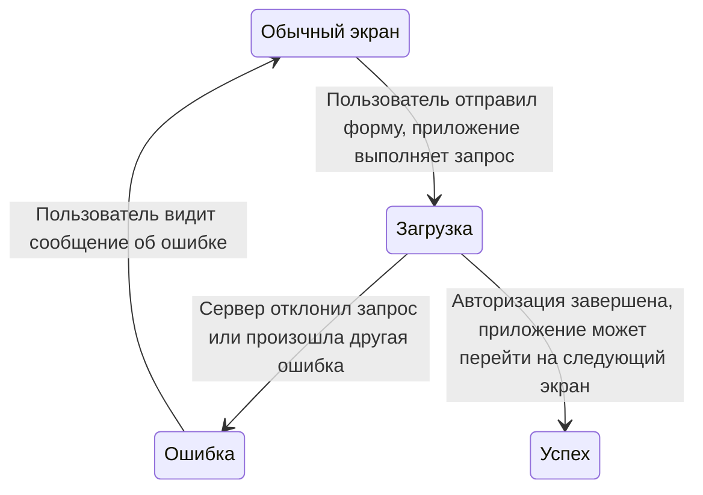
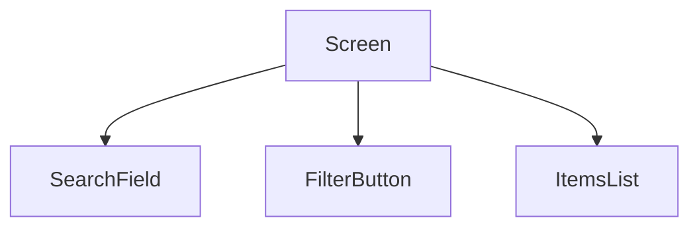

# Глава 5. Управление состоянием в Jetpack Compose

## 5.1. Что такое состояние

**Состояние** (State) — это данные, которые могут изменяться со временем и влияют на поведение приложения или
отображение пользовательского интерфейса.

Примеры состояния:

- имя пользователя;
- содержимое текстового поля;
- количество товаров в корзине;
- выбранная тема;
- состояние загрузки;
- список сообщений;
- текущая страница;
- текст ошибки;
- состояние переключателя;
- позиция прокрутки списка.

Рассмотрим экран авторизации.

В зависимости от текущего состояния он может выглядеть по-разному:



Таким образом, один и тот же экран может иметь несколько визуальных представлений, определяемых состоянием.

В **Compose** действует принцип:

**`UI = f(State)`**

Интерфейс описывается на основе текущего состояния.

Когда наблюдаемое состояние изменяется, **Compose** получает возможность обновить соответствующие части интерфейса
посредством рекомпозиции.

## 5.2. State<T> и MutableState<T>

Compose предоставляет собственный механизм хранения наблюдаемого состояния.

В основе этого механизма лежат два интерфейса:

- `State<T>`;
- `MutableState<T>`.

### State<T>

`State<T>` представляет собой контейнер, позволяющий читать текущее значение.

Упрощённо его интерфейс выглядит следующим образом:

```kotlin
interface State<T> {
    val value: T
}
```

Свойство `value` доступно только для чтения.

### MutableState<T>

`MutableState<T>` расширяет `State<T>` и позволяет изменять значение.

```kotlin
interface MutableState<T> : State<T> {
    override var value: T
}
```

Когда composable-функция читает значение `State`, **Compose** регистрирует эту зависимость.

При изменении значения наблюдаемого состояния **Compose** планирует рекомпозицию тех участков UI, которые читали
изменившееся значение.

Это позволяет не обновлять интерфейс вручную.

### Создание состояния с mutableStateOf()

Для создания `MutableState` используется функция `mutableStateOf()`.

```kotlin
val count = mutableStateOf(0)
```

Теперь мы можем получить значение:

```kotlin
println(count.value)
```

И изменить его:

```kotlin
count.value = 10
```

Однако обычно такое состояние создаётся внутри composable-функции с использованием `remember`, чтобы оно не
пересоздавалось при каждой рекомпозиции.

## 5.3. remember

Рассмотрим следующий пример:

```kotlin
@Composable
fun CounterScreen() {
    var count = 0

    Button(
        onClick = {
            count++
        }
    ) {
        Text("Счётчик: $count")
    }
}
```

На первый взгляд всё выглядит правильно.

Однако при рекомпозиции composable-функции переменная `count` будет инициализирована заново.

В результате её значение снова станет равным нулю.

Для решения этой проблемы используется `remember`.

```kotlin
@Composable
fun CounterScreen() {
    val count = remember {
        mutableStateOf(0)
    }

    Button(
        onClick = {
            count.value++
        }
    ) {
        Text("Счётчик: ${count.value}")
    }
}
```

Теперь значение хранится в композиции и сохраняется при рекомпозициях.

### Как работает remember

1. При первой композиции выполняется лямбда `remember`.
2. Созданный объект сохраняется в композиции.
3. При последующих рекомпозициях возвращается ранее созданный объект.
4. Если компонент удаляется из композиции, связанное с ним значение `remember` забывается.

Таким образом, `remember` обеспечивает сохранение объекта в рамках жизненного цикла соответствующего участка композиции.

### Синтаксис с делегированием

Вместо обращения к `.value` можно использовать делегирование свойств:

```kotlin
@Composable
fun CounterScreen() {
    var count by remember {
        mutableStateOf(0)
    }

    Button(
        onClick = {
            count++
        }
    ) {
        Text("Счётчик: $count")
    }
}
```

Здесь `by` позволяет обращаться к состоянию как к обычной переменной.

Для этого используются расширения `getValue` и `setValue` из `androidx.compose.runtime`.

Такой вариант часто удобнее при работе с простыми значениями.

### remember с ключами

`remember` может принимать ключи.

```kotlin
val formattedName = remember(userName) {
    userName.trim().uppercase()
}
```

Если `userName` изменится, **Compose** пересоздаст сохранённое значение.

Если ключи не изменились, сохранённое значение будет использоваться повторно.

Несколько ключей:

```kotlin
val result = remember(userName, userAge) {
    "$userName ($userAge)"
}
```

Значение будет пересчитано при изменении любого из ключей.

> [!IMPORTANT] `remember` не является механизмом автоматического сохранения данных между перезапусками приложения.
>
> Он предназначен для хранения объектов в композиции.

## 5.4. rememberSaveable

Рассмотрим ситуацию.

Пользователь ввёл текст в поле поиска. Затем устройство повернулось, и **Android** пересоздал `Activity`.

При использовании обычного `remember` состояние может потеряться, поскольку композиция была создана заново.

Для сохранения простых значений используется `rememberSaveable`.

```kotlin
@Composable
fun SearchScreen() {
    var query by rememberSaveable {
        mutableStateOf("")
    }

    OutlinedTextField(
        value = query,
        onValueChange = {
            query = it
        },
        label = {
            Text("Поиск")
        }
    )
}
```

Теперь значение может восстанавливаться после пересоздания `Activity`.

На **Android** `rememberSaveable` использует механизм сохранённого состояния и умеет сохранять поддерживаемые значения
через `Bundle`.

Также он может восстанавливать состояние после системного пересоздания процесса, если **Android** сохранил
соответствующее состояние экземпляра.

Это не является постоянным хранилищем данных: например, после полного закрытия `Activity` пользователем восстановление
не гарантируется.

### remember и rememberSaveable

| Характеристика                             | remember | rememberSaveable                       |
|--------------------------------------------|----------|----------------------------------------|
| Между рекомпозициями                       | Да       | Да                                     |
| При пересоздании Activity                  | Нет      | Да                                     |
| При системном пересоздании процесса        | Нет      | Да, при наличии сохранённого состояния |
| Требует сохранённого представления объекта | Нет      | Да                                     |
| Подходит для временного UI-состояния       | Да       | Да                                     |

### Saver

Иногда требуется сохранить собственный объект, который не поддерживается стандартным механизмом сериализации состояния.

Для этого используется `Saver`.

Рассмотрим модель:

```kotlin
data class UserFilter(
    val category: String,
    val onlyAvailable: Boolean
)
```

Можно самостоятельно описать сохранение и восстановление:

```kotlin
val UserFilterSaver = listSaver<UserFilter, Any>(
    save = {
        listOf(
            it.category,
            it.onlyAvailable
        )
    },
    restore = {
        UserFilter(
            category = it[0] as String,
            onlyAvailable = it[1] as Boolean
        )
    }
)
```

Теперь этот объект можно использовать с `rememberSaveable`:

```kotlin
var filter by rememberSaveable(
    stateSaver = UserFilterSaver
) {
    mutableStateOf(
        UserFilter(
            category = "Все",
            onlyAvailable = false
        )
    )
}
```

В результате **Compose** сможет сохранять необходимые поля модели и восстанавливать её состояние.

Для более сложных моделей могут использоваться другие подходы, в том числе `mapSaver` и платформенные механизмы
сериализации.

## 5.5. Локальное состояние и состояние экрана

Не всё состояние приложения должно находиться в `ViewModel`.

Это важное архитектурное правило.

Рассмотрим два примера.

### Пример 1. Локальное состояние элемента

Есть карточка сообщения, которая может сворачиваться и разворачиваться.

```kotlin
@Composable
fun MessageCard(
    message: String
) {
    var expanded by rememberSaveable {
        mutableStateOf(false)
    }

    Column {
        Text(message)

        TextButton(
            onClick = {
                expanded = !expanded
            }
        ) {
            Text(
                if (expanded) {
                    "Свернуть"
                } else {
                    "Развернуть"
                }
            )
        }

        if (expanded) {
            Text("Дополнительная информация")
        }
    }
}
```

Состояние `expanded` относится исключительно к отображению компонента.

Оно не влияет на бизнес-логику приложения и не требуется другим слоям.

Поэтому нет необходимости передавать его во `ViewModel`.

### Пример 2. Состояние экрана

Рассмотрим список заказов.

Экран должен отображать:

- список заказов;
- состояние загрузки;
- сообщение об ошибке;
- выбранный фильтр.

Эти данные могут зависеть от работы репозитория и бизнес-правил.

Поэтому их логично хранить в `ViewModel`.

```kotlin
data class OrdersUiState(
    val orders: List<OrderUiModel> = emptyList(),
    val isLoading: Boolean = false,
    val errorMessage: String? = null,
    val selectedFilter: OrderFilter = OrderFilter.ALL
)
```

`ViewModel` будет предоставлять актуальное состояние, а **Compose** — отображать его.

### Основное различие

Локальное состояние относится к поведению конкретного UI-элемента.

Состояние экрана описывает данные и состояние всего экрана, необходимые для его отображения.

Состояние приложения может выходить за пределы одного экрана и использоваться несколькими частями приложения.

## 5.6. State Hoisting

**State Hoisting** — это перенос состояния из одного composable-компонента в его вызывающий компонент.

**Основная цель:** разделить владельца состояния и компонент, который его отображает.

Рассмотрим пример компонента счётчика.

### Stateful-компонент

```kotlin
@Composable
fun Counter() {
    var count by remember {
        mutableStateOf(0)
    }

    Button(
        onClick = {
            count++
        }
    ) {
        Text("Счётчик: $count")
    }
}
```

Этот компонент самостоятельно хранит и изменяет состояние.

Его можно назвать stateful-компонентом.

Недостаток такого подхода заключается в том, что вызывающая сторона не может напрямую управлять значением счётчика.

### Stateless-компонент

Перенесём состояние наружу:

```kotlin
@Composable
fun Counter(
    count: Int,
    onIncrement: () -> Unit
) {
    Button(
        onClick = onIncrement
    ) {
        Text("Счётчик: $count")
    }
}
```

Теперь компонент не хранит состояние и не изменяет его самостоятельно.

Он получает значение через параметр и передаёт событие через `callback`.

Использование:

```kotlin
@Composable
fun CounterScreen() {
    var count by remember {
        mutableStateOf(0)
    }

    Counter(
        count = count,
        onIncrement = {
            count++
        }
    )
}
```

Теперь `CounterScreen` является владельцем состояния, а `Counter` — stateless-компонентом.

### Стандартная схема State Hoisting

Обычно состояние представляется двумя параметрами:

- `value` — текущее значение;
- `onValueChange` — событие, предлагающее изменить значение.

Например:

```kotlin
@Composable
fun NameField(
    value: String,
    onValueChange: (String) -> Unit
) {
    OutlinedTextField(
        value = value,
        onValueChange = onValueChange,
        label = {
            Text("Имя")
        }
    )
}
```

Такая структура обеспечивает:

1. Единственный источник истины.
2. Возможность повторного использования компонента.
3. Простое тестирование.
4. Предсказуемое управление состоянием.
5. Разделение отображения и обработки событий.

Для событий не обязательно использовать универсальное название `onValueChange`. Можно создавать более конкретные
callback-функции, например `onSubmit`, `onDelete` или `onItemSelected`.

### Где поднимать состояние

В **Compose** рекомендуется поднимать состояние до наименьшего общего предка всех компонентов, которые должны читать или
изменять его.

Например:



Если поиск используется одновременно в `SearchField`, `FilterButton` и `ItemsList`, состояние должно находиться на
уровне `Screen` или выше.

Нет необходимости помещать его в глобальный объект приложения.

> **Правило: состояние должно храниться как можно ближе к месту использования, но достаточно высоко для всех
> компонентов, которым оно необходимо.**

## 5.7. Три уровня владельцев состояния

Для дальнейшей работы с **Compose** и **MVVM** будем использовать следующую модель.

### Уровень 1. Composable

Подходит для небольшого локального состояния:

- раскрытие карточки;
- анимация;
- временное отображение подсказки;
- локальное переключение элемента;
- небольшое UI-взаимодействие, не требующее бизнес-логики.

Основные инструменты:

- `remember`;
- `rememberSaveable`;
- `mutableStateOf`.

### Уровень 2. Plain State Holder

Обычный **Kotlin**-класс, предназначенный для управления сложным состоянием UI.

Он может использоваться, если composable-компонент содержит слишком много UI-логики.

Например, для управления:

- состоянием панели навигации;
- логикой прокрутки;
- взаимодействием нескольких UI-элементов;
- локальными UI-сценариями.

Такой класс может создаваться с помощью `remember` и следовать жизненному циклу композиции.

Пример простого state holder:

```kotlin
@Stable
class SearchState(
    initialQuery: String = ""
) {
    var query by mutableStateOf(initialQuery)
        private set

    fun updateQuery(value: String) {
        query = value
    }

    fun clear() {
        query = ""
    }
}
```

Функция создания и хранения экземпляра:

```kotlin
@Composable
fun rememberSearchState(
    initialQuery: String = ""
): SearchState {
    return remember {
        SearchState(initialQuery)
    }
}
```

Здесь класс управляет состоянием поиска, но не зависит от **Android** `ViewModel`.

Аннотация `@Stable` задаёт контракт для **Compose** относительно стабильности объекта. Использовать её следует только
тогда, когда класс действительно соблюдает необходимые гарантии. Само наличие `mutableStateOf` в поле не делает
произвольный класс автоматически корректным кандидатом на такую аннотацию.

### Уровень 3. ViewModel

`ViewModel` используется для состояния экрана, связанного с бизнес-логикой или данными приложения.

Например:

- состояние авторизации;
- загруженные данные;
- результаты поиска с сервера;
- состояние отправки формы;
- состояние списка заказов;
- выбранный пользователем фильтр, влияющий на бизнес-операции.

`ViewModel` позволяет хранить состояние вне композиции и управлять им независимо от непосредственного отображения UI.

Эти три уровня не конкурируют между собой. Их можно использовать совместно на одном экране.

## 5.8. Snapshot State

До этого мы использовали `mutableStateOf`, но не рассматривали механизм, который делает его работу возможной.

**Compose Runtime** содержит механизм **Snapshot State**.

**Snapshot System** обеспечивает отслеживание изменений наблюдаемых значений.

То есть:

1. Composable-функция читает значение состояния.
2. Compose регистрирует чтение.
3. Значение изменяется.
4. Система определяет зависимости, которые затронуты изменением.
5. Соответствующие участки композиции становятся кандидатами на рекомпозицию.

### Snapshot State и обычные переменные

Рассмотрим обычную переменную:

```kotlin
var count = 0
```

Её изменение само по себе не уведомляет Compose.

Теперь рассмотрим:

```kotlin
var count by mutableStateOf(0)
```

Такое значение является наблюдаемым состоянием **Compose**.

Изменение:

```kotlin
count++
```

приводит к уведомлению механизмов **Snapshot System**.

Однако для хранения такого состояния внутри composable-функции обычно необходим `remember`:

```kotlin
var count by remember {
    mutableStateOf(0)
}
```

### Изменение объекта не означает изменение наблюдаемого состояния

Рассмотрим ошибочный пример:

```kotlin
val users = remember {
    mutableListOf<String>()
}
```

При выполнении:

```kotlin
users.add("Александр")
```

**Compose** не получает автоматического уведомления об изменении обычного списка.

Изменяемый объект сам по себе не является наблюдаемым состоянием **Compose**.

Для работы с коллекциями можно использовать специальные наблюдаемые структуры.

### SnapshotStateList

Например:

```kotlin
val users = remember {
    mutableStateListOf<String>()
}
```

Добавление элемента:

```kotlin
users.add("Александр")
```

Изменение будет отслеживаться механизмами **Compose**.

Также доступны:

- `mutableStateMapOf()`;
- `mutableStateListOf()`.

**Но необходимо помнить:** наблюдение за изменениями коллекции не делает произвольные изменяемые объекты внутри неё
автоматически наблюдаемыми.

Например, если список содержит объекты с обычными `var`, изменение их внутренних свойств может остаться незамеченным.

Для моделей состояния обычно предпочтительнее использовать неизменяемые объекты.

## 5.9. derivedStateOf

Иногда значение состояния зависит от других значений.

Например, необходимо отображать кнопку прокрутки вверх только тогда, когда пользователь пролистал список.

Можно вычислять условие напрямую:

```kotlin
val showButton =
    listState.firstVisibleItemIndex > 0
```

Но некоторые состояния обновляются очень часто.

Например, прокрутка списка может менять позицию на каждом небольшом перемещении.

Если итоговое условие меняется значительно реже, можно использовать `derivedStateOf`.

```kotlin
val showButton by remember {
    derivedStateOf {
        listState.firstVisibleItemIndex > 0
    }
}
```

Теперь производное состояние меняется только тогда, когда результат вычисления изменился.

Это полезно, если исходные данные обновляются часто, а результат имеет более редкие изменения.

### Когда использовать derivedStateOf

Пример:

- положение списка меняется часто;
- булево значение `showButton` меняется только при переходе от первой строки к следующей или обратно.

В такой ситуации производное состояние может уменьшить количество ненужных рекомпозиций потребителей этого значения.

### Когда derivedStateOf не нужен

Не стоит использовать его для любого вычисляемого значения.

Например:

```kotlin
val fullName = remember {
    derivedStateOf {
        "$firstName $lastName"
    }
}
```

Такое применение неудачно, если требуется просто сформировать строку из двух значений.

Достаточно:

```kotlin
val fullName = "$firstName $lastName"
```

`derivedStateOf` имеет собственные накладные расходы. Его стоит использовать тогда, когда он действительно позволяет
отделить часто меняющееся исходное состояние от более редко меняющегося производного состояния.

## 5.10. StateFlow

В предыдущих главах мы уже использовали `StateFlow`.

Теперь рассмотрим подробнее, почему он хорошо подходит для архитектуры **MVVM**.

`StateFlow` — горячий поток, который хранит актуальное значение и предоставляет его подписчикам.

Он всегда имеет начальное значение и позволяет получить последнее опубликованное состояние.

В отличие от обычного `Flow`, `StateFlow` представляет именно текущее состояние, а не только последовательность событий.

Для `ViewModel` обычно используются:

- `MutableStateFlow<T>` — изменяемое состояние;
- `StateFlow<T>` — интерфейс только для чтения.

Пример:

```kotlin
data class CounterUiState(
    val count: Int = 0
)

class CounterViewModel : ViewModel() {

    private val _uiState =
        MutableStateFlow(CounterUiState())

    val uiState: StateFlow<CounterUiState> =
        _uiState.asStateFlow()

    fun increment() {
        _uiState.update { current ->
            current.copy(
                count = current.count + 1
            )
        }
    }
}
```

Здесь:

- `_uiState` доступен для изменения только внутри ViewModel;
- `uiState` предоставляется внешнему коду для чтения;
- `increment()` отвечает за изменение состояния.

### Почему используется data class

`CounterUiState` является неизменяемой моделью.

При обновлении счётчика создаётся новый объект с помощью `copy()`.

Это делает изменения явными и упрощает сравнение состояний.

### Почему используется update()

`update()` позволяет атомарно изменить значение `MutableStateFlow` на основе текущего состояния.

Это особенно полезно при конкурентных обновлениях, поскольку простая последовательность чтения и записи может приводить
к потере изменений при одновременном доступе.

Также `StateFlow` использует сравнение значений: если новое состояние равно предыдущему согласно `equals`, повторное
значение не будет опубликовано.

## 5.11. Explicit Backing Fields в Kotlin 2.4.0

Это отдельная важная тема, которую стоит включить в современную практику **MVVM**.

До появления **Explicit Backing Fields** распространённым способом предоставления состояния `ViewModel` был следующий
шаблон:

```kotlin
private val _uiState =
    MutableStateFlow(CounterUiState())

val uiState: StateFlow<CounterUiState> =
    _uiState.asStateFlow()
```

Здесь мы создаём две переменные:

- `_uiState` — изменяемый поток;
- `uiState` — публичное представление для чтения.

Такой подход называется **Backing Property Pattern**.

Он полностью корректен и продолжает использоваться.

Однако **Kotlin** получил более компактный механизм — **Explicit Backing Fields**.

В **Kotlin 2.4.0** эта возможность перешла в статус **Stable**. Поэтому для её использования больше не требуется
экспериментальный opt-in или отдельный compiler-флаг.

### 5.11.1. Идея Explicit Backing Fields

Предположим, мы хотим:

- предоставить внешнему коду `StateFlow<CounterUiState>`;
- внутри класса изменять состояние через `MutableStateFlow<CounterUiState>`;
- не создавать отдельную backing property с именем `_uiState`.

Теперь это можно описать непосредственно в объявлении одного свойства.

```kotlin
class CounterViewModel : ViewModel() {

    val uiState: StateFlow<CounterUiState>
        field = MutableStateFlow(CounterUiState())

    fun increment() {
        uiState.update { current ->
            current.copy(
                count = current.count + 1
            )
        }
    }
}
```

Обрати внимание на объявление:

```kotlin
val uiState: StateFlow<CounterUiState>
field = MutableStateFlow(CounterUiState())
```

Здесь:

- `uiState` — публичное свойство;
- `StateFlow<CounterUiState>` — тип публичного API;
- `field` — явное объявление **backing field**;
- `MutableStateFlow<CounterUiState>` — внутренний тип хранения.

Компилятор автоматически обеспечивает доступ к более конкретному типу **backing field** внутри класса.

Поэтому внутри `CounterViewModel` можно вызывать `uiState.update()` или изменять `uiState.value`.

Снаружи свойство доступно как `StateFlow`, то есть через интерфейс только для чтения.

### 5.11.2. Как выглядит обращение изнутри класса

```kotlin
fun increment() {
    uiState.value = uiState.value.copy(
        count = uiState.value.count + 1
    )
}
```

Или:

```kotlin
fun increment() {
    uiState.update { current ->
        current.copy(
            count = current.count + 1
        )
    }
}
```

Оба примера показывают возможность изменять внутреннее состояние, не объявляя отдельную переменную `_uiState`.

### 5.11.3. Сравнение двух подходов

**Классический Backing Property:**

```kotlin
private val _uiState =
    MutableStateFlow(CounterUiState())

val uiState: StateFlow<CounterUiState> =
    _uiState.asStateFlow()
```

**Explicit Backing Field:**

```kotlin
val uiState: StateFlow<CounterUiState>
field = MutableStateFlow(CounterUiState())
```

Оба подхода позволяют разделить тип для внутренней модификации и внешний тип для чтения.

Второй вариант сокращает количество объявлений и делает публичное свойство и его внутреннюю реализацию частью одного
объявления.

### 5.11.4. Ограничения Explicit Backing Fields

У этого механизма есть правила:

1. Свойство должно быть `val`.
2. Для свойства нельзя объявлять собственный getter.
3. Свойство не должно быть `open`.
4. Свойство не должно быть delegated property.
5. Свойство не должно быть compile-time constant.
6. Тип backing field должен быть подтипом публичного типа свойства.
7. Сам backing field имеет `private`-видимость.

Поэтому **Explicit Backing Fields** подходят не для любой ситуации.

Например, если необходимо преобразовывать данные в getter, можно оставить традиционный **Backing Property Pattern**.

### 5.11.5. Важная особенность API

**Explicit Backing Fields** ограничивают тип, доступный через публичное объявление свойства, средствами системы типов
**Kotlin**.

Например, внешний код видит `StateFlow`, а не `MutableStateFlow`.

Однако это не следует воспринимать как криптографическую или абсолютную защиту от изменения внутреннего объекта:
публичный тип и реальная реализация объекта — разные вещи.

Если требуется дополнительная runtime-изоляция посредством специальной read-only-обёртки, можно продолжать использовать
`asStateFlow()` и классический подход с backing property.

### 5.11.6. Когда использовать Explicit Backing Fields

В наших последующих примерах на **Kotlin 2.4.0** и новее будем использовать **Explicit Backing Fields** там, где:

- публичный тип является read-only-интерфейсом;
- внутренний тип является его изменяемой реализацией;
- не требуется пользовательский getter;
- нет необходимости создавать дополнительную обёртку.

Для совместимости с более ранними версиями **Kotlin** будем показывать традиционный вариант.

Это особенно удобно для ViewModel, где часто встречается пара `MutableStateFlow` / `StateFlow`.

Таким образом, **Explicit Backing Fields** становятся полезным инструментом при проектировании публичного API состояния
в **MVVM**.

## 5.12. StateFlow и Compose

Теперь необходимо связать состояние `ViewModel` с **Compose**.

Наличие `StateFlow` само по себе не заставляет composable-функцию автоматически обновляться.

Поток необходимо преобразовать в состояние Compose.

Для этого используются `collectAsState()` и `collectAsStateWithLifecycle()`.

### Android: collectAsStateWithLifecycle()

В Android-приложениях рекомендуется использовать lifecycle-aware сбор потока.

```kotlin
@Composable
fun CounterRoute(
    viewModel: CounterViewModel = viewModel()
) {
    val uiState by
    viewModel.uiState.collectAsStateWithLifecycle()

    CounterScreen(
        count = uiState.count,
        onIncrement = viewModel::increment
    )
}
```

`collectAsStateWithLifecycle()`:

1. Подписывается на поток.
2. Получает последнее опубликованное значение.
3. Представляет его как состояние Compose.
4. Учитывает жизненный цикл **Android UI** при сборе потока.

Это позволяет не выполнять сбор данных, когда соответствующий UI не находится в активном состоянии, согласно настроенной
lifecycle-стратегии.

### Stateless-компонент

```kotlin
@Composable
fun CounterScreen(
    count: Int,
    onIncrement: () -> Unit
) {
    Column {
        Text("Счётчик: $count")

        Button(
            onClick = onIncrement
        ) {
            Text("Увеличить")
        }
    }
}
```

> [!WARNING] `CounterScreen` не зависит от ViewModel и `StateFlow`.

Это важное архитектурное разделение.

### Compose Multiplatform: collectAsState()

В общем коде, где **Android lifecycle API** недоступен или не требуется, можно использовать:

```kotlin
@Composable
fun CounterRoute(
    viewModel: CounterViewModel
) {
    val uiState by viewModel.uiState.collectAsState()

    CounterScreen(
        count = uiState.count,
        onIncrement = viewModel::increment
    )
}
```

Таким образом:

- Android-интеграция может использовать `collectAsStateWithLifecycle()`;
- общий Compose-код может использовать `collectAsState()`.

Это не означает, что `collectAsState()` всегда предпочтительнее на Android. Выбор зависит от платформенного жизненного
цикла и архитектуры приложения.

### Важное различие

`StateFlow` и **Compose** `State` — не одно и то же.

`StateFlow` принадлежит **Kotlin Coroutines**.

`State<T>` принадлежит **Compose Runtime**.

Между ними существует интеграция, которая позволяет использовать потоковое состояние в декларативном UI.

## 5.13. Как выбирать место хранения состояния

Рассмотрим сводную таблицу.

| Вид состояния                          | Где хранить                     | Инструмент                |
|----------------------------------------|---------------------------------|---------------------------|
| Локальное раскрытие карточки           | Composable                      | remember                  |
| Локальное значение после пересоздания  | Composable                      | rememberSaveable          |
| Состояние нескольких UI-компонентов    | Общий родитель или State Holder | State Hoisting            |
| Сложное UI-взаимодействие              | Plain State Holder              | Compose State             |
| Состояние экрана                       | ViewModel                       | StateFlow                 |
| Данные предметной области              | Domain / Data                   | Модели и репозитории      |
| Долговременные пользовательские данные | Постоянное хранилище            | База данных или DataStore |

### Почему не следует помещать всё во ViewModel

Это распространённая ошибка при изучении **MVVM**.

Разработчик начинает создавать отдельную переменную в `ViewModel` для каждого маленького UI-состояния:

- открыт ли tooltip;
- раскрыта ли карточка;
- находится ли курсор в поле ввода;
- какая временная анимация выполняется.

Но такое состояние часто не имеет отношения к бизнес-логике приложения.

Избыточное использование `ViewModel` усложняет код и создаёт ненужные зависимости.

Поэтому нужно выбирать владельца состояния исходя из его назначения.

## 5.14. Сохранение состояния в MVVM

Рассмотрим важный вопрос.

`ViewModel` обычно переживает изменения конфигурации **Android**, например поворот экрана, пока соответствующий
`ViewModelStoreOwner` продолжает существовать.

Однако обычная `ViewModel` не гарантирует сохранение данных после уничтожения процесса приложения.

Для сохранения небольших значений UI в **Android** можно использовать `SavedStateHandle`.

Например:

```kotlin
class SearchViewModel(
    private val savedStateHandle: SavedStateHandle
) : ViewModel() {

    val query: StateFlow<String> =
        savedStateHandle.getStateFlow(
            key = "query",
            initialValue = ""
        )

    fun onQueryChanged(value: String) {
        savedStateHandle["query"] = value
    }
}
```

`SavedStateHandle` позволяет сохранять небольшое состояние экрана через механизм сохранённого состояния **Android**.

Он не предназначен для хранения больших объёмов данных или замены базы данных.

### Когда использовать разные механизмы

- `remember` — сохранить объект при рекомпозиции.
- `rememberSaveable` — сохранить поддерживаемые UI-значения при восстановлении композиции.
- `ViewModel` — удерживать состояние экрана за пределами композиции.
- `SavedStateHandle` — восстанавливать небольшое состояние `ViewModel` после системного пересоздания.
- Репозиторий и постоянное хранилище — сохранять данные приложения на длительный срок.

## 5.15. Типичные ошибки при управлении состоянием

#### Ошибка 1. Использовать обычную переменную вместо наблюдаемого состояния.

Изменение обычной переменной не уведомляет **Compose**.

Используйте подходящий observable state holder.

#### Ошибка 2. Не использовать remember для локального состояния composable-функции.

При рекомпозиции значение может пересоздаваться.

#### Ошибка 3. Использовать remember вместо rememberSaveable, когда требуется восстановление после пересоздания.

`remember` не является механизмом сохранения через конфигурационные изменения.

#### Ошибка 4. Передавать всю ViewModel каждому UI-компоненту.

В большинстве случаев следует передавать необходимые данные и обработчики.

#### Ошибка 5. Хранить все состояния в одной ViewModel.

Необходимо разделять локальное UI-состояние и состояние приложения.

#### Ошибка 6. Изменять обычные коллекции без наблюдаемого механизма.

**Compose** не сможет автоматически определить изменение обычного `MutableList`.

#### Ошибка 7. Использовать MutableStateFlow с публичной изменяемой областью доступа.

Не следует предоставлять внешнему коду возможность произвольно изменять состояние `ViewModel`.

#### Ошибка 8. Использовать derivedStateOf для каждого вычисляемого значения.

Он нужен для определённых сценариев оптимизации зависимого состояния.

#### Ошибка 9. Дублировать одно и то же состояние в нескольких местах.

Это создаёт несколько источников истины и может приводить к рассинхронизации.

#### Ошибка 10. Использовать ViewModel как постоянное хранилище.

`ViewModel` не заменяет базу данных и механизмы долговременного сохранения.

#### Ошибка 11. Считать StateFlow и Compose State одинаковыми инструментами.

Они принадлежат разным системам и имеют разные назначения.

#### Ошибка 12. Использовать Explicit Backing Fields без учёта ограничений.

Механизм подходит для определённого вида публичных read-only-свойств, но не заменяет все варианты backing properties.

## 5.16. Практический пример: экран списка заметок

Объединим изученные принципы в одном примере.

Модель заметки:

```kotlin
data class NoteUiModel(
    val id: String,
    val title: String,
    val description: String
)
```

Состояние экрана:

```kotlin
data class NotesUiState(
    val notes: List<NoteUiModel> = emptyList(),
    val query: String = "",
    val isLoading: Boolean = false,
    val errorMessage: String? = null
)
```

ViewModel:

```kotlin
class NotesViewModel : ViewModel() {

    val uiState: StateFlow<NotesUiState>
        field = MutableStateFlow(NotesUiState())

    fun onQueryChanged(value: String) {
        uiState.update {
            it.copy(query = value)
        }
    }

    fun onNoteAdded(note: NoteUiModel) {
        uiState.update { current ->
            current.copy(
                notes = current.notes + note
            )
        }
    }

    fun onNoteDeleted(id: String) {
        uiState.update { current ->
            current.copy(
                notes = current.notes.filterNot {
                    it.id == id
                }
            )
        }
    }
}
```

В этом примере используется **Explicit Backing Field**.

Внутреннее состояние доступно для изменения через `MutableStateFlow`, а внешний тип свойства — `StateFlow`.

Интерфейс:

```kotlin
@Composable
fun NotesScreen(
    state: NotesUiState,
    onQueryChanged: (String) -> Unit,
    onNoteDelete: (String) -> Unit
) {
    Column(
        modifier = Modifier
            .fillMaxSize()
            .padding(16.dp)
    ) {
        OutlinedTextField(
            value = state.query,
            onValueChange = onQueryChanged,
            label = {
                Text("Поиск заметок")
            },
            modifier = Modifier.fillMaxWidth()
        )

        when {
            state.isLoading -> {
                CircularProgressIndicator()
            }

            state.errorMessage != null -> {
                Text(state.errorMessage)
            }

            else -> {
                val filteredNotes = state.notes.filter {
                    it.title.contains(
                        state.query,
                        ignoreCase = true
                    )
                }

                LazyColumn {
                    items(
                        items = filteredNotes,
                        key = { it.id }
                    ) { note ->
                        NoteItem(
                            note = note,
                            onDelete = {
                                onNoteDelete(note.id)
                            }
                        )
                    }
                }
            }
        }
    }
}
```

Связь с `ViewModel` на **Android**:

```kotlin
@Composable
fun NotesRoute(
    viewModel: NotesViewModel = viewModel()
) {
    val state by
    viewModel.uiState.collectAsStateWithLifecycle()

    NotesScreen(
        state = state,
        onQueryChanged = viewModel::onQueryChanged,
        onNoteDelete = viewModel::onNoteDeleted
    )
}
```

В этом примере:

- `ViewModel` является владельцем состояния экрана;
- `StateFlow` предоставляет актуальные данные;
- **Compose** получает состояние через `collectAsStateWithLifecycle`;
- `NotesScreen` является stateless-компонентом;
- пользовательские действия передаются в `ViewModel` через callback;
- список строится на основе неизменяемой модели;
- изменение заметок приводит к публикации нового состояния.

Это базовый вариант архитектуры, который в дальнейшем можно расширить репозиторием и полноценным слоем данных.

Для учебного примера поиск выполняется непосредственно по текущему списку. В приложении с большим количеством данных
фильтрацию, серверный поиск и другие бизнес-операции следует организовывать соответствующим образом в `ViewModel` и слое
данных.

