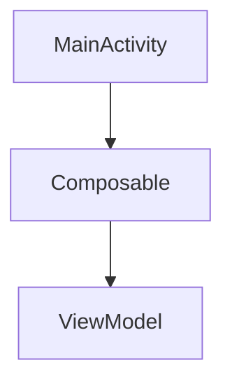
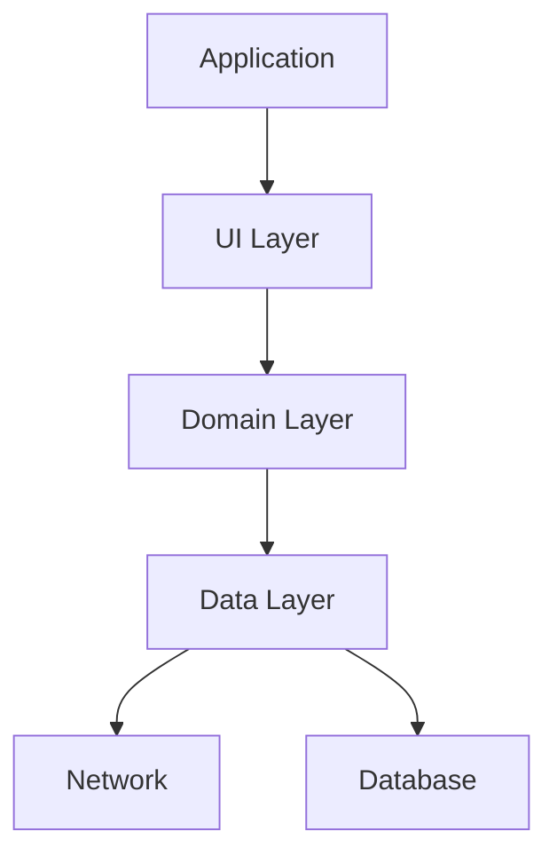
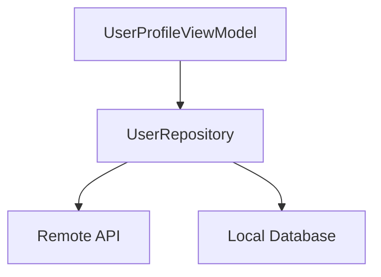
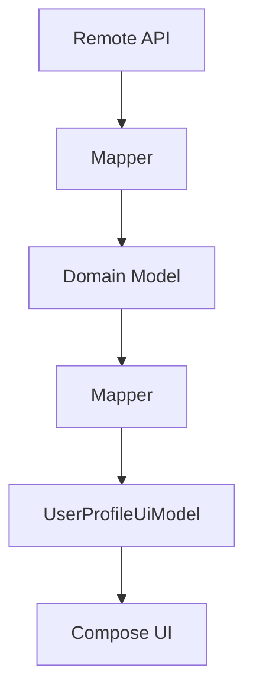
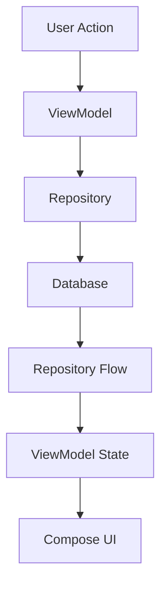

# Глава 8. Архитектура приложения и MVVM

## 8.1. Зачем приложению архитектура

На начальном этапе приложение может состоять из нескольких элементов:



Такой структуры может быть достаточно для простого примера.

Но при развитии приложения появляются новые задачи:

- получение данных из сети;
- хранение информации в базе данных;
- кеширование;
- авторизация;
- работа с несколькими источниками информации;
- сложная бизнес-логика;
- поддержка нескольких платформ;
- тестирование;
- повторное использование функциональности.

Если вся логика находится в composable-функциях или `ViewModel`, приложение становится сложным для сопровождения.

Поэтому необходимо разделять ответственность.

Архитектура определяет:

- какие компоненты существуют;
- за что отвечает каждый компонент;
- как компоненты взаимодействуют;
- где находятся данные;
- каким образом передаётся состояние;
- какие зависимости разрешено использовать.

## 8.2. Основные слои приложения

В рамках учебника будем использовать три основных слоя:

1. UI Layer.
2. Domain Layer.
3. Data Layer.

Общая структура:



Здесь `Domain Layer` является промежуточным слоем, в котором располагается предметная логика.

> [!IMPORTANT] `Domain Layer` не обязателен для каждого приложения. Для небольших проектов достаточно двух основных
> слоёв — `UI` и `Data`. `Domain` добавляется тогда, когда он действительно помогает разделить сложную или повторно
> используемую бизнес-логику.

## 8.3. UI Layer

**UI Layer** отвечает за взаимодействие с пользователем и отображение данных.

В **Compose** он состоит из:

- composable-функций;
- экранов;
- **UI State**;
- `ViewModel`;
- вспомогательных **UI State Holder**;
- механизмов навигации и отображения.

Основные задачи:

1. Отобразить состояние приложения.
2. Передать пользовательские действия.
3. Преобразовать данные в UI-модели.
4. Обрабатывать локальные UI-взаимодействия.
5. Связывать интерфейс с `ViewModel`.

**UI Layer** не должен самостоятельно управлять всеми источниками данных.

Например, composable-функция не должна знать, как выполняется SQL-запрос или HTTP-запрос.

## 8.4. ViewModel в архитектуре MVVM

`ViewModel` является владельцем состояния экрана и посредником между UI и остальными слоями приложения.

Она:

- получает данные через репозитории или **Use Cases**;
- обрабатывает пользовательские действия;
- выполняет асинхронные операции;
- преобразует данные в состояние экрана;
- публикует актуальный **UI State**.

Рассмотрим пример:

```kotlin
data class UserProfileUiState(
    val name: String = "",
    val email: String = "",
    val isLoading: Boolean = false,
    val errorMessage: String? = null
)
```

`ViewModel` предоставляет состояние:

```kotlin
class UserProfileViewModel(
    private val userRepository: UserRepository
) : ViewModel() {

    // Объявление состояния будет рассмотрено
    // в следующем разделе.
}
```

> Основной принцип: `ViewModel` не должна зависеть от конкретного UI-компонента и не должна хранить ссылки на `Activity`
> или `View`.

Composable-функции получают данные и callback-функции через параметры.

## 8.5. Data Layer

**Data Layer** отвечает за получение, хранение и преобразование данных.

Внутри него обычно находятся:

- `Repository`;
- `DataSource`;
- сетевые сервисы;
- DAO;
- локальные хранилища;
- кеши;
- мапперы.

Например, экран профиля может получать информацию сразу из нескольких источников:



`ViewModel` не должна знать, из какого источника пришло значение.

Она взаимодействует с репозиторием через его публичный интерфейс.

## 8.6. Repository Pattern

**Repository** — компонент, который предоставляет остальной части приложения удобный интерфейс доступа к данным.

Его основная задача — скрыть детали получения и хранения информации.

Например:

```kotlin
interface UserRepository {

    fun observeUser(
        id: String
    ): Flow<User?>

    suspend fun updateUser(
        user: User
    )
}
```

Здесь интерфейс определяет:

- получение пользователя в виде потока;
- обновление пользователя.

При этом он не раскрывает, используется ли база данных, сервер или кеш.

### Реализация репозитория

```kotlin
class UserRepositoryImpl(
    private val remoteDataSource: UserRemoteDataSource,
    private val localDataSource: UserLocalDataSource
) : UserRepository {

    override fun observeUser(
        id: String
    ): Flow<User?> {
        return localDataSource.observeUser(id)
    }

    override suspend fun updateUser(
        user: User
    ) {
        remoteDataSource.updateUser(user)
        localDataSource.saveUser(user)
    }
}
```

> [!WARNING] В полноценном приложении необходимо также учитывать ошибки сети, транзакции, кеширование и правила синхронизации.

### Преимущества Repository

1. `ViewModel` не зависит от конкретного источника данных.
2. Источники можно заменять.
3. Упрощается тестирование.
4. Можно объединять данные из нескольких источников.
5. Можно реализовывать кеширование и offline-first-поведение.

Даже если приложение использует только один источник, наличие репозитория может быть полезно как архитектурная граница.

## 8.7. DataSource

**DataSource** — компонент, который непосредственно взаимодействует с определённым источником данных.

Примеры:

- `RemoteDataSource` — удалённый сервер;
- `LocalDataSource` — локальная база данных;
- `PreferencesDataSource` — настройки приложения;
- `FileDataSource` — файловое хранилище.

Например:

```kotlin
interface UserRemoteDataSource {

    suspend fun getUser(
        id: String
    ): UserDto

    suspend fun updateUser(
        user: UserDto
    )
}
```

Репозиторий использует **DataSource**, но остальные слои не обязаны знать о его существовании.

### Repository и DataSource — разница

| Repository                                       | DataSource                         |
|--------------------------------------------------|------------------------------------|
| Предоставляет единый интерфейс данных            | Работает с конкретным источником   |
| Может объединять несколько источников            | Обычно отвечает за один источник   |
| Управляет стратегией кеширования и синхронизации | Выполняет конкретные операции      |
| Используется **UI** и **Domain Layer**           | Обычно используется **Repository** |

## 8.8. Модели данных

Не следует использовать одну модель для всех слоёв приложения.

Рассмотрим четыре основных вида моделей.

### Data Transfer Object

**DTO** представляет структуру данных, полученных из внешнего источника.

Например:

```kotlin
data class UserDto(
    val user_id: String,
    val full_name: String,
    val email_address: String
)
```

Названия полей могут соответствовать структуре серверного API.

**DTO** не обязан повторять архитектуру приложения.

### Entity

**Entity** обычно представляет запись локального хранилища.

Например:

```kotlin
@Entity(
    tableName = "users"
)
data class UserEntity(
    @PrimaryKey
    val id: String,
    val name: String,
    val email: String
)
```

Этот пример показывает модель для **Room** на **Android**. В общем **Kotlin Multiplatform**-коде можно использовать
другую библиотеку или собственную платформенно-независимую модель хранения.

### Domain Model

**Domain Model** описывает сущность предметной области.

```kotlin
data class User(
    val id: String,
    val name: String,
    val email: String
)
```

Она не должна зависеть от структуры конкретного API или таблицы базы данных.

### UiModel

**UiModel** предназначена для отображения информации.

```kotlin
data class UserProfileUiModel(
    val displayName: String,
    val email: String,
    val initials: String
)
```

Например, `initials` может быть вычислено на основании имени пользователя.

### Схема преобразования



Преобразования моделей позволяют изолировать различные слои приложения друг от друга.

Не всегда требуется создавать все четыре модели. Если проект небольшой, избыточное количество преобразований может
усложнить архитектуру.

Решение зависит от требований приложения.

## 8.9. Domain Layer и Use Case

**Domain Layer** предназначен для инкапсуляции бизнес-правил.

Обычно здесь размещаются:

- бизнес-модели;
- интерфейсы, описывающие операции предметной области;
- **Use Cases**;
- доменные правила и ограничения.

**Use Case** — объект, отвечающий за определённую операцию.

Например:

- получить профиль пользователя;
- оформить заказ;
- добавить товар в корзину;
- зарегистрировать пользователя;
- проверить доступность товара.

Пример:

```kotlin
class GetUserProfileUseCase(
    private val repository: UserRepository
) {
    suspend operator fun invoke(
        id: String
    ): User? {
        return repository.getUser(id)
    }
}
```

Использование в `ViewModel`:

```kotlin
class UserProfileViewModel(
    private val getUserProfile: GetUserProfileUseCase
) : ViewModel() {

    fun loadUser(id: String) {
        viewModelScope.launch {
            val user = getUserProfile(id)
        }
    }
}
```

### Когда нужны Use Cases

**Use Case** полезен, если:

- логика повторяется в нескольких `ViewModel`;
- операция объединяет несколько репозиториев;
- необходимо изолировать бизнес-правила;
- операция имеет собственную сложность;
- требуется отдельно тестировать определённый сценарий.

Не следует создавать отдельный **Use Case** для каждой простой операции без необходимости.

Например, если `ViewModel` вызывает простую операцию `repository.deleteUser(id)`, дополнительный класс
`DeleteUserUseCase` может не давать существенной пользы.

## 8.10. Пример полной архитектуры

Рассмотрим приложение со списком задач.

Структура:


### Domain Model

```kotlin
data class Task(
    val id: String,
    val title: String,
    val isCompleted: Boolean
)
```

### Repository

```kotlin
interface TasksRepository {

    fun observeTasks(): Flow<List<Task>>

    suspend fun addTask(title: String)

    suspend fun updateTask(task: Task)

    suspend fun deleteTask(id: String)
}
```

### Use Case

```kotlin
class GetTasksUseCase(
    private val repository: TasksRepository
) {
    operator fun invoke(): Flow<List<Task>> {
        return repository.observeTasks()
    }
}
```

### UI State

```kotlin
data class TasksUiState(
    val tasks: List<TaskUiModel> = emptyList(),
    val query: String = "",
    val isLoading: Boolean = true,
    val errorMessage: String? = null
)
```

### ViewModel

```kotlin
class TasksViewModel(
    private val getTasks: GetTasksUseCase,
    private val repository: TasksRepository
) : ViewModel() {

    private val query = MutableStateFlow("")

    val uiState: StateFlow<TasksUiState> =
        combine(
            getTasks(),
            query
        ) { tasks, currentQuery ->

            val filteredTasks = tasks
                .filter {
                    it.title.contains(
                        currentQuery,
                        ignoreCase = true
                    )
                }

            TasksUiState(
                tasks = filteredTasks.map {
                    TaskUiModel(
                        id = it.id,
                        title = it.title,
                        isCompleted = it.isCompleted
                    )
                },
                query = currentQuery,
                isLoading = false
            )

        }.catch { error ->
            emit(
                TasksUiState(
                    isLoading = false,
                    errorMessage = error.message
                        ?: "Не удалось загрузить задачи"
                )
            )
        }.stateIn(
            scope = viewModelScope,
            started = SharingStarted.WhileSubscribed(5_000),
            initialValue = TasksUiState()
        )

    fun onQueryChanged(value: String) {
        query.value = value
    }

    fun onAddTask(title: String) {
        viewModelScope.launch {
            repository.addTask(title)
        }
    }

    fun onDeleteTask(id: String) {
        viewModelScope.launch {
            repository.deleteTask(id)
        }
    }
}
```

В этом примере:

- `GetTasksUseCase` получает поток задач;
- `combine` объединяет задачи и поисковый запрос;
- фильтрация формирует актуальную выборку;
- `map` преобразует **Domain Model** в `UiModel`;
- `catch` обрабатывает ошибку потока;
- `stateIn` преобразует `Flow` в `StateFlow`;
- `ViewModel` предоставляет состояние экрану.

В реальном приложении операции добавления и удаления также должны иметь явную обработку ошибок и отражение результата в
**UI State**.

`SharingStarted.WhileSubscribed(5_000)` позволяет продолжать upstream-сбор в течение небольшого периода после
исчезновения подписчиков. Это полезно, например, при кратковременных изменениях конфигурации или переходах между
состояниями UI.

## 8.11. Explicit Backing Fields в архитектуре MVVM

В **Kotlin 2.4.0** **Explicit Backing Fields** получили стабильный статус.

Эта возможность особенно удобна при разработке публичного API `ViewModel`.

Рассмотрим классический вариант:

```kotlin
private val _uiState =
    MutableStateFlow(TasksUiState())

val uiState: StateFlow<TasksUiState> =
    _uiState.asStateFlow()
```

С помощью **Explicit Backing Fields** можно описать оба типа в одном объявлении:

```kotlin
class TasksViewModel : ViewModel() {

    val uiState: StateFlow<TasksUiState>
        field = MutableStateFlow(TasksUiState())

    fun updateQuery(query: String) {
        uiState.update {
            it.copy(query = query)
        }
    }
}
```

Снаружи доступен интерфейс `StateFlow`, а внутри класса компилятор разрешает работу с конкретным backing field типа
`MutableStateFlow`.

Это позволяет уменьшить количество служебных свойств.

### Когда использовать традиционный вариант

**Explicit Backing Fields** не заменяют классический паттерн во всех случаях.

Традиционный вариант остаётся предпочтительным, если:

- нужен пользовательский getter;
- требуется дополнительное преобразование данных;
- публичное свойство должно возвращать обёртку `asStateFlow()`;
- необходимо обеспечить отдельную runtime-изоляцию изменяемого объекта.

Для новых примеров на **Kotlin 2.4.0+** будем использовать **Explicit Backing Fields** там, где они действительно
упрощают код.

## 8.12. Dependency Injection

**Dependency Injection** — механизм предоставления объекту его зависимостей извне.

Предположим, `ViewModel` зависит от репозитория:

```kotlin
class TasksViewModel(
    private val repository: TasksRepository
) : ViewModel()
```

`ViewModel` не создаёт репозиторий самостоятельно.

Его необходимо передать в конструктор.

Это позволяет:

- заменять реализации;
- тестировать `ViewModel`;
- использовать разные источники данных;
- управлять жизненным циклом зависимостей.

### Ручное внедрение зависимостей

Для небольшого приложения можно использовать простую фабрику:

```kotlin
class TasksViewModelFactory(
    private val repository: TasksRepository
) : ViewModelProvider.Factory {

    override fun <T : ViewModel> create(
        modelClass: Class<T>
    ): T {
        if (modelClass.isAssignableFrom(
                TasksViewModel::class.java
            )
        ) {
            @Suppress("UNCHECKED_CAST")
            return TasksViewModel(repository) as T
        }

        error("Unknown ViewModel class")
    }
}
```

Это ручное создание объекта с передачей необходимых зависимостей.

### Hilt

Для Android-приложений часто используется Hilt.

Он построен на основе Dagger и автоматизирует создание и предоставление зависимостей.

Например:

```kotlin
@HiltViewModel
class TasksViewModel @Inject constructor(
    private val repository: TasksRepository
) : ViewModel()
```

В Compose:

```kotlin
@Composable
fun TasksRoute(
    viewModel: TasksViewModel = hiltViewModel()
) {
    val uiState by
    viewModel.uiState.collectAsStateWithLifecycle()

    TasksScreen(
        state = uiState
    )
}
```

**Hilt** является Android-ориентированным решением.

Для общего **Kotlin Multiplatform**-кода потребуется DI-библиотека с соответствующей поддержкой платформ либо ручной
способ создания зависимостей.

В качестве примеров можно рассматривать **Koin** и другие multiplatform-совместимые решения.

### Правила DI

1. Зависимости должны передаваться явно.
2. Не следует создавать репозитории внутри `ViewModel`.
3. Не следует использовать глобальные изменяемые объекты в качестве универсального контейнера зависимостей.
4. Необходимо учитывать область жизни объектов.
5. Для тестирования следует предусматривать возможность подмены реализации.

## 8.13. Единый источник истины

**Single Source of Truth** (SSOT) — принцип, согласно которому конкретное значение данных имеет один определённый
авторитетный источник.

Предположим, список задач хранится в базе данных.

Вместо того чтобы независимо поддерживать копии списка в `ViewModel`, Repository и нескольких компонентах UI, приложение
должно иметь понятную точку, в которой определяется актуальное значение.

Пример:



После изменения данных репозиторий публикует актуальное состояние.

UI получает его через `ViewModel`.

Это помогает избежать рассинхронизации.

### Offline-first подход

В приложениях с поддержкой работы без сети локальная база данных часто становится основным источником истины.

Серверные данные синхронизируются с локальными.

Пользователь может продолжать работать даже при временном отсутствии интернет-соединения.

Такой подход особенно полезен для мобильных и multiplatform-приложений.

## 8.15. Типичные ошибки архитектуры

1. Размещать бизнес-логику в composable-функциях.
2. Выполнять SQL-запросы непосредственно из `ViewModel`.
3. Создавать репозитории внутри `ViewModel`.
4. Использовать одну модель для API, базы данных и UI.
5. Создавать **Use Case** для каждой простой операции без необходимости.
6. Хранить дублирующееся состояние в нескольких источниках.
7. Делать `ViewModel` зависимой от **Android Context** без необходимости.
8. Использовать **Android**-зависимости в общем **Kotlin Multiplatform**-коде.
9. Передавать `ViewModel` во все дочерние composable-функции.
10. Не предусматривать подмену зависимостей при тестировании.
